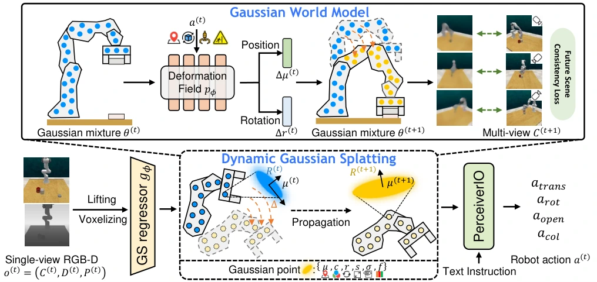

<!-- Generated by scripts/generate.py; edit data/works.json and data/media.json. -->

[← Back to the Awesome index](../../../README.md) · [Interactive website](https://chang-xinhai.github.io/Awesome-RGBDT-Manipulation/?collection=policy&item=manigaussian#library)

# ManiGaussian

ManiGaussian: Dynamic Gaussian Splatting for Multi-task Robotic Manipulation

**2024-03-13 · ECCV 2024 · Tsinghua University; Carnegie Mellon University; collaborating authors**

**[Paper](https://arxiv.org/abs/2403.08321)** · [Project](https://guanxinglu.github.io/ManiGaussian/) · [Code](https://github.com/GuanxingLu/ManiGaussian)

Dynamic Gaussian reconstruction supervises a language-conditioned multi-task keyframe policy.

*ManiGaussian authors · [Figure source](https://arxiv.org/html/2403.08321) · Original rights retained.*

| Field | Reported value and source scope |
| :-- | :-- |
| Record type | policy |
| Policy family | Transformer / BC [1](https://arxiv.org/abs/2403.08321)  |
| Base model and architecture | Semantic/geometric Gaussian embeddings, Gaussian world-model reconstruction and PerAct-style action prediction. [1](https://arxiv.org/abs/2403.08321)  |
| Model size and component | Not reported in the inspected primary-source sections [1](https://arxiv.org/abs/2403.08321)  |
| Deployment inputs | Calibrated multi-view RGB-D, language and proprioception. [1](https://arxiv.org/abs/2403.08321)  |
| Action outputs and horizon | 6-DoF end-effector keyframes, gripper and collision state. [1](https://arxiv.org/abs/2403.08321)  |
| Training method | Imitation learning with future-scene reconstruction auxiliary supervision. [1](https://arxiv.org/abs/2403.08321)  |
| Training data | RLBench multi-task demonstrations; ten task families with166variations. [1](https://arxiv.org/abs/2403.08321)  |
| Training duration | 100K iterations; wall-clock not reported [1](https://arxiv.org/abs/2403.08321)  |
| Training hardware | 2 NVIDIA RTX 4090 GPUs [1](https://arxiv.org/abs/2403.08321)  |
| Inference and control rates | Not reported in the inspected primary-source sections [1](https://arxiv.org/abs/2403.08321)  |
| Evaluation scope | Ten RLBench tasks; task variation and held-out scene tests. [1](https://arxiv.org/abs/2403.08321)  |
| Observations / modalities | RGB · Depth · Point cloud · Proprioception |
| Evaluation domain | Simulation |
| Embodiment | Parallel-jaw gripper |
| Release: code | Available [2](https://guanxinglu.github.io/ManiGaussian/) [3](https://github.com/GuanxingLu/ManiGaussian) [5](https://github.com/GuanxingLu/ManiGaussian/tree/main)  |
| Release: weights | Not verified [2](https://guanxinglu.github.io/ManiGaussian/) [3](https://github.com/GuanxingLu/ManiGaussian)  |
| Release: data | Not verified [2](https://guanxinglu.github.io/ManiGaussian/) [3](https://github.com/GuanxingLu/ManiGaussian)  |
| Release: license | MIT for repository code; pretrained models, data and figure rights remain separate [2](https://guanxinglu.github.io/ManiGaussian/) [3](https://github.com/GuanxingLu/ManiGaussian) [4](https://github.com/GuanxingLu/ManiGaussian/blob/main/LICENSE)  |
| Release: notes | Code, data and weights are checked independently; an upstream pretrained model is not a released task policy. [2](https://guanxinglu.github.io/ManiGaussian/) [3](https://github.com/GuanxingLu/ManiGaussian)  |

**Scope and qualifications**

- Future Gaussian reconstruction is training supervision; executed policy actions and reconstruction quality are separate metrics.

**Primary evidence**

1. [Original manuscript and first submission history](https://arxiv.org/abs/2403.08321) — Full author HTML method/evaluation/appendix inspected; depth observations, pseudo-labels and generated outputs retain distinct roles.
2. [Official author project](https://guanxinglu.github.io/ManiGaussian/) — Public author-linked project; figure and downstream scope verified separately.
3. [Official current implementation linked by author project](https://github.com/GuanxingLu/ManiGaussian) — Actual runnable release and model artifacts checked independently.
4. [Actual license file in released source](https://github.com/GuanxingLu/ManiGaussian/blob/main/LICENSE) — Only source code covered by this file; not a blanket license for paper figures or upstream weights.
5. [Actual repository content inventory](https://github.com/GuanxingLu/ManiGaussian/tree/main) — 11994 tracked paths inspected; code release is distinguished from a README/project/figure-only repository.
