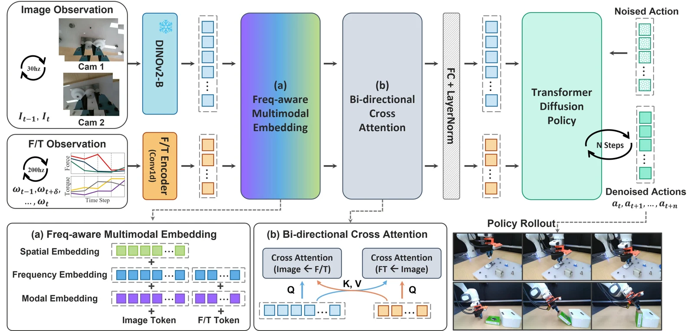

<!-- Generated by scripts/generate.py; edit data/works.json and data/media.json. -->

[← Back to the Awesome index](../../../README.md) · [Interactive website](https://chang-xinhai.github.io/Awesome-RGBDT-Manipulation/?collection=policy&item=manipforce#library)

# ManipForce / FMT

ManipForce: Force-Guided Policy Learning with Frequency-Aware Representation for Contact-Rich Manipulation

**2025-09-23 · arXiv preprint · Gwangju Institute of Science and Technology**

**[Paper](https://arxiv.org/abs/2509.19047)** · [Project](https://sites.google.com/view/manipforce/) · [Code](https://github.com/gist-ailab/ManipForce)

A handheld F/T and RGB collection system trains a frequency-aware diffusion policy for contact-rich manipulation.

*ManipForce / FMT authors · [Figure source](https://arxiv.org/html/2509.19047v1) · Original rights retained.*

| Field | Reported value and source scope |
| :-- | :-- |
| Record type | policy |
| Policy family | Frequency-aware multimodal diffusion policy [1](https://arxiv.org/html/2509.19047v1)  |
| Base model and architecture | Not reported [1](https://arxiv.org/html/2509.19047v1)  |
| Model size and component | Not reported [1](https://arxiv.org/html/2509.19047v1)  |
| Deployment inputs | RGB imagery and high-frequency wrist force/torque observations. [1](https://arxiv.org/html/2509.19047v1)  |
| Action outputs and horizon | Robot manipulation action chunks. [1](https://arxiv.org/html/2509.19047v1)  |
| Training method | Handheld demonstrations and frequency-aware cross-modal transformer diffusion training. [1](https://arxiv.org/html/2509.19047v1)  |
| Training data | Human demonstrations collected with the described wearable or handheld interface. [1](https://arxiv.org/html/2509.19047v1)  |
| Training duration | Not reported [1](https://arxiv.org/html/2509.19047v1)  |
| Training hardware | Not reported [1](https://arxiv.org/html/2509.19047v1)  |
| Inference and control rates | Not reported [1](https://arxiv.org/html/2509.19047v1)  |
| Evaluation scope | Six real robot contact-rich tasks, including gear assembly and insertion. [1](https://arxiv.org/html/2509.19047v1)  |
| Observations / modalities | RGB · Force/Torque |
| Evaluation domain | Real world |
| Embodiment | Parallel-jaw gripper |
| Release: code | Available — source [2](https://sites.google.com/view/manipforce/) [3](https://github.com/gist-ailab/ManipForce)  |
| Release: weights | Not verified [2](https://sites.google.com/view/manipforce/) [3](https://github.com/gist-ailab/ManipForce)  |
| Release: data | Not verified [2](https://sites.google.com/view/manipforce/) [3](https://github.com/gist-ailab/ManipForce)  |
| Release: license | No root license verified [2](https://sites.google.com/view/manipforce/) [3](https://github.com/gist-ailab/ManipForce)  |
| Release: notes | 147 files with training, sensor calibration and robot interfaces; no blanket license inferred. [2](https://sites.google.com/view/manipforce/) [3](https://github.com/gist-ailab/ManipForce)  |

**Scope and qualifications**

- Wrist force/torque is distinct from fingertip skin tactile sensing.

**Primary evidence**

1. [Author paper and experimental details](https://arxiv.org/html/2509.19047v1) — Observed deployment sensors are distinguished from training-only labels.
2. [Official project](https://sites.google.com/view/manipforce/) — Project release and available links inspected.
3. [Official source tree](https://github.com/gist-ailab/ManipForce) — Actual file inventory and root license checked.
