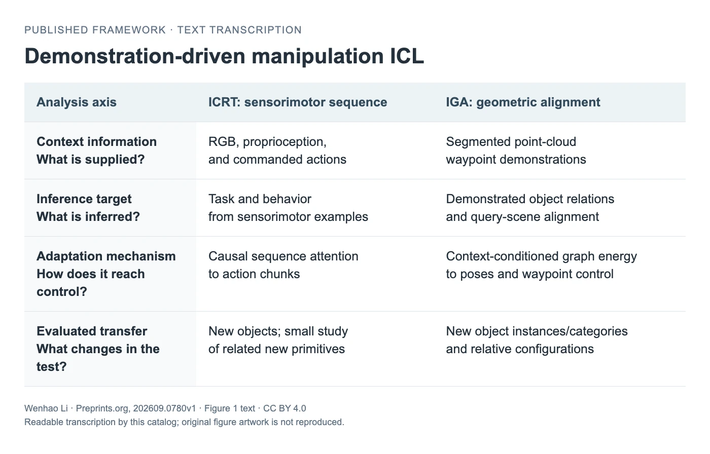

<!-- Generated by scripts/generate.py; edit data/works.json and data/media.json. -->

[← Back to the Awesome index](../../../README.md) · [Interactive website](https://chang-xinhai.github.io/Awesome-RGBDT-Manipulation/?collection=policy&item=manipulation-icl-survey#library)

# Demonstration-driven Manipulation ICL

In-Context Learning from Demonstrations for Robotic Manipulation: A Survey

**2026-09-09 · Preprint · Survey · Not reported in inspected manuscript page**

**[Paper](https://www.preprints.org/manuscript/202609.0780)**

A targeted review comparing what demonstrations supply, what methods infer and what manipulation-transfer experiments establish.

*Wenhao Li, Figure 1 text, Preprints.org 202609.0780v1; CC BY 4.0. Typography adapted by this catalog. · [Figure source](https://www.preprints.org/manuscript/202609.0780/v1/download) · Original rights retained.*

**Preview scope:** Text transcription of the author’s Figure 1, preserving its classification example. The original image download returned HTTP 403; this preview does not reproduce its artwork or introduce a new framework.

| Field | Reported value and source scope |
| :-- | :-- |
| Record type | Survey |
| Review scope | Demonstration-driven in-context learning for robotic manipulation. [1](https://www.preprints.org/manuscript/202609.0780)  |
| Organizing taxonomy | Context information · Inference target · Adaptation mechanism · Evaluated transfer [1](https://www.preprints.org/manuscript/202609.0780)  |
| Adaptation mechanisms | Fixed-parameter contextual inference · Geometric correspondence · Retrieval and memory · Parameter adaptation as a boundary case [1](https://www.preprints.org/manuscript/202609.0780)  |
| Context and evidence | Human video · Robot sensorimotor trajectories · Geometry · Text examples · Outcome history [1](https://www.preprints.org/manuscript/202609.0780)  |
| Evaluation dimensions | Task versus execution versus dynamics inference · Same-checkpoint context interventions · Transfer scope · Preparation and sensing budgets [1](https://www.preprints.org/manuscript/202609.0780)  |
| Literature corpus and snapshot | Literature cutoff 2026-09-06. Tables 2–3 compare 21 representative methods; an inventory attachment is described by the author. [1](https://www.preprints.org/manuscript/202609.0780)  |
| Literature selection | Targeted narrative review using arXiv searches and citation tracing, with core, adjacent and background distinctions. [1](https://www.preprints.org/manuscript/202609.0780)  |
| Coverage boundaries | Demonstration count is not a common information budget. Unchanged replay is treated as adjacent under this review's narrower working definition. [1](https://www.preprints.org/manuscript/202609.0780)  |
| Review format | Literature review |
| Release: code | Not applicable — survey [1](https://www.preprints.org/manuscript/202609.0780)  |
| Release: weights | Not applicable — survey [1](https://www.preprints.org/manuscript/202609.0780)  |
| Release: data | Author describes literature_inventory.csv; direct attachment not independently verified [1](https://www.preprints.org/manuscript/202609.0780)  |
| Release: license | CC BY 4.0 for the manuscript as stated by publisher; cited methods retain their own terms [1](https://www.preprints.org/manuscript/202609.0780)  |
| Release: notes | Preprints.org v1 is a preprint; peer-reviewed publication is not claimed. [1](https://www.preprints.org/manuscript/202609.0780)  |

**Scope and qualifications**

- A distinct review from Huang et al.'s arXiv:2609.36012.
- An official concept figure is visible on the manuscript page, but a local source copy has not been verified.

**Primary evidence**

1. [Primary manuscript v1](https://www.preprints.org/manuscript/202609.0780) — Posted September 9, not submission September 8. Sections 1.2–2.3 describe selection, scope and evidence budgets.
