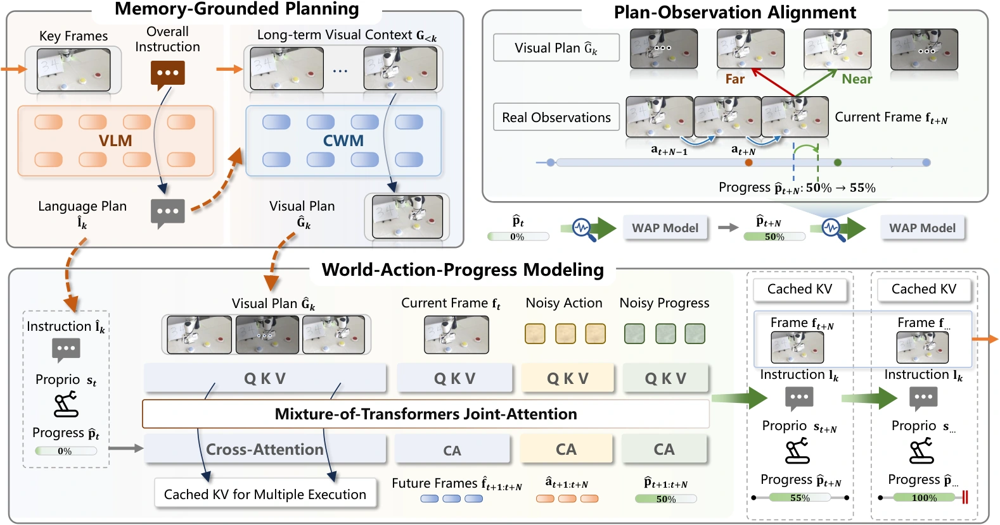

<!-- Generated by scripts/generate.py; edit data/works.json and data/media.json. -->

[← Back to the Awesome index](../../../README.md) · [Interactive website](https://chang-xinhai.github.io/Awesome-RGBDT-Manipulation/?collection=policy&item=map-wam#library)

# MaP-WAM

Memory as Plans: World-Action Modeling with Memory-Grounded Planning

**2026-09-10 · Preprint · Harbin Institute of Technology / Nanyang Technological University / Shandong University**

**[Paper](https://arxiv.org/abs/2609.11561)** · [Project](https://sizhezhao.github.io/projects/MaP-WAM/) · [Code](https://github.com/aipixel/MaP-WAM)

Sparse segment memories generate language and visual plans that guide a world-action-progress executor.

*MaP-WAM authors · [Figure source](https://arxiv.org/html/2609.11561) · Original rights retained.*

| Field | Reported value and source scope |
| :-- | :-- |
| Record type | policy |
| Policy family | World-action model [1](https://arxiv.org/abs/2609.11561)  |
| Base model and architecture | Memory-grounded hierarchical world-action planning. Qwen3.5-4B language planner; Wan2.2-5B causal visual planner and WAP video expert, plus action/progress experts. [1](https://arxiv.org/abs/2609.11561)  |
| Model size and component | WAP action expert 1.02B and progress expert 207M; 4B VLM and 5B video components. Whole-system count not reported. [1](https://arxiv.org/abs/2609.11561)  |
| Deployment inputs | Global language instruction, current RGB/proprioception and sparse visual/language memory of completed segments; eight frames summarize each completed segment. [1](https://arxiv.org/abs/2609.11561)  |
| Action outputs and horizon | Next language/visual plan and 32-step robot action/progress chunks, executing eight actions before the next call. [1](https://arxiv.org/abs/2609.11561)  |
| Training method | LoRA language-planner adaptation plus causal visual/world-action-progress training; episodic memories update without deployment-time policy retraining. [1](https://arxiv.org/abs/2609.11561)  |
| Training data | RMBench with supplied segment annotations and physical task demonstrations; exact combined training trajectory count not reported. [1](https://arxiv.org/abs/2609.11561)  |
| Training duration | VLM eight epochs; causal world model 100; WAP 40–100 by task. Wall-clock duration not reported. [1](https://arxiv.org/abs/2609.11561)  |
| Training hardware | 8 NVIDIA A800 80 GB GPUs. [1](https://arxiv.org/abs/2609.11561)  |
| Inference and control rates | Ten flow-matching steps; eight executed actions per 32-step prediction. Complete deployed Hz not reported. [1](https://arxiv.org/abs/2609.11561)  |
| Evaluation scope | RMBench memory manipulation and real tasks, 50 physical trials per task. [1](https://arxiv.org/abs/2609.11561)  |
| Observations / modalities | RGB · Proprioception · Language |
| Evaluation domain | Simulation · Real world |
| Embodiment | Parallel-jaw gripper |
| Release: code | Not released [2](https://sizhezhao.github.io/projects/MaP-WAM/) [3](https://github.com/aipixel/MaP-WAM)  |
| Release: weights | Not released [2](https://sizhezhao.github.io/projects/MaP-WAM/) [3](https://github.com/aipixel/MaP-WAM)  |
| Release: data | Not verified [2](https://sizhezhao.github.io/projects/MaP-WAM/) [3](https://github.com/aipixel/MaP-WAM)  |
| Release: license | No license found in README-only repository [2](https://sizhezhao.github.io/projects/MaP-WAM/) [3](https://github.com/aipixel/MaP-WAM)  |
| Release: notes | Official repository contains a README and unchecked release plan; implementation and checkpoints are marked coming soon. [2](https://sizhezhao.github.io/projects/MaP-WAM/) [3](https://github.com/aipixel/MaP-WAM)  |

**Scope and qualifications**

- Segment boundaries are provided by benchmark annotations during training; automatic unsegmented skill discovery is future work.
- Reported latency excludes prompt/VAE encoding, loading and transfers and is not an end-to-end control measurement.

**Primary evidence**

1. [Original manuscript and first submission history](https://arxiv.org/abs/2609.11561) — Original method, evaluation and available implementation/appendix sections inspected. The survey is discovery evidence only.
2. [Official project](https://sizhezhao.github.io/projects/MaP-WAM/) — Author-linked source. Component and artifact release terms may differ.
3. [Official code](https://github.com/aipixel/MaP-WAM) — Author-linked source. Component and artifact release terms may differ.
