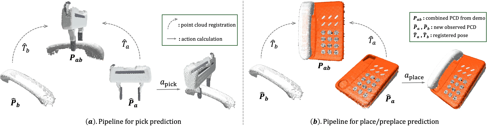

<!-- Generated by scripts/generate.py; edit data/works.json and data/media.json. -->

[← Back to the Awesome index](../../../README.md) · [Interactive website](https://chang-xinhai.github.io/Awesome-RGBDT-Manipulation/?collection=policy&item=match-policy#library)

# MATCH Policy

MATCH POLICY: A Simple Pipeline from Point Cloud Registration to Manipulation Policies

**2024-09-23 · arXiv preprint · Northeastern University; Worcester Polytechnic Institute**

**[Paper](https://arxiv.org/abs/2409.15517)** · [Project](https://haojhuang.github.io/match_page/)

Point-cloud registration directly transfers demonstrated keyframes without fitting task-policy weights.

*MATCH Policy authors · [Figure source](https://arxiv.org/html/2409.15517) · Original rights retained.*

| Field | Reported value and source scope |
| :-- | :-- |
| Record type | policy |
| Policy family | Geometric transfer [1](https://arxiv.org/abs/2409.15517)  |
| Base model and architecture | Demonstration retrieval and geometric registration of gripper/object and object/target point clouds. [1](https://arxiv.org/abs/2409.15517)  |
| Model size and component | Not reported in the inspected primary-source sections [1](https://arxiv.org/abs/2409.15517)  |
| Deployment inputs | Segmented RGB-D point clouds and stored manipulation demonstrations. [1](https://arxiv.org/abs/2409.15517)  |
| Action outputs and horizon | Relative pick/place/keyframe transforms for robot execution. [1](https://arxiv.org/abs/2409.15517)  |
| Training method | Training-free point-cloud registration and demo transfer. [1](https://arxiv.org/abs/2409.15517)  |
| Training data | One or few demonstrations; no learned task-policy training. [1](https://arxiv.org/abs/2409.15517)  |
| Training duration | Not reported in the inspected primary-source sections [1](https://arxiv.org/abs/2409.15517)  |
| Training hardware | Not reported in the inspected primary-source sections [1](https://arxiv.org/abs/2409.15517)  |
| Inference and control rates | Not reported in the inspected primary-source sections [1](https://arxiv.org/abs/2409.15517)  |
| Evaluation scope | RLBench and six physical robot tasks, including precision and articulated manipulation. [1](https://arxiv.org/abs/2409.15517)  |
| Observations / modalities | Depth · Point cloud · Proprioception |
| Evaluation domain | Simulation · Real world |
| Embodiment | Parallel-jaw gripper |
| Release: code | Not verified [2](https://haojhuang.github.io/match_page/)  |
| Release: weights | Not verified [2](https://haojhuang.github.io/match_page/)  |
| Release: data | Not verified [2](https://haojhuang.github.io/match_page/)  |
| Release: license | Not verified [2](https://haojhuang.github.io/match_page/)  |
| Release: notes | Code, data and weights are checked independently; an upstream pretrained model is not a released task policy. [2](https://haojhuang.github.io/match_page/)  |

**Scope and qualifications**

- Training-free refers to the geometric task policy; segmentation and motion execution remain external requirements.

**Primary evidence**

1. [Original manuscript and first submission history](https://arxiv.org/abs/2409.15517) — Full author HTML method/evaluation/appendix inspected; depth observations, pseudo-labels and generated outputs retain distinct roles.
2. [Official author project](https://haojhuang.github.io/match_page/) — Public author-linked project; figure and downstream scope verified separately.
