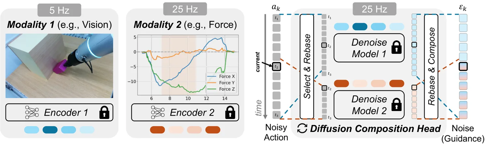

<!-- Generated by scripts/generate.py; edit data/works.json and data/media.json. -->

[← Back to the Awesome index](../../../README.md) · [Interactive website](https://chang-xinhai.github.io/Awesome-RGBDT-Manipulation/?collection=policy&item=mate-async#library)

# MATE

MATE: Asynchronous Multi-Rate Diffusion Policy Composition

**2026-07-19 · Preprint · Shanghai Jiao Tong University**

**[Paper](https://arxiv.org/abs/2607.17257)** · [Project](https://lag-fusion.github.io/) · [Code](https://github.com/Alan-Heoooh/MATE)

Asynchronously composes independently trained vision and force diffusion policies at different rates.

*MATE authors · [Figure source](https://arxiv.org/abs/2607.17257) · Original rights retained.*

| Field | Reported value and source scope |
| :-- | :-- |
| Record type | policy |
| Policy family | Asynchronous diffusion composition [1](https://arxiv.org/abs/2607.17257)  |
| Base model and architecture | Vision and force diffusion experts [1](https://arxiv.org/abs/2607.17257)  |
| Model size and component | Not reported [1](https://arxiv.org/abs/2607.17257)  |
| Deployment inputs | RGB observations, wrist force/torque and robot state; alternative experiment composes 2D and 3D visual policies. [1](https://arxiv.org/abs/2607.17257)  |
| Action outputs and horizon | Rebased relative action trajectories [1](https://arxiv.org/abs/2607.17257)  |
| Training method | Independently trained experts contribute asynchronous denoising guidance; state-aligned rebase handles delayed updates. [1](https://arxiv.org/abs/2607.17257)  |
| Training data | Task demonstrations; component-specific datasets supplied separately. [1](https://arxiv.org/abs/2607.17257)  |
| Training duration | Not reported [1](https://arxiv.org/abs/2607.17257)  |
| Training hardware | Not reported [1](https://arxiv.org/abs/2607.17257)  |
| Inference and control rates | Not reported [1](https://arxiv.org/abs/2607.17257)  |
| Evaluation scope | Real contact-rich manipulation and separately tested 2D/3D policy composition. [1](https://arxiv.org/abs/2607.17257)  |
| Observations / modalities | RGB · Force/Torque · Proprioception |
| Evaluation domain | Real world |
| Embodiment |  |
| Release: code | Available — training and asynchronous deployment source [2](https://github.com/Alan-Heoooh/MATE)  |
| Release: weights | Not bundled; supplied separately [2](https://github.com/Alan-Heoooh/MATE)  |
| Release: data | Not bundled; supplied separately [2](https://github.com/Alan-Heoooh/MATE)  |
| Release: license | CC BY-NC-SA 4.0 root license; upstream components have separate terms [2](https://github.com/Alan-Heoooh/MATE)  |
| Release: notes | Public repository contains training and inference source; checkpoints, measured calibration and robot adapter are separately supplied. [2](https://github.com/Alan-Heoooh/MATE)  |

**Scope and qualifications**

- Measured wrist force/torque is not cutaneous tactile sensing. RGB-D is specific to the separate 3D-vision experiment. Title and method use revised v2; date remains v1.

**Primary evidence**

1. [Original paper and first submission](https://arxiv.org/abs/2607.17257)
2. [Official code and release scope](https://github.com/Alan-Heoooh/MATE)
3. [Official project and method overview](https://lag-fusion.github.io/)
