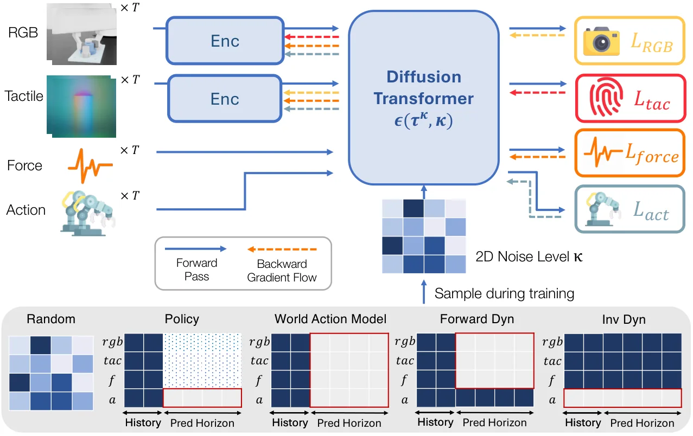

<!-- Generated by scripts/generate.py; edit data/works.json and data/media.json. -->

[← Back to the Awesome index](../../../README.md) · [Interactive website](https://chang-xinhai.github.io/Awesome-RGBDT-Manipulation/?collection=policy&item=mdf-plus-plus#library)

# MDF++

MDF++: Visuo-Tactile World Action Model with End-to-end Representation Learning

**2026-11-06 · CoRL 2026 · University of Michigan**

**[Paper](https://arxiv.org/abs/2611.09293)** · [Project](https://jointmdf.github.io/)

Learns control-relevant vision and touch representations jointly with a diffusion world-action model.

*MDF++ authors · [Figure source](https://jointmdf.github.io/) · Original rights retained.*

| Field | Reported value and source scope |
| :-- | :-- |
| Record type | policy |
| Policy family | Multimodal diffusion world-action model [1](https://arxiv.org/html/2611.09293v1)  |
| Base model and architecture | Not reported [1](https://arxiv.org/html/2611.09293v1)  |
| Model size and component | Not reported [1](https://arxiv.org/html/2611.09293v1)  |
| Deployment inputs | Visual and tactile images, force and robot proprioception. [1](https://arxiv.org/html/2611.09293v1)  |
| Action outputs and horizon | Action chunks and conditional multisensory predictions. [1](https://arxiv.org/html/2611.09293v1)  |
| Training method | Selective cross-modal gradient flow jointly trains visual/tactile encoders with a diffusion backbone; real task datasets contain 300 and 255 demonstrations. [1](https://arxiv.org/html/2611.09293v1)  |
| Training data | Selective cross-modal gradient flow jointly trains visual/tactile encoders with a diffusion backbone; real task datasets contain 300 and 255 demonstrations. [1](https://arxiv.org/html/2611.09293v1)  |
| Training duration | Not reported [1](https://arxiv.org/html/2611.09293v1)  |
| Training hardware | Not reported [1](https://arxiv.org/html/2611.09293v1)  |
| Inference and control rates | Not reported [1](https://arxiv.org/html/2611.09293v1)  |
| Evaluation scope | Simulated contact tasks and real bolt screwing and nut mating with Franka Research 3 and WSG-50 GelSight gripper. [1](https://arxiv.org/html/2611.09293v1)  |
| Observations / modalities | RGB · Tactile · Force/Torque · Proprioception |
| Evaluation domain | Simulation · Real world |
| Embodiment |  |
| Release: code | Not verified |
| Release: weights | Not verified |
| Release: data | Not verified |
| Release: license | Not verified |
| Release: notes | Paper and project links are not evidence of code or model availability. |

**Scope and qualifications**

- The physical experiment uses both tactile imagery and force/proprioceptive sensing; force is not inferred tactile-only evidence.

**Primary evidence**

1. [Primary paper and first submission](https://arxiv.org/html/2611.09293v1)
