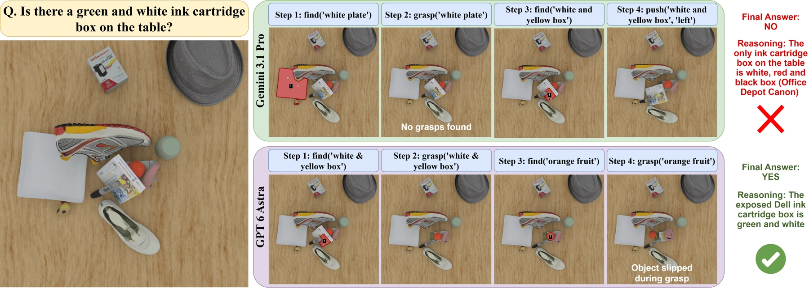

<!-- Generated by scripts/generate.py; edit data/works.json and data/media.json. -->

[← Back to the Awesome index](../../../README.md) · [Interactive website](https://chang-xinhai.github.io/Awesome-RGBDT-Manipulation/?collection=policy&item=mg-vqa#library)

# MG-VQA Agent

MG-VQA: Manipulation Grounded Visual Question Answering with VLMs

**2026-08-17 · Preprint · NVIDIA**

**[Paper](https://arxiv.org/abs/2608.17129)** · [Code](https://github.com/vineet2104/MG-VQA)

Uses grasping and pushing as evidence-gathering actions to answer questions about initially occluded tabletop scenes.

*Vineet Bhat et al., MG-VQA, Figure 4 (arXiv v3). Original rights retained. · [Figure source](https://arxiv.org/html/2608.17129v3#S4.F4) · Original rights retained.*

| Field | Reported value and source scope |
| :-- | :-- |
| Record type | policy |
| Policy family | Robot agent [1](https://arxiv.org/abs/2608.17129)  |
| Base model and architecture | Eight tool-using VLMs, including GPT-6 Astra and Gemini 3.8 Flash; a shared Gemini 3.6 Flash perception tool returns scene graphs. [1](https://arxiv.org/abs/2608.17129)  |
| Model size and component | Not reported [1](https://arxiv.org/abs/2608.17129)  |
| Deployment inputs | Question, rendered RGB observations and tool returns. The grasp tool consumes a segmentation mask, top-down depth map and camera intrinsics for GraspGen; raw depth is not a VLM image input. [1](https://arxiv.org/abs/2608.17129) [4](https://arxiv.org/abs/2608.17129)  |
| Action outputs and horizon | Information-gathering robot actions followed by an answer to Count, Find, Beneath or Compare questions. [1](https://arxiv.org/abs/2608.17129)  |
| Training method | Frozen VLM tool use; observations and execution feedback determine whether to gather further evidence or answer. [1](https://arxiv.org/abs/2608.17129)  |
| Training data | No per-model robot-policy training; 600 human-verified questions, with a separate forty-question hard set, evaluate the agent interface. [1](https://arxiv.org/abs/2608.17129)  |
| Training duration | Not reported [1](https://arxiv.org/abs/2608.17129)  |
| Training hardware | Not reported [1](https://arxiv.org/abs/2608.17129)  |
| Inference and control rates | Not reported [1](https://arxiv.org/abs/2608.17129)  |
| Evaluation scope | MG-VQA-Bench with a simulated UR5 in cluttered scenes; Direct, Perception and Manipulation access conditions and MG-VQA-Hard. [1](https://arxiv.org/abs/2608.17129)  |
| Observations / modalities | RGB · Depth · Language |
| Evaluation domain | Simulation |
| Embodiment | Parallel-jaw gripper |
| Release: code | Available [2](https://raw.githubusercontent.com/vineet2104/MG-VQA/main/README.md)  |
| Release: weights | Not applicable |
| Release: data | Not verified |
| Release: license | MIT (code); model, dependency and dataset terms are separate. [3](https://raw.githubusercontent.com/vineet2104/MG-VQA/main/LICENSE)  |
| Release: notes | Public author repository includes implementation / execution instructions; this does not certify every physical setup or experiment artifact. The frozen agent itself has no separately trained method-specific checkpoint; upstream model access has its own terms. [2](https://raw.githubusercontent.com/vineet2104/MG-VQA/main/README.md)  |

**Scope and qualifications**

- The survey calls this PROBE; the current primary title and repository identify MG-VQA for the same arXiv ID.
- Simulator state constructs / validates ground truth but is not exposed to the agent.
- The main metric is answer correctness after manipulation, not a precision-assembly success rate.
- The public paper shows benchmark / task illustrations; no dedicated policy architecture figure was identified.
- Depth is used behind the grasp-tool interface; simulator ground-truth object state is not exposed to the VLM.

**Primary evidence**

1. [Original primary paper and appendix](https://arxiv.org/abs/2608.17129) — Survey citation is used only for discovery. Method and deployment facts come from the original paper; the date is its first submission where available. Affiliations are transcribed from the PDF author block / footnotes; LMPC affiliation is confirmed by its official project page.
2. [Author repository README](https://raw.githubusercontent.com/vineet2104/MG-VQA/main/README.md) — Public author repository includes implementation / execution instructions; this does not certify every physical setup or experiment artifact.
3. [Repository LICENSE](https://raw.githubusercontent.com/vineet2104/MG-VQA/main/LICENSE) — Code-license text checked directly; this license is not automatically assigned to model weights or third-party data.
4. [Primary paper appendix: grasp tool](https://arxiv.org/abs/2608.17129) — The grasp API lifts a segmentation mask with the top-down depth map and intrinsics before GraspGen. This is tool-mediated depth, separate from VLM RGB observations.
