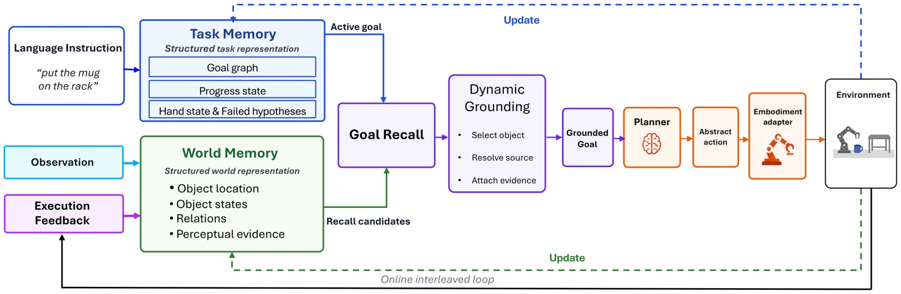

<!-- Generated by scripts/generate.py; edit data/works.json and data/media.json. -->

[← Back to the Awesome index](../../../README.md) · [Interactive website](https://chang-xinhai.github.io/Awesome-RGBDT-Manipulation/?collection=policy&item=mimir#library)

# Mimir

Mimir: A Neuro-Symbolic Memory System with Dynamic Grounding for Embodied Agents in Interactive Environments

**2026-08-05 · Preprint · PrimeBot Research Institute; Peking University; University of Chinese Academy of Sciences**

**[Paper](https://arxiv.org/abs/2608.04933)**

Separates persistent world evidence from task progress, then dynamically grounds the active goal against both memories before acting.

*Mimir authors · [Figure source](https://arxiv.org/abs/2608.04933) · Original rights retained.*

| Field | Reported value and source scope |
| :-- | :-- |
| Record type | policy |
| Policy family | Robot agent [1](https://arxiv.org/abs/2608.04933)  |
| Base model and architecture | Backbone-agnostic memory wrapper evaluated with Qwen3-VL, Qwen3.5, InternVL, Gemma and Cosmos-Reason variants; main examples include Qwen3-VL-8B / 32B. [1](https://arxiv.org/abs/2608.04933)  |
| Model size and component | Evaluated backbones range from 8B to 78B; these are alternatives rather than one combined model. [1](https://arxiv.org/abs/2608.04933)  |
| Deployment inputs | Task, current visual observations, world entities / relations / evidence and explicit task progress / held-object / failure memory. [1](https://arxiv.org/abs/2608.04933)  |
| Action outputs and horizon | Grounded next actions through discrete household-agent interfaces, plus updates to world and task memory. [1](https://arxiv.org/abs/2608.04933)  |
| Training method | Frozen VLM with neuro-symbolic world / task memory, goal-conditioned recall and grounding validation. [1](https://arxiv.org/abs/2608.04933)  |
| Training data | No new model-weight training is required by the memory system; task episodes supply external execution evidence. [1](https://arxiv.org/abs/2608.04933)  |
| Training duration | Not reported [1](https://arxiv.org/abs/2608.04933)  |
| Training hardware | Not reported [1](https://arxiv.org/abs/2608.04933)  |
| Inference and control rates | Not reported [1](https://arxiv.org/abs/2608.04933)  |
| Evaluation scope | EmbodiedBench EB-ALFRED and EB-Habitat, including base and long-horizon conditions. [1](https://arxiv.org/abs/2608.04933)  |
| Observations / modalities | RGB · Language |
| Evaluation domain | Simulation |
| Embodiment | Simulated household agent |
| Release: code | Not released |
| Release: weights | Not applicable |
| Release: data | Not verified |
| Release: license | Not verified |
| Release: notes | The primary paper explicitly says code will be released soon; no released implementation is claimed. The frozen agent itself has no separately trained method-specific checkpoint; upstream model access has its own terms. |

**Scope and qualifications**

- The benchmark uses discrete household interaction; reported results do not establish continuous-arm contact precision.
- Comparisons across different backbone sizes should not be interpreted as memory-only ablations.

**Primary evidence**

1. [Original primary paper and appendix](https://arxiv.org/abs/2608.04933) — Survey citation is used only for discovery. Method and deployment facts come from the original paper; the date is its first submission where available. Affiliations are transcribed from the PDF author block / footnotes; LMPC affiliation is confirmed by its official project page.
