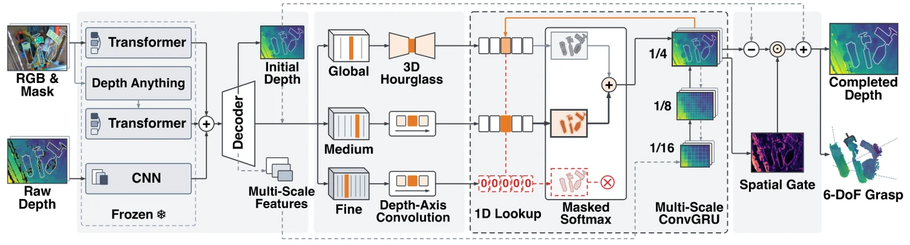

<!-- Generated by scripts/generate.py; edit data/works.json and data/media.json. -->

[← Back to the Awesome index](../../../README.md) · [Interactive website](https://chang-xinhai.github.io/Awesome-RGBDT-Manipulation/?collection=policy&item=mir-depth#library)

# MIR-Depth

MIR-Depth: Multi-Range Refinement for Single-View RGB-D Depth Completion of Transparent Objects

**2026-11-19 · Preprint · Harbin Engineering University and collaborators**

**[Paper](https://arxiv.org/abs/2611.25417)**

Refines inaccurate single-view RGB-D captures of transparent objects for visible-surface depth recovery and GraspNet-based grasp prediction.

*MIR-Depth authors · [Figure source](https://arxiv.org/html/2611.25417v1) · Original rights retained.*

| Field | Reported value and source scope |
| :-- | :-- |
| Record type | model |
| Model role and downstream interface | Geometry perception model [1](https://arxiv.org/html/2611.25417v1)  |
| Model family | Single-view depth completion [1](https://arxiv.org/html/2611.25417v1)  |
| Model architecture | Frozen Depth Anything V2 Small prior plus multi-scale ConvGRU and gated depth correction. [1](https://arxiv.org/html/2611.25417v1)  |
| Model size and component | Not reported [1](https://arxiv.org/html/2611.25417v1)  |
| Model inputs | Single RGB frame, measured raw depth, object mask and computed prior. [1](https://arxiv.org/html/2611.25417v1)  |
| Model outputs | Corrected visible-object metric depth. [1](https://arxiv.org/html/2611.25417v1)  |
| Training method | Combine global and local inverse-depth range hypotheses and use validity-gated recurrent updates. [1](https://arxiv.org/html/2611.25417v1)  |
| Training data and scale | Official TransCG training split, 34,191 640 × 480 RGB-D frames from 78 scenes as reported by the paper. [1](https://arxiv.org/html/2611.25417v1)  |
| Training duration | Not reported [1](https://arxiv.org/html/2611.25417v1)  |
| Training hardware | Not reported [1](https://arxiv.org/html/2611.25417v1)  |
| Inference setting and runtime | Not reported [1](https://arxiv.org/html/2611.25417v1)  |
| Downstream evaluation and scope | TransCG and zero-shot tests on TODD, TRansPose, ClearPose and HouseCat6D, plus real setup grasp pose prediction. [1](https://arxiv.org/html/2611.25417v1)  |
| Observations / modalities | RGB · Depth |
| Evaluation domain | Real world |
| Embodiment |  |
| Release: code | Announced, not verified |
| Release: weights | Announced, not verified |
| Release: data | Uses named public datasets |
| Release: license | Not verified |
| Release: notes | Code and checkpoints are planned in the paper. |

**Scope and qualifications**

- This is a single-view restoration model and uses an object mask. Predicted grasp poses are downstream evidence.

**Primary evidence**

1. [Original author paper or dataset description](https://arxiv.org/html/2611.25417v1)
2. [Paper compares DCIRNet as transparent-object depth completion prior work](https://arxiv.org/html/2611.25417v1)
