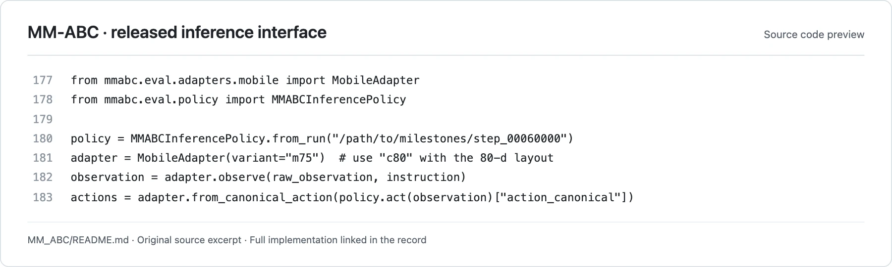

<!-- Generated by scripts/generate.py; edit data/works.json and data/media.json. -->

[← Back to the Awesome index](../../../README.md) · [Interactive website](https://chang-xinhai.github.io/Awesome-RGBDT-Manipulation/?collection=policy&item=mm-abc#library)

# MM-ABC

MM-ABC mobile-manipulation policy

**Undated · Official project / technical release · Not reported**

**[Project](https://github.com/XPolicyLab/XPolicyLab/tree/main/policy/MM_ABC)** · [Code](https://github.com/XPolicyLab/XPolicyLab/tree/main/policy/MM_ABC)

Uses subsystem-aware flow actions for a mobile dual-arm dexterous robot with a preserved embodiment/schema contract.

*MM-ABC / XPolicyLab contributors · [Figure source](https://github.com/XPolicyLab/XPolicyLab/blob/94dbf9505f2f87cf59c3ee8ba5912cd236781771/policy/MM_ABC/MM_ABC/README.md#L177-L183) · Original rights retained.*

**Preview scope:** Exact contiguous source excerpt (lines 177–183), rendered for legibility. This is a released implementation interface preview; an original architecture figure was not located in the reviewed sources. Source rights remain with the original authors.

| Field | Reported value and source scope |
| :-- | :-- |
| Record type | policy |
| Policy family | VLA [1](https://github.com/XPolicyLab/XPolicyLab/tree/main/policy/MM_ABC)  |
| Base model and architecture | Qwen3-VL-4B-Instruct with dual-stream flow action expert; frozen VGGT-Omega teacher in optional training recipe [1](https://github.com/XPolicyLab/XPolicyLab/tree/main/policy/MM_ABC)  |
| Model size and component | 4B VLM backbone; full expert-inclusive total not disclosed [1](https://github.com/XPolicyLab/XPolicyLab/tree/main/policy/MM_ABC)  |
| Deployment inputs | Head, left-wrist and right-wrist RGB, language and mobile proprioception; teacher is not loaded for inference [1](https://github.com/XPolicyLab/XPolicyLab/tree/main/policy/MM_ABC) [2](https://github.com/XPolicyLab/XPolicyLab/tree/main/policy/MM_ABC)  |
| Action outputs and horizon | 32-step chunks, execute 16; 75D default absolute model layout, 80D pretrain canonical layout; base/waist/arms/hands [1](https://github.com/XPolicyLab/XPolicyLab/tree/main/policy/MM_ABC) [2](https://github.com/XPolicyLab/XPolicyLab/tree/main/policy/MM_ABC)  |
| Training method | Clean-action prediction with velocity-space loss; optional future-alignment teacher; from-backbone and pretrained recipes [1](https://github.com/XPolicyLab/XPolicyLab/tree/main/policy/MM_ABC)  |
| Training data | Not disclosed; adapter converts custom mobile HDF5 to LeRobotV3.0 with policy-specific packing [1](https://github.com/XPolicyLab/XPolicyLab/tree/main/policy/MM_ABC)  |
| Training duration | Not reported [1](https://github.com/XPolicyLab/XPolicyLab/tree/main/policy/MM_ABC)  |
| Training hardware | Not reported [1](https://github.com/XPolicyLab/XPolicyLab/tree/main/policy/MM_ABC)  |
| Inference and control rates | 10Euler integration steps; no measured feedback/servo rate disclosed [1](https://github.com/XPolicyLab/XPolicyLab/tree/main/policy/MM_ABC)  |
| Evaluation scope | Integrated m92uw mobile embodiment interface; no official RoboTwin/RoboDojo scored participation verified [1](https://github.com/XPolicyLab/XPolicyLab/tree/main/policy/MM_ABC)  |
| Observations / modalities | RGB · Proprioception · Language |
| Evaluation domain | Real world |
| Embodiment | Mobile manipulator · Bimanual · Dexterous hand |
| Release: code | Partial [1](https://github.com/XPolicyLab/XPolicyLab/tree/main/policy/MM_ABC) [2](https://github.com/XPolicyLab/XPolicyLab/tree/main/policy/MM_ABC)  |
| Release: weights | Not verified [1](https://github.com/XPolicyLab/XPolicyLab/tree/main/policy/MM_ABC)  |
| Release: data | Not verified [1](https://github.com/XPolicyLab/XPolicyLab/tree/main/policy/MM_ABC)  |
| Release: license | Apache-2.0 for repository code, verified from LICENSE; pretrained models, datasets, dependencies and figure rights retain separate terms. [1](https://github.com/XPolicyLab/XPolicyLab/tree/main/policy/MM_ABC) [3](https://github.com/XPolicyLab/XPolicyLab/blob/main/LICENSE)  |
| Release: notes | Public project and model release; undisclosed training details remain explicitly unknown. A manuscript is not required to identify the released policy. [1](https://github.com/XPolicyLab/XPolicyLab/tree/main/policy/MM_ABC)  |

**Scope and qualifications**

- Integration is not benchmark participation; mock hold-state debug mode is not learned-policy performance.
- Required mmabc_pretrain_200k checkpoint is not distributed by adapter; no independent weights URL or architecture figure verified.

**Primary evidence**

1. [Official model project / technical release](https://github.com/XPolicyLab/XPolicyLab/tree/main/policy/MM_ABC) — Research-report facts and current executable release are scoped separately; undated releases retain an unknown publication date.
2. [Official implementation / author-contributed adapter](https://github.com/XPolicyLab/XPolicyLab/tree/main/policy/MM_ABC) — Actual deployment contract is checked; adapter presence alone is not evidence of benchmark participation.
3. [Actual repository code license](https://github.com/XPolicyLab/XPolicyLab/blob/main/LICENSE) — 2026-10-19 actual file inspection; applies to repository code, not a blanket grant over models/data/third-party assets.
