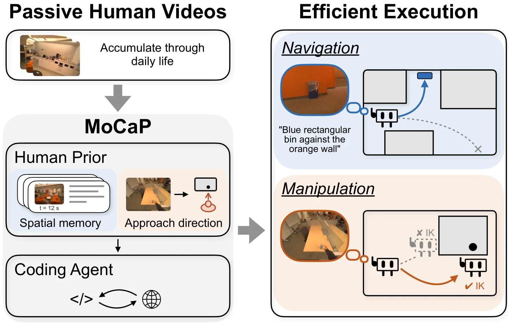

<!-- Generated by scripts/generate.py; edit data/works.json and data/media.json. -->

[← Back to the Awesome index](../../../README.md) · [Interactive website](https://chang-xinhai.github.io/Awesome-RGBDT-Manipulation/?collection=policy&item=mocap#library)

# MoCaP

MoCaP: Mobile Code-as-Policies for Zero-Shot Mobile Manipulation from Passive Human Videos

**2026-10-14 · Preprint · New York University**

**[Paper](https://arxiv.org/abs/2610.20998)** · [Project](https://mocap-7.github.io/MoCAP-page/) · [Code](https://github.com/MoCAP-7/MoCAP)

Passive human video supplies reusable spatial memory and approach priors to a robot-grounded, closed-loop mobile code-as-policy agent.

*MoCaP authors; original rights retained · [Figure source](https://arxiv.org/abs/2610.20998) · Original rights retained.*

| Field | Reported value and source scope |
| :-- | :-- |
| Record type | policy |
| Policy family | Robot agent [1](https://arxiv.org/html/2610.20998)  |
| Base model and architecture | Frozen VLM-driven mobile code-as-policy with passive-video spatial memory and robot-grounded navigation/manipulation primitives. [1](https://arxiv.org/html/2610.20998)  |
| Model size and component | Not reported [1](https://arxiv.org/html/2610.20998)  |
| Deployment inputs | Task and RGB-only passive-video spatial/approach memory; live robot observation o=(RGB I, measured depth D, base pose x, joint state z). ZED2i stereo RGB-D supplies metric depth for 3D grounding; VGGT-relative geometry uses that scale. [1](https://arxiv.org/html/2610.20998)  |
| Action outputs and horizon | Closed-loop tool/code calls coordinate base navigation, manipulation-ready base pose selection and end-effector grasping under kinematic constraints. [1](https://arxiv.org/html/2610.20998)  |
| Training method | Extract human spatial memory/approach cues; frozen-model execution observes outcomes and replans through robot-grounded tool use. [1](https://arxiv.org/html/2610.20998)  |
| Training data | Passive human activity videos provide reusable priors rather than per-task robot demonstrations. [1](https://arxiv.org/html/2610.20998)  |
| Training duration | Not reported [1](https://arxiv.org/html/2610.20998)  |
| Training hardware | Not reported [1](https://arxiv.org/html/2610.20998)  |
| Inference and control rates | Not reported [1](https://arxiv.org/html/2610.20998)  |
| Evaluation scope | Real YOR mobile dual-arm robot:80% success on each of two manipulation tasks. Navigation/base-pose ablations are separate subtask metrics. [1](https://arxiv.org/html/2610.20998)  |
| Observations / modalities | RGB · Depth · Proprioception · Language |
| Evaluation domain | Real world |
| Embodiment | Mobile manipulator · Bimanual · Parallel-jaw gripper |
| Release: code | Available [2](https://github.com/MoCAP-7/MoCAP)  |
| Release: weights | Not applicable [2](https://github.com/MoCAP-7/MoCAP)  |
| Release: data | Not verified [2](https://github.com/MoCAP-7/MoCAP)  |
| Release: license | Repository-wide source license not verified. External models, motion tools and video assets retain separate terms. [2](https://github.com/MoCAP-7/MoCAP)  |
| Release: notes | Actual yor_agent and nav_planner implementations are public, including spatial-memory and robot-controller tools. No repository-wide license was established; included CaP-X mobilemanip baselines are not substituted for the original method. [2](https://github.com/MoCAP-7/MoCAP)  |

**Scope and qualifications**

- Human-video spatial memory is a prior; deployment separately observes live RGB-D, mobile-base pose and arm/joint state.
- Depth lifts current candidate image targets to 3D for robot-grounded manipulation tools; human videos alone are not an executable action policy.
- The real evaluation has two tasks; it is not a RoboDojo leaderboard participant.

**Primary evidence**

1. [Original full paper, methods and evaluation](https://arxiv.org/html/2610.20998) — Publication date is arXiv v1; implementation and deployment observations are distinguished from training supervision, generated geometry and base-model identity.
2. [Official artifact: actual source files, inventory and license](https://github.com/MoCAP-7/MoCAP) — Actual original yor_agent and nav_planner runtime/source inspected, including nav_planner/src/nav_planner/memory.py. Root source license not found.
