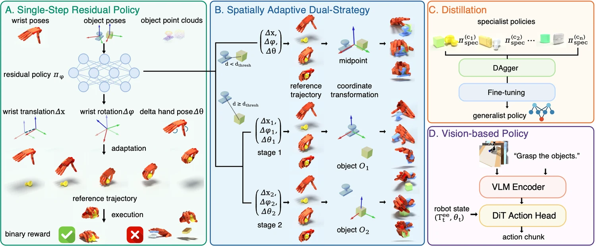

<!-- Generated by scripts/generate.py; edit data/works.json and data/media.json. -->

[← Back to the Awesome index](../../../README.md) · [Interactive website](https://chang-xinhai.github.io/Awesome-RGBDT-Manipulation/?collection=policy&item=modex#library)

# MoDex

MoDex: Towards Universal Multi-Object Dexterous Grasping

**2026-09-28 · CoRL 2026 · Peking University**

**[Paper](https://arxiv.org/abs/2610.23888)** · [Code](https://github.com/Aurora-Xiong/MoDex) · [Weights](https://github.com/Aurora-Xiong/MoDex/tree/main/checkpoints)

A single-step residual RL policy adapts reference grasp trajectories to multi-object layouts; a separate distilled visual student transfers to real dexterous grasping.

*MoDex authors; original rights retained · [Figure source](https://arxiv.org/abs/2610.23888) · Original rights retained.*

| Field | Reported value and source scope |
| :-- | :-- |
| Record type | policy |
| Policy family | Hybrid [1](https://arxiv.org/html/2610.23888)  |
| Base model and architecture | PPO reference-trajectory residual teacher; distilled visual VLM/DiT action student. [1](https://arxiv.org/html/2610.23888)  |
| Model size and component | Not reported [1](https://arxiv.org/html/2610.23888)  |
| Deployment inputs | State teacher: initial object pose/point clouds and robot state. Physical student: two RGB images and 13D arm/hand state. [1](https://arxiv.org/html/2610.23888)  |
| Action outputs and horizon | Reference wrist/hand trajectory corrections for teacher;13D low-level action chunks for visual student. [1](https://arxiv.org/html/2610.23888)  |
| Training method | Single-step sparse-reward residual PPO with spatially adaptive single/sequential strategies, then distillation and visual behavior cloning. [1](https://arxiv.org/html/2610.23888)  |
| Training data | Simulation training objects and 30,000 successful visual episodes/1.2M frames from sim at3 Hz. [1](https://arxiv.org/html/2610.23888)  |
| Training duration | Not reported [1](https://arxiv.org/html/2610.23888)  |
| Training hardware | State training single GPU/8,000 parallel environments; physical visual inference RTX 4090. [1](https://arxiv.org/html/2610.23888)  |
| Inference and control rates | Physical visual student≈3 Hz; not the single-shot teacher’s inference rate. [1](https://arxiv.org/html/2610.23888)  |
| Evaluation scope | IsaacGym proximal/separated layouts and cross-hand generalization; Franka FR3+Inspire real zero-shot student transfer. [1](https://arxiv.org/html/2610.23888)  |
| Observations / modalities | RGB · Point cloud · Proprioception |
| Evaluation domain | Simulation · Real world |
| Embodiment | Dexterous hand |
| Release: code | Partial — state-based RL train/evaluation [2](https://github.com/Aurora-Xiong/MoDex)  |
| Release: weights | Partial — ten binary-reward state-policy .pt checkpoints [2](https://github.com/Aurora-Xiong/MoDex)  |
| Release: data | Partial — robot/object assets; full visual-student training corpus not verified [2](https://github.com/Aurora-Xiong/MoDex)  |
| Release: license | Apache-2.0 root implementation and checkpoints/LICENSE; third-party modules/assets retain separate terms. [2](https://github.com/Aurora-Xiong/MoDex)  |
| Release: notes | Ten actual state-based PPO checkpoints and reproducible configurations are public. The paper’s separate RGB student/real-robot deployment release is not established by these state-policy files. [2](https://github.com/Aurora-Xiong/MoDex)  |

**Scope and qualifications**

- State teacher consumes object poses/point clouds and emits one residual before open-loop trajectory execution. This differs from the visual student.
- Physical cameras are RealSense D435i, but depth is explicitly discarded; real inference uses two RGB views and proprioception at approximately3 Hz, without tactile/F/T.
- Do not count the released state-policy checkpoints as the real visual student.

**Primary evidence**

1. [Original full paper, methods and evaluation](https://arxiv.org/html/2610.23888) — Publication date is arXiv v1; implementation and deployment observations are distinguished from training supervision, generated geometry and base-model identity.
2. [Official artifact: actual source files, inventory and license](https://github.com/Aurora-Xiong/MoDex) — 329 files, ten checkpoints/*/model_8000.pt and checkpoint-specific Apache license; release README explicitly says state-based policies.
