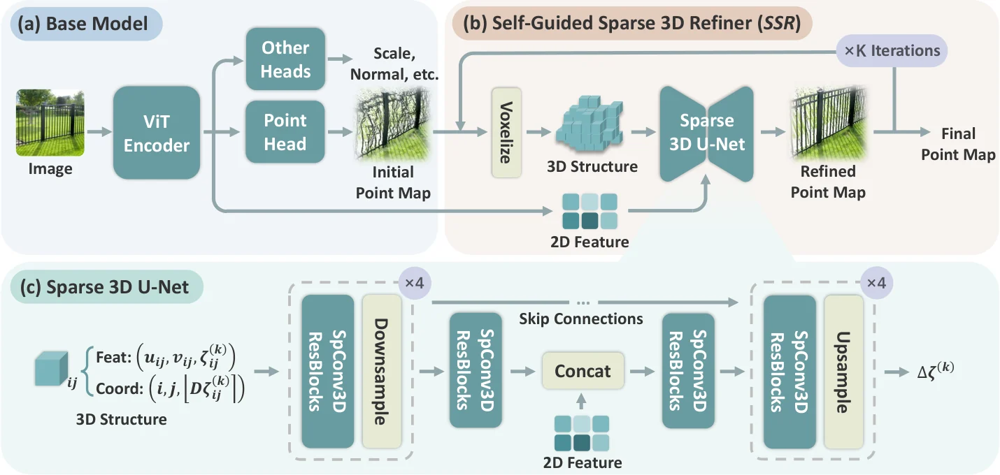

<!-- Generated by scripts/generate.py; edit data/works.json and data/media.json. -->

[← Back to the Awesome index](../../../README.md) · [Interactive website](https://chang-xinhai.github.io/Awesome-RGBDT-Manipulation/?collection=policy&item=moge-3#library)

# MoGe-3

MoGe-3: Fine-Detail Monocular Geometry Estimation with Self-Guided Sparse Volumetric Refinement

**2026-07-20 · NeurIPS 2026 · Microsoft Research and Tsinghua University**

**[Paper](https://arxiv.org/abs/2607.17967)** · [Project](https://qft-333.github.io/moge3page/) · [Code](https://github.com/microsoft/MoGe) · [Data](https://huggingface.co/datasets/Ruicheng/monocular-geometry-evaluation) · [Weights](https://huggingface.co/Ruicheng/moge-3-vitg) · [Vit-L Weights](https://huggingface.co/Ruicheng/moge-3-vitl)

Predicts metric point maps from one RGB image, then refines thin structures and local depth discontinuities in a sparse voxel shell.

*Lingyu Kong and coauthors, Microsoft Research · [Figure source](https://arxiv.org/html/2607.17967v1) · Original rights retained.*

| Field | Reported value and source scope |
| :-- | :-- |
| Record type | model |
| Model role and downstream interface | Geometry perception model [1](https://arxiv.org/html/2607.17967v1) [6](https://qft-333.github.io/moge3page/)  |
| Model family | Monocular metric geometry [1](https://arxiv.org/html/2607.17967v1) [6](https://qft-333.github.io/moge3page/)  |
| Model architecture | Base point-map estimator plus Self-Guided Sparse 3D Refinement (SSR). [1](https://arxiv.org/html/2607.17967v1) [6](https://qft-333.github.io/moge3page/)  |
| Model size and component | Released ViT-G 1.25B and ViT-L 370M per official repository. [1](https://arxiv.org/html/2607.17967v1) [3](https://github.com/microsoft/MoGe) [6](https://qft-333.github.io/moge3page/)  |
| Model inputs | One RGB image. [1](https://arxiv.org/html/2607.17967v1) [6](https://qft-333.github.io/moge3page/)  |
| Model outputs | Metric camera-frame point map, depth, surface normals and predicted camera geometry. [1](https://arxiv.org/html/2607.17967v1) [6](https://qft-333.github.io/moge3page/)  |
| Training method | Lift coarse points and 2D features into a sparse voxel shell and train sparse 3D residual refinement. [1](https://arxiv.org/html/2607.17967v1) [6](https://qft-333.github.io/moge3page/)  |
| Training data and scale | Mixed geometry supervision; source and training details are described in the paper. [1](https://arxiv.org/html/2607.17967v1) [6](https://qft-333.github.io/moge3page/)  |
| Training duration | Not reported [1](https://arxiv.org/html/2607.17967v1) [6](https://qft-333.github.io/moge3page/)  |
| Training hardware | Not reported [1](https://arxiv.org/html/2607.17967v1) [6](https://qft-333.github.io/moge3page/)  |
| Inference setting and runtime | Iterative sparse voxel refinement, with successive re-voxelization of the current point-map estimate. [1](https://arxiv.org/html/2607.17967v1) [6](https://qft-333.github.io/moge3page/)  |
| Downstream evaluation and scope | Relative and metric geometry, boundary F1 and local geometry evaluated separately on held-out samples with close object and thin-structure examples. [1](https://arxiv.org/html/2607.17967v1) [6](https://qft-333.github.io/moge3page/)  |
| Observations / modalities | RGB |
| Evaluation domain | Simulation · Real world |
| Embodiment |  |
| Release: code | Available — official MoGe v3 inference and evaluation paths. [2](https://qft-333.github.io/moge3page/) [3](https://github.com/microsoft/MoGe)  |
| Release: weights | Available — ViT-G and ViT-L checkpoint cards. [2](https://qft-333.github.io/moge3page/) [4](https://huggingface.co/Ruicheng/moge-3-vitg) [5](https://huggingface.co/Ruicheng/moge-3-vitl)  |
| Release: data | Named training sources; processed common evaluation archive is public. [2](https://qft-333.github.io/moge3page/)  |
| Release: license | MIT repository with bundled third-party exceptions; official ViT-G checkpoint card states MIT. Check individual files and dependency terms. [2](https://qft-333.github.io/moge3page/) [4](https://huggingface.co/Ruicheng/moge-3-vitg)  |
| Release: notes | Use the v3 class and a v3 checkpoint; v1 and v2 are separate models. [2](https://qft-333.github.io/moge3page/)  |

**Scope and qualifications**

- Metric 3D and normals are inferred from RGB; no physical depth stream or manipulation policy is provided.

**Primary evidence**

1. [Original author paper or dataset description](https://arxiv.org/html/2607.17967v1)
2. [Author source and artifact entry points](https://qft-333.github.io/moge3page/)
3. [Official implementation and checkpoint matrix](https://github.com/microsoft/MoGe)
4. [ViT-G weights and license card](https://huggingface.co/Ruicheng/moge-3-vitg)
5. [ViT-L weights](https://huggingface.co/Ruicheng/moge-3-vitl)
6. [Author project and acceptance label](https://qft-333.github.io/moge3page/)
