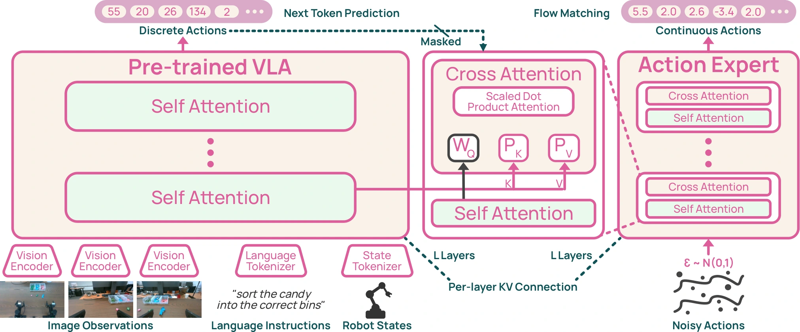

<!-- Generated by scripts/generate.py; edit data/works.json and data/media.json. -->

[← Back to the Awesome index](../../../README.md) · [Interactive website](https://chang-xinhai.github.io/Awesome-RGBDT-Manipulation/?collection=policy&item=molmoact2#library)

# MolmoAct2

MolmoAct2: Action Reasoning Models for Real-world Deployment

**2026-05-04 · Preprint · Allen Institute for AI / University of Washington**

**[Paper](https://arxiv.org/abs/2605.02881)** · [Project](https://allenai.org/blog/molmoact2) · [Code](https://github.com/allenai/molmoact2) · [Data](https://huggingface.co/collections/allenai/molmoact2-datasets-69f81e316ec3daafe3f9555c) · [Weights](https://huggingface.co/collections/allenai/molmoact2-models-69f81e05242e2499606b1be6)

Uses an embodied-reasoning VLM, discrete-action pretraining and a continuous flow expert, with optional depth/trajectory reasoning.

*MolmoAct2 authors · [Figure source](https://arxiv.org/html/2605.02881v2) · Original rights retained.*

| Field | Reported value and source scope |
| :-- | :-- |
| Record type | policy |
| Policy family | VLA [1](https://arxiv.org/abs/2605.02881)  |
| Base model and architecture | Molmo2-ER-4B backbone derived from Molmo2; FAST action tokenizer and flow-matching expert [1](https://arxiv.org/abs/2605.02881)  |
| Model size and component | 4B VLM backbone; full action-expert-inclusive total not reported [1](https://arxiv.org/abs/2605.02881)  |
| Deployment inputs | Multi-view RGB, task language and embodiment-specific state; Think variant predicts its own depth/trajectory tokens [1](https://arxiv.org/abs/2605.02881)  |
| Action outputs and horizon | Continuous absolute-joint or relative-EEF chunks: 30 steps YAM/SO100, 15 DROID, 10 LIBERO [1](https://arxiv.org/abs/2605.02881)  |
| Training method | Embodied reasoning specialization → discrete FAST action pretraining → joint continuous/discrete action post-training → embodiment fine-tuning [1](https://arxiv.org/abs/2605.02881)  |
| Training data | Open robot mixture including 34.5k bimanual YAM demos /720 h, filtered DROID and 38,059 SO100/101 demos /184 h; embodied-reasoning data [1](https://arxiv.org/abs/2605.02881)  |
| Training duration | Action pretraining 200k steps/90 h; post-training 100k/36 h; main embodiment fine-tunes100k/36 h; distinct earlier Molmo2-ER cost not included [1](https://arxiv.org/abs/2605.02881)  |
| Training hardware | Pretraining64 × H100 (5,760 GPU-h); post-training64 × H100 (2,304 GPU-h); fine-tuning32/64 × H100 (1,152/2,304 GPU-h) [1](https://arxiv.org/abs/2605.02881)  |
| Inference and control rates | Action timelines30 Hz YAM/SO100, 15 Hz DROID, 10 Hz LIBERO; chunks execute open-loop before policy re-query [1](https://arxiv.org/abs/2605.02881)  |
| Evaluation scope | MolmoSpace, LIBERO, RoboCasa and real YAM/Franka/SO100/101; separate Think reasoning variant [1](https://arxiv.org/abs/2605.02881)  |
| Observations / modalities | RGB · Proprioception · Language |
| Evaluation domain | Simulation · Real world |
| Embodiment | Parallel-jaw gripper · Bimanual |
| Release: code | Available [2](https://github.com/allenai/molmoact2)  |
| Release: weights | Available [2](https://github.com/allenai/molmoact2)  |
| Release: data | Available [2](https://github.com/allenai/molmoact2)  |
| Release: license | Apache-2.0 [2](https://github.com/allenai/molmoact2) [3](https://raw.githubusercontent.com/allenai/molmoact2/main/LICENSE)  |
| Release: notes | Availability reflects public source/model links; complete paper-scale reproduction and all dataset access terms were not tested. [2](https://github.com/allenai/molmoact2)  |

**Scope and qualifications**

- Depth reasoning tokens are generated from RGB; they do not establish measured depth-camera input.
- The action training compute excludes the earlier VLM foundation and embodied-reasoning backbone training.

**Primary evidence**

1. [Primary manuscript and first-submission history](https://arxiv.org/abs/2605.02881) — Latest available full manuscript inspected; publication date retains the first arXiv submission. Sizes, training cost and deployment rates keep their experimental scope.
2. [Official policy implementation](https://github.com/allenai/molmoact2) — Source and checkpoint availability checked separately; no local policy execution was performed.
3. [Repository license file](https://raw.githubusercontent.com/allenai/molmoact2/main/LICENSE) — Code scope; model, data and third-party component terms can differ.
