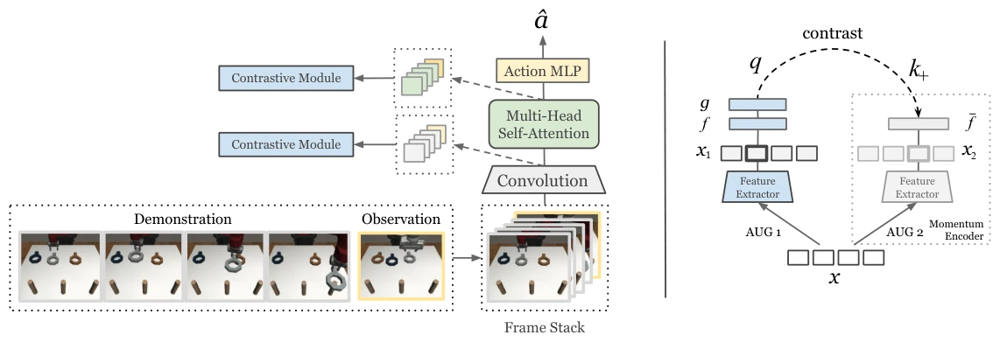

<!-- Generated by scripts/generate.py; edit data/works.json and data/media.json. -->

[← Back to the Awesome index](../../../README.md) · [Interactive website](https://chang-xinhai.github.io/Awesome-RGBDT-Manipulation/?collection=policy&item=mosaic#library)

# MOSAIC

Towards More Generalizable One-shot Visual Imitation Learning

**2021-10-26 · ICRA 2022 · UC Berkeley**

**[Paper](https://arxiv.org/abs/2110.13423)** · [Project](https://sites.google.com/berkeley.edu/mosaic) · [Code](https://github.com/rll-research/mosaic)

Self-attention and temporal contrastive learning enable one-shot visual imitation across a seven-task manipulation suite.

*MOSAIC authors · [Figure source](https://arxiv.org/abs/2110.13423) · Original rights retained.*

| Field | Reported value and source scope |
| :-- | :-- |
| Record type | policy |
| Policy family | Meta-imitation [1](https://arxiv.org/abs/2110.13423)  |
| Base model and architecture | First three ResNet-18 residual blocks, self-attention demonstration/observation fusion and a discretized-logistic action head. [1](https://arxiv.org/abs/2110.13423)  |
| Model size and component | Not reported [1](https://arxiv.org/abs/2110.13423)  |
| Deployment inputs | Sawyer RGB demonstration video and current Panda RGB observation; four demonstration frames and one evaluation observation frame. [1](https://arxiv.org/abs/2110.13423)  |
| Action outputs and horizon | Robot action distribution using independently discretized action dimensions; the reported 256 is the number of bins, not action dimensionality. [1](https://arxiv.org/abs/2110.13423)  |
| Training method | Behavior cloning plus temporal contrastive representation learning across paired demonstrations. [1](https://arxiv.org/abs/2110.13423)  |
| Training data | 7 tasks / 61 variations; 100 Sawyer and 100 Panda scripted demonstrations for each variation. [1](https://arxiv.org/abs/2110.13423)  |
| Training duration | Single-task model within one GPU-day; multi-task model about four GPU-days. [1](https://arxiv.org/abs/2110.13423)  |
| Training hardware | NVIDIA Titan Xp for the reported compute budget. [1](https://arxiv.org/abs/2110.13423)  |
| Inference and control rates | Not reported [1](https://arxiv.org/abs/2110.13423)  |
| Evaluation scope | Single-task / multi-task one-shot execution, held-out tasks and fine-tuning in the seven-task simulated suite. [1](https://arxiv.org/abs/2110.13423)  |
| Observations / modalities | RGB |
| Evaluation domain | Simulation |
| Embodiment | Parallel-jaw gripper |
| Release: code | Available [2](https://sites.google.com/berkeley.edu/mosaic) [4](https://github.com/rll-research/mosaic)  |
| Release: weights | Not released [2](https://sites.google.com/berkeley.edu/mosaic)  |
| Release: data | Partial [2](https://sites.google.com/berkeley.edu/mosaic)  |
| Release: license | MIT for repository code; external model, dataset and dependency terms remain separate. [2](https://sites.google.com/berkeley.edu/mosaic) [3](https://github.com/rll-research/mosaic/blob/HEAD/LICENSE)  |
| Release: notes | Official code includes expert-data generation, model training and evaluation; checkpoint-input commands do not establish pretrained weights. [2](https://sites.google.com/berkeley.edu/mosaic)  |

**Scope and qualifications**

- Cross-morphology protocol uses Sawyer videos to condition a Panda policy; images are RGB.

**Primary evidence**

1. [Original paper / author report](https://arxiv.org/abs/2110.13423) — Original full paper and supplementary experimental / implementation details; deployment inputs are separated from supervision and benchmark state.
2. [Official project](https://sites.google.com/berkeley.edu/mosaic) — Author-linked project and current release checked on the catalog cutoff.
3. [Repository LICENSE](https://github.com/rll-research/mosaic/blob/HEAD/LICENSE) — Actual license file inspected; code license does not automatically license data or weights.
4. [Verified official code artifact](https://github.com/rll-research/mosaic) — Author project / repository cross-link verified; current release distinguished from original paper experiments.
