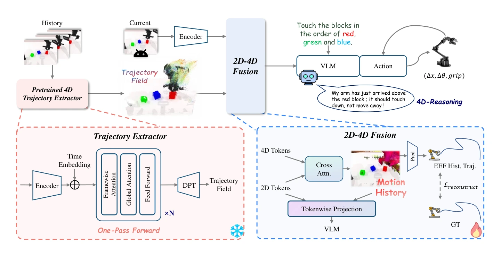

<!-- Generated by scripts/generate.py; edit data/works.json and data/media.json. -->

[← Back to the Awesome index](../../../README.md) · [Interactive website](https://chang-xinhai.github.io/Awesome-RGBDT-Manipulation/?collection=policy&item=motionvla#library)

# MotionVLA

MotionVLA: Injecting Geometric Motion into Vision-Language-Action Model

**2026-06-06 · arXiv preprint · Huazhong University of Science and Technology; D-Robotics; Wuhan University**

**[Paper](https://arxiv.org/abs/2606.08288)**

Past-only geometric motion history conditions a VLA without providing future observations during deployment.

*MotionVLA authors · [Figure source](https://arxiv.org/html/2606.08288) · Original rights retained.*

| Field | Reported value and source scope |
| :-- | :-- |
| Record type | policy |
| Policy family | VLA [1](https://arxiv.org/abs/2606.08288)  |
| Base model and architecture | π₀ flow-matching VLA augmented by frozen trajectory-field extraction, past-only motion tokens and query-conditioned fusion. [1](https://arxiv.org/abs/2606.08288)  |
| Model size and component | Not reported in the inspected primary-source sections [1](https://arxiv.org/abs/2606.08288)  |
| Deployment inputs | Current RGB, past head-camera RGB history, language and robot state. [1](https://arxiv.org/abs/2606.08288)  |
| Action outputs and horizon | Continuous action chunks; future trajectory head is only an auxiliary training objective. [1](https://arxiv.org/abs/2606.08288)  |
| Training method | Generic-to-specific action training with auxiliary trajectory supervision detached in target adaptation. [1](https://arxiv.org/abs/2606.08288)  |
| Training data | 100-hour heterogeneous manipulation mixture; over 100 physical demonstrations per task. [1](https://arxiv.org/abs/2606.08288)  |
| Training duration | Not reported in the inspected primary-source sections [1](https://arxiv.org/abs/2606.08288)  |
| Training hardware | 8 NVIDIA H20 for physical-task model training; single A800 evaluation [1](https://arxiv.org/abs/2606.08288)  |
| Inference and control rates | Not reported in the inspected primary-source sections [1](https://arxiv.org/abs/2606.08288)  |
| Evaluation scope | RoboTwin2 and preliminary real AgileX Piper manipulation. [1](https://arxiv.org/abs/2606.08288)  |
| Observations / modalities | RGB · Language · Proprioception |
| Evaluation domain | Simulation · Real world |
| Embodiment | Bimanual · Parallel-jaw gripper |
| Release: code | Not verified |
| Release: weights | Not verified |
| Release: data | Not verified |
| Release: license | Not verified |
| Release: notes | Code, data and weights are checked independently; an upstream pretrained model is not a released task policy. |

**Scope and qualifications**

- Geometric history is inferred from RGB, not an additional measured depth modality.
- History excludes the current frame and contains only earlier selected observations.

**Primary evidence**

1. [Original manuscript and first submission history](https://arxiv.org/abs/2606.08288) — Full author HTML method/evaluation/appendix inspected; depth observations, pseudo-labels and generated outputs retain distinct roles.
