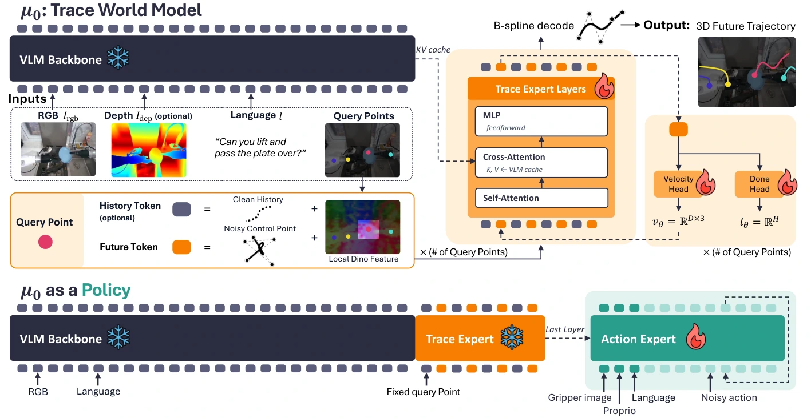

<!-- Generated by scripts/generate.py; edit data/works.json and data/media.json. -->

[← Back to the Awesome index](../../../README.md) · [Interactive website](https://chang-xinhai.github.io/Awesome-RGBDT-Manipulation/?collection=policy&item=mu0#library)

# μ₀ / Trace Expert + Action Expert

μ₀: A Scalable 3D Interaction-Trace World Model

**2026-06-11 · arXiv preprint · University of Maryland; Seoul National University; collaborating authors**

**[Paper](https://arxiv.org/abs/2606.13769)** · [Project](https://mu0-wm.github.io/) · [Code](https://github.com/Yoonkyo/mu0) · [Weights](https://huggingface.co/collections/furonghuang-lab/mu0)

A reusable 3D interaction-trace prior conditions a separately trained robot action expert.

*μ₀ / Trace Expert + Action Expert authors · [Figure source](https://arxiv.org/html/2606.13769) · Original rights retained.*

| Field | Reported value and source scope |
| :-- | :-- |
| Record type | policy |
| Policy family | World-action model [1](https://arxiv.org/abs/2606.13769)  |
| Base model and architecture | SmolVLM2-2.2B prefix with modular trace expert, B-spline motion tokens and flow-matching action expert. [1](https://arxiv.org/abs/2606.13769)  |
| Model size and component | 342M / 568M / 2.59B trace-inference variants; action-expert parameters separate [1](https://arxiv.org/abs/2606.13769)  |
| Deployment inputs | RGB, optional metric depth, language, query points/history; downstream action expert also uses proprioception. [1](https://arxiv.org/abs/2606.13769)  |
| Action outputs and horizon | 3D traces and embodiment-specific continuous action chunks. [1](https://arxiv.org/abs/2606.13769)  |
| Training method | Video-only trace pretraining; freeze the prior and train the target action expert. [1](https://arxiv.org/abs/2606.13769)  |
| Training data | TraceExtract human/robot video traces; separate robot demonstrations for action training. [1](https://arxiv.org/abs/2606.13769)  |
| Training duration | Not reported in the inspected primary-source sections [1](https://arxiv.org/abs/2606.13769)  |
| Training hardware | 4 NVIDIA L40S GPUs for RoboCasa downstream action-expert training [1](https://arxiv.org/abs/2606.13769)  |
| Inference and control rates | Not reported in the inspected primary-source sections [1](https://arxiv.org/abs/2606.13769)  |
| Evaluation scope | Trace forecasting, eight RoboCasa365 tasks and three real UR3 tasks. [1](https://arxiv.org/abs/2606.13769)  |
| Observations / modalities | RGB · Depth · Language · Proprioception |
| Evaluation domain | Simulation · Real world |
| Embodiment | Parallel-jaw gripper |
| Release: code | Available [2](https://mu0-wm.github.io/) [3](https://github.com/Yoonkyo/mu0) [5](https://github.com/Yoonkyo/mu0/tree/main)  |
| Release: weights | Not verified [2](https://mu0-wm.github.io/) [3](https://github.com/Yoonkyo/mu0) [6](https://huggingface.co/collections/furonghuang-lab/mu0)  |
| Release: data | Not verified [2](https://mu0-wm.github.io/) [3](https://github.com/Yoonkyo/mu0)  |
| Release: license | Apache-2.0 for repository code; pretrained models, data and figure rights remain separate [2](https://mu0-wm.github.io/) [3](https://github.com/Yoonkyo/mu0) [4](https://github.com/Yoonkyo/mu0/blob/main/LICENSE)  |
| Release: notes | Code, data and weights are checked independently; an upstream pretrained model is not a released task policy. [2](https://mu0-wm.github.io/) [3](https://github.com/Yoonkyo/mu0)  |

**Scope and qualifications**

- No action labels during pretraining does not mean action-free downstream policy training.
- Depth is optional in trace-model design; comparisons must retain the selected input setting.

**Primary evidence**

1. [Original manuscript and first submission history](https://arxiv.org/abs/2606.13769) — Full author HTML method/evaluation/appendix inspected; depth observations, pseudo-labels and generated outputs retain distinct roles.
2. [Official author project](https://mu0-wm.github.io/) — Public author-linked project; figure and downstream scope verified separately.
3. [Official implementation and release scope](https://github.com/Yoonkyo/mu0) — Availability of research implementation does not establish public task-policy checkpoints.
4. [Actual license file in released source](https://github.com/Yoonkyo/mu0/blob/main/LICENSE) — Only source code covered by this file; not a blanket license for paper figures or upstream weights.
5. [Actual repository content inventory](https://github.com/Yoonkyo/mu0/tree/main) — 379 tracked paths inspected; code release is distinguished from a README/project/figure-only repository.
6. [Official weights release destination](https://huggingface.co/collections/furonghuang-lab/mu0) — Destination linked by the official project/repository; component release scope is retained in release notes.
