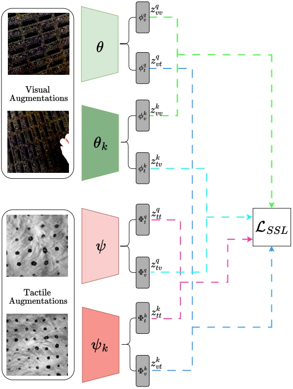

<!-- Generated by scripts/generate.py; edit data/works.json and data/media.json. -->

[← Back to the Awesome index](../../../README.md) · [Interactive website](https://chang-xinhai.github.io/Awesome-RGBDT-Manipulation/?collection=policy&item=mvitac#library)

# MViTac

Multimodal Visual-Tactile Representation Learning through Self-Supervised Contrastive Pre-Training

**2024-01-22 · Preprint · Cyber-Physical-Systems Lab, Montanuniversität Leoben, Austria**

**[Paper](https://arxiv.org/abs/2401.12024)** · [Project](https://sites.google.com/view/mvitac/home) · [Code](https://github.com/ligerfotis/mvitac) · [Data](https://drive.google.com/drive/folders/1wHEg_RR8YAQjMnt9r5biUwo5z3P6bjR3)

Learns visual–tactile features through intra- and cross-modal self-supervision for material recognition and grasp-success prediction.

*mvitac authors; original paper figure · [Figure source](https://arxiv.org/html/2401.12024#S3.F1.fig1) · Original rights retained.*

| Field | Reported value and source scope |
| :-- | :-- |
| Record type | model |
| Model role and downstream interface | Reusable representation or perception model; downstream controllers are separate systems [1](https://arxiv.org/abs/2401.12024)  |
| Model family | Multimodal representation [1](https://arxiv.org/abs/2401.12024)  |
| Model architecture | ImageNet-pretrained ResNet-18 branches with momentum encoders; two-layer intra/inter-modal contrastive projection heads [1](https://arxiv.org/abs/2401.12024)  |
| Model size and component | ResNet-18 backbone, 512-dimensional features and 128-dimensional contrastive projections; complete-system parameter count not reported [1](https://arxiv.org/abs/2401.12024)  |
| Model inputs | Paired scene RGB and optical tactile images [1](https://arxiv.org/abs/2401.12024)  |
| Model outputs | Visual/tactile representations and lightweight property/grasp prediction heads [1](https://arxiv.org/abs/2401.12024)  |
| Training method | Self-supervised contrastive pretraining combining intra-modal augmented-view and inter-modal paired losses [1](https://arxiv.org/abs/2401.12024)  |
| Training data and scale | Touch and Go, ObjectFolder and tactile grasping data under dataset-specific experiments [1](https://arxiv.org/abs/2401.12024)  |
| Training duration | 240 pretraining epochs and 60 downstream epochs; wall-clock duration not reported [1](https://arxiv.org/abs/2401.12024)  |
| Training hardware | 1 NVIDIA RTX 4090 [1](https://arxiv.org/abs/2401.12024)  |
| Inference setting and runtime | Not reported [1](https://arxiv.org/abs/2401.12024)  |
| Downstream evaluation and scope | Material/hardness/roughness classification and binary grasp-success prediction; no learned control action output. [1](https://arxiv.org/abs/2401.12024)  |
| Observations / modalities | Tactile · RGB |
| Evaluation domain | Real world |
| Embodiment |  |
| Release: code | Available [2](https://sites.google.com/view/mvitac/home) [3](https://github.com/ligerfotis/mvitac)  |
| Release: weights | Not verified [2](https://sites.google.com/view/mvitac/home) [3](https://github.com/ligerfotis/mvitac)  |
| Release: data | Available — official resource link [2](https://sites.google.com/view/mvitac/home) [3](https://github.com/ligerfotis/mvitac)  |
| Release: license | MIT text embedded in official README; no standalone LICENSE file identified; upstream data terms remain separate [2](https://sites.google.com/view/mvitac/home) [3](https://github.com/ligerfotis/mvitac)  |
| Release: notes | Code, pretrained encoders and downstream task data are separate artifacts; no policy checkpoint is implied by an encoder release. [2](https://sites.google.com/view/mvitac/home) [3](https://github.com/ligerfotis/mvitac)  |

**Scope and qualifications**

- This paper is MViTac, not the similarly named VITaL pretraining or VisuoTactile Local policy.
- Grasp outcome classification is evaluated from recorded tactile/visual data and is not autonomous grasp control.

**Primary evidence**

1. [Original model paper and first submission](https://arxiv.org/abs/2401.12024) — Method, experiments and implementation sections; specifications retain component and evaluation scope.
2. [Official project](https://sites.google.com/view/mvitac/home) — Author project; author-reported release scope is distinguished from an executed reproduction.
3. [Official implementation and current release instructions](https://github.com/ligerfotis/mvitac) — README and repository files inspected on 2026-10-17.
