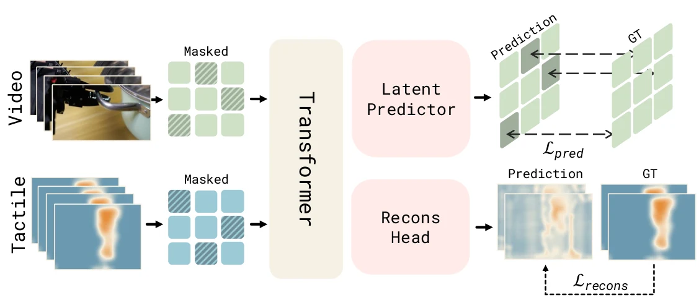

<!-- Generated by scripts/generate.py; edit data/works.json and data/media.json. -->

[← Back to the Awesome index](../../../README.md) · [Interactive website](https://chang-xinhai.github.io/Awesome-RGBDT-Manipulation/?collection=policy&item=n0-foundation#library)

# NeoForce

𝒩₀-Foundation: Towards the Age of Tactile Intelligence

**2026-08-30 · Preprint · N₀-Foundation report · NeoteAI; Fudan University TEAI**

**[Paper](https://arxiv.org/abs/2608.29601)** · [Project](https://research.neoteai.com/n0-foundation/) · [Code](https://github.com/neoteai/N0-Foundation) · [Data](https://huggingface.co/datasets/NeoteAIEmbodied/OpenNeoData) · [Weights](https://huggingface.co/NeoteAI/NeoForce)

NeoForce learns visual–tactile contact features with force reconstruction and masked teacher-latent prediction; downstream policies consume the representation.

*NeoteAI / Fudan TEAI authors · [Figure source](https://arxiv.org/html/2608.29601v2#S5) · Original rights retained.*

| Field | Reported value and source scope |
| :-- | :-- |
| Record type | model |
| Model role and downstream interface | Contact representation for downstream manipulation; the encoder itself does not emit robot actions. [2](https://arxiv.org/html/2608.29601v2#S5)  |
| Model family | Multimodal representation [2](https://arxiv.org/html/2608.29601v2#S5)  |
| Model architecture | DINOv2-initialized ViT-B shares visual/tactile tokens, with temporal aggregation, force/mask reconstruction and an EMA-teacher latent predictor. A separate GoogLeNet-based converter estimates force fields from tactile imagery. [2](https://arxiv.org/html/2608.29601v2#S5) [4](https://github.com/neoteai/N0-Foundation/tree/main/neoforce)  |
| Model size and component | ViT-B backbone; released encoder lists 12 layers and 768-dimensional tokens. Full encoder/converter parameter totals are not reported. [2](https://arxiv.org/html/2608.29601v2#S5)  |
| Model inputs | Synchronized four-frame RGB and dual-finger force-field chunks. Raw tactile images are converted into estimated three-axis fields; the wrist F/T sensor used for calibration is not an online encoder input. Proprioception belongs to downstream policies/benchmark streams, not this encoder. [2](https://arxiv.org/html/2608.29601v2#S5) [4](https://github.com/neoteai/N0-Foundation/tree/main/neoforce)  |
| Model outputs | Contact features, reconstructed dense force fields and contact masks; released code also exposes global force estimates. No action vector. [2](https://arxiv.org/html/2608.29601v2#S5) [4](https://github.com/neoteai/N0-Foundation/tree/main/neoforce)  |
| Training method | Force/mask reconstruction plus masked latent prediction, cross-modal alignment and contrastive learning; EMA teacher targets. [2](https://arxiv.org/html/2608.29601v2#S5)  |
| Training data and scale | NeoForce experiment: 20,000 demonstrations across 30 tasks, 2,500 held-out episodes. This subset is distinct from 30,000+ hours of NeoData and the 5,000-hour OpenNeoData release. [2](https://arxiv.org/html/2608.29601v2#S5)  |
| Training duration | 100,000 NeoForce steps; wall-clock time not reported. The separate force converter uses 50 epochs. [2](https://arxiv.org/html/2608.29601v2#S5)  |
| Training hardware | 8 NVIDIA A100 GPUs for NeoForce (Appendix D.4). [2](https://arxiv.org/html/2608.29601v2#S5)  |
| Inference setting and runtime | Released interface uses four frames at 30-fps sampling; measured encoder latency and downstream feedback frequency are not reported. [2](https://arxiv.org/html/2608.29601v2#S5) [4](https://github.com/neoteai/N0-Foundation/tree/main/neoforce)  |
| Downstream evaluation and scope | Force reconstruction/segmentation and a controlled π0.5 tactile-conditioning study on NeoReal. Calibration converter and downstream policy results retain separate scopes. [2](https://arxiv.org/html/2608.29601v2#S5)  |
| Observations / modalities | RGB · Tactile |
| Evaluation domain | Real world · Simulation |
| Embodiment | Parallel-jaw gripper · Bimanual |
| Release: code | Available [4](https://github.com/neoteai/N0-Foundation/tree/main/neoforce) [5](https://github.com/neoteai/N0-Foundation/blob/main/neosim/docs/EnvironmentLock.md) [12](https://huggingface.co/NeoteAI/NeoForce)  |
| Release: weights | Available — NeoForce and tactile converter checkpoints [6](https://huggingface.co/NeoteAI/NeoForce) [12](https://huggingface.co/NeoteAI/NeoForce)  |
| Release: data | Gated — OpenNeoData requires Hugging Face access terms [7](https://huggingface.co/datasets/NeoteAIEmbodied/OpenNeoData) [12](https://huggingface.co/NeoteAI/NeoForce)  |
| Release: license | NeoForce and NeoSim code subdirectories MIT; root documentation and OpenNeoData CC BY-NC-SA 4.0. NeoForce checkpoint model card specifically declares MIT; other artifacts retain their individual terms. [7](https://huggingface.co/datasets/NeoteAIEmbodied/OpenNeoData) [8](https://github.com/neoteai/N0-Foundation/blob/main/neoforce/LICENSE) [9](https://github.com/neoteai/N0-Foundation/blob/main/neosim/LICENSE)  |
| Release: notes | Code and checkpoint files were inspected. The complete 30,000-hour NeoData corpus is distinct from the 5,000-hour OpenNeoData subset; hardware access and live training were not tested. [12](https://huggingface.co/NeoteAI/NeoForce)  |

**Scope and qualifications**

- NeoForce is a supporting encoder, not a standalone action policy or a new 30,000-hour encoder-training run.
- NeoSim gel-depth maps describe local tactile deformation, not an observed external depth camera stream.
- The project page is dated July 25; this catalog uses the first arXiv manuscript date and preserves that difference.
- The full NeoData corpus, the released OpenNeoData subset and per-benchmark task demonstrations must not be summed.

**Primary evidence**

1. [Original report and arXiv history](https://arxiv.org/abs/2608.29601) — First arXiv manuscript 30 August; revised 20 September 2026.
2. [NeoForce method and Appendix D](https://arxiv.org/html/2608.29601v2#S5) — Encoder training subset, converter, supervision and downstream use are distinct.
3. [NeoReal / NeoSim with Appendices E–F](https://arxiv.org/html/2608.29601v2#S6) — Full paper task names, protocols, hardware and evaluated baseline subsets.
4. [Released NeoForce implementation](https://github.com/neoteai/N0-Foundation/tree/main/neoforce)
5. [Released NeoSim environment lock](https://github.com/neoteai/N0-Foundation/blob/main/neosim/docs/EnvironmentLock.md)
6. [NeoForce model release](https://huggingface.co/NeoteAI/NeoForce) — Public API lists neoforce.pt and the tactile converter checkpoint.
7. [OpenNeoData card and access terms](https://huggingface.co/datasets/NeoteAIEmbodied/OpenNeoData)
8. [NeoForce MIT license](https://github.com/neoteai/N0-Foundation/blob/main/neoforce/LICENSE)
9. [NeoSim MIT license](https://github.com/neoteai/N0-Foundation/blob/main/neosim/LICENSE)
10. [Root documentation license](https://github.com/neoteai/N0-Foundation/blob/main/LICENSE)
11. [Data collection method and scope](https://arxiv.org/abs/2608.29601) — NeoSim appendix describes scripted cuRobo collection; NeoData pretraining capture is not treated as the NeoReal task collector.
12. [Official current source / artifact inventory — 21 October 2026](https://huggingface.co/NeoteAI/NeoForce) — Current actual neoforce/neoforce.pt and visuo_tactile_conversion/visuo_tactile_conversion.pt inventory and MIT model card reviewed; gated OpenNeoData and benchmark code terms remain separate.
