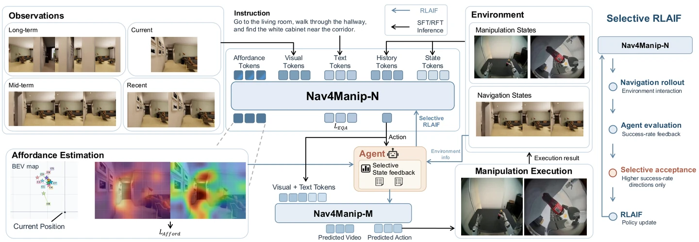

<!-- Generated by scripts/generate.py; edit data/works.json and data/media.json. -->

[← Back to the Awesome index](../../../README.md) · [Interactive website](https://chang-xinhai.github.io/Awesome-RGBDT-Manipulation/?collection=policy&item=nav4manip#library)

# Nav4Manip

Nav4Manip: From Navigation to Dexterous Mobile Manipulation through Co-Evolution

**2026-11-25 · Preprint · Peking University; Galbot and collaborators**

**[Paper](https://arxiv.org/abs/2611.34655)** · [Project](https://nav4manip.github.io/)

Couples monocular mobile navigation and dexterous world-action execution using measured manipulation outcomes at navigation endpoints.

*Yusen Feng and coauthors · [Figure source](https://arxiv.org/html/2611.34655v1) · Original rights retained.*

| Field | Reported value and source scope |
| :-- | :-- |
| Record type | policy |
| Policy family | Manipulation-aware navigation + dexterous WAM [1](https://arxiv.org/html/2611.34655v1)  |
| Base model and architecture | Qwen3-VL-4B-Instruct, flow heads and 5B Wan2.2 video branch in the manipulation executor. [1](https://arxiv.org/html/2611.34655v1)  |
| Model size and component | Not reported [1](https://arxiv.org/html/2611.34655v1)  |
| Deployment inputs | Navigation receives designated head-camera RGB and instruction; the dexterous manipulator uses wrist RGB views, instruction and arm/hand state. [1](https://arxiv.org/html/2611.34655v1)  |
| Action outputs and horizon | Mobile base navigation and endpoint affordance, followed by arm and hand action segments from Nav4Manip-M. [1](https://arxiv.org/html/2611.34655v1)  |
| Training method | Multitask co-tuning, manipulation-feedback rejection fine-tuning and agentic counterfactual feedback. Manipulation branch is also trained from synchronized teleoperation. [1](https://arxiv.org/html/2611.34655v1)  |
| Training data | Nav4Manip-Pairs is reported as 233 h; navigation co-tuning includes several other datasets. Do not sum those scopes. [1](https://arxiv.org/html/2611.34655v1)  |
| Training duration | Not reported [1](https://arxiv.org/html/2611.34655v1)  |
| Training hardware | Not reported [1](https://arxiv.org/html/2611.34655v1)  |
| Inference and control rates | Not reported [1](https://arxiv.org/html/2611.34655v1)  |
| Evaluation scope | Closed-loop Nav-N-Manip in simulation and demonstrations with one Galbot G3 equipped with two Sharpa hands. [1](https://arxiv.org/html/2611.34655v1)  |
| Observations / modalities | RGB · Proprioception · Language |
| Evaluation domain | Simulation · Real world |
| Embodiment | Mobile manipulator · Dexterous hand · Bimanual |
| Release: code | Not verified |
| Release: weights | Not verified |
| Release: data | Not verified |
| Release: license | Not verified |
| Release: notes | Paper or official project reviewed. Code, weights and data are tracked independently. |

**Scope and qualifications**

- Stereo head camera hardware does not imply measurable depth is used in the navigation or manipulation policy interface.

**Primary evidence**

1. [Original paper and evaluation settings](https://arxiv.org/html/2611.34655v1)
2. [Official project with task and method examples](https://nav4manip.github.io/)
