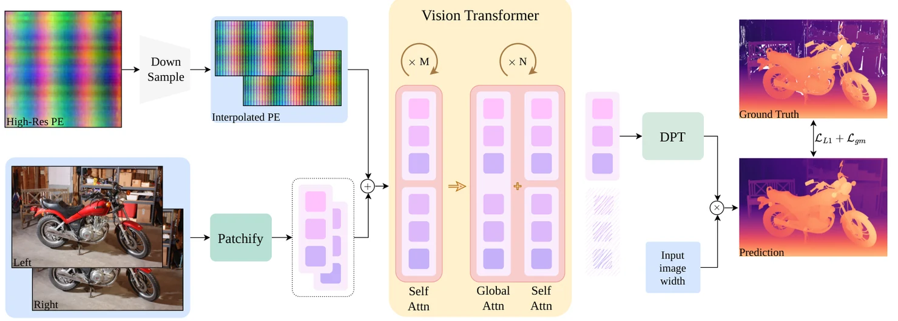

<!-- Generated by scripts/generate.py; edit data/works.json and data/media.json. -->

[← Back to the Awesome index](../../../README.md) · [Interactive website](https://chang-xinhai.github.io/Awesome-RGBDT-Manipulation/?collection=policy&item=nbs#library)

# NBS

NBS: No Bias Stereo

**2026-08-28 · Preprint · Intrinsic (Google) and Texas A&M University**

**[Paper](https://arxiv.org/abs/2608.28933)** · [Project](https://intrinsic-experimental.github.io/nbs-website/) · [Data](https://intrinsic-experimental.github.io/nbs-website/static/data/NBS_No_Bias_Stereo_Supplementary_Material.zip)

A ViT-based stereo model studies large public/private training mixtures separately from synthetic and industrial evaluation sets.

*NBS authors · [Figure source](https://intrinsic-experimental.github.io/nbs-website/) · Original rights retained.*

| Field | Reported value and source scope |
| :-- | :-- |
| Record type | model |
| Model role and downstream interface | Geometry perception model [1](https://arxiv.org/html/2608.28933v1)  |
| Model family | Stereo matching [1](https://arxiv.org/html/2608.28933v1)  |
| Model architecture | DINOv2-initialized ViT-L and DPT disparity head. [1](https://arxiv.org/html/2608.28933v1)  |
| Model size and component | Not reported [1](https://arxiv.org/html/2608.28933v1)  |
| Model inputs | Rectified RGB pair. [1](https://arxiv.org/html/2608.28933v1)  |
| Model outputs | Dense disparity in pixels. [1](https://arxiv.org/html/2608.28933v1)  |
| Training method | Base pretraining, staged high-resolution adaptation and benchmark-specific fine-tuning. [1](https://arxiv.org/html/2608.28933v1)  |
| Training data and scale | Base training uses FSD. High-resolution adaptation cites 13 public datasets and approximately 2.4M private synthetic scenes. ETH3D-specific fine-tuning combines FSD, ETH3D and Middlebury training splits. [1](https://arxiv.org/html/2608.28933v1) [4](https://arxiv.org/html/2608.28933v1#S3.SS4)  |
| Training duration | Not reported [1](https://arxiv.org/html/2608.28933v1)  |
| Training hardware | Paper reports A100 and H100 stages separately. [1](https://arxiv.org/html/2608.28933v1) [4](https://arxiv.org/html/2608.28933v1#S3.SS4)  |
| Inference setting and runtime | Up to 1932 × 1330 native training resolution for the high-resolution model. [1](https://arxiv.org/html/2608.28933v1)  |
| Downstream evaluation and scope | ETH3D, SimpleProc-S/M and a processed 55-pair XYZ-IBD stereo evaluation. [1](https://arxiv.org/html/2608.28933v1)  |
| Observations / modalities | RGB |
| Evaluation domain | Simulation · Real world |
| Embodiment |  |
| Release: code | Not verified [2](https://intrinsic-experimental.github.io/nbs-website/) [3](https://intrinsic-experimental.github.io/nbs-website/static/data/NBS_No_Bias_Stereo_Supplementary_Material.zip)  |
| Release: weights | Not verified [2](https://intrinsic-experimental.github.io/nbs-website/) [3](https://intrinsic-experimental.github.io/nbs-website/static/data/NBS_No_Bias_Stereo_Supplementary_Material.zip)  |
| Release: data | Available — author supplement contains processed industrial evaluation and seeds for SimpleProc. Internal training data will not be released. [2](https://intrinsic-experimental.github.io/nbs-website/) [3](https://intrinsic-experimental.github.io/nbs-website/static/data/NBS_No_Bias_Stereo_Supplementary_Material.zip)  |
| Release: license | Not verified [2](https://intrinsic-experimental.github.io/nbs-website/) [3](https://intrinsic-experimental.github.io/nbs-website/static/data/NBS_No_Bias_Stereo_Supplementary_Material.zip)  |
| Release: notes | Public benchmark artifacts are independently available. No model implementation or checkpoint was identified in the primary release. [2](https://intrinsic-experimental.github.io/nbs-website/) [3](https://intrinsic-experimental.github.io/nbs-website/static/data/NBS_No_Bias_Stereo_Supplementary_Material.zip)  |

**Scope and qualifications**

- The 2.4M figure is the count of internal synthetic scenes, not the size of the supplement.

**Primary evidence**

1. [Original author paper or dataset description](https://arxiv.org/html/2608.28933v1)
2. [Author source and artifact entry points](https://intrinsic-experimental.github.io/nbs-website/)
3. [Author-hosted benchmark supplement](https://intrinsic-experimental.github.io/nbs-website/static/data/NBS_No_Bias_Stereo_Supplementary_Material.zip)
4. [Paper training stages and provenance](https://arxiv.org/html/2608.28933v1#S3.SS4)
