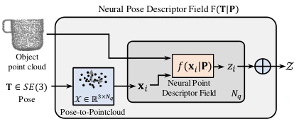

<!-- Generated by scripts/generate.py; edit data/works.json and data/media.json. -->

[← Back to the Awesome index](../../../README.md) · [Interactive website](https://chang-xinhai.github.io/Awesome-RGBDT-Manipulation/?collection=policy&item=ndf#library)

# Neural Descriptor Fields (NDF)

Neural Descriptor Fields: SE(3)-Equivariant Object Representations for Manipulation

**2021-12-09 · ICRA 2022 · MIT; Google Research; University of Toronto**

**[Paper](https://arxiv.org/abs/2112.05124)** · [Project](https://yilundu.github.io/ndf/) · [Code](https://github.com/anthonysimeonov/ndf_robot)

Equivariant 3D descriptors transfer demonstrated grasp/place poses to unseen object instances.

*Neural Descriptor Fields (NDF) authors · [Figure source](https://arxiv.org/html/2112.05124) · Original rights retained.*

| Field | Reported value and source scope |
| :-- | :-- |
| Record type | policy |
| Policy family | Geometric transfer [1](https://arxiv.org/abs/2112.05124)  |
| Base model and architecture | Vector-neuron occupancy autoencoder; continuous point/pose descriptors and test-time pose optimization. [1](https://arxiv.org/abs/2112.05124)  |
| Model size and component | Not reported in the inspected primary-source sections [1](https://arxiv.org/abs/2112.05124)  |
| Deployment inputs | Segmented depth-derived object point clouds and 5–10 demonstration poses. [1](https://arxiv.org/abs/2112.05124)  |
| Action outputs and horizon | Task-relative 6-DoF grasp/place poses. [1](https://arxiv.org/abs/2112.05124)  |
| Training method | Self-supervised category-level 3D autoencoding, then demonstration descriptor matching. [1](https://arxiv.org/abs/2112.05124)  |
| Training data | Category-shape pretraining and 5–10 task demonstrations; pretraining is not eliminated by few-shot adaptation. [1](https://arxiv.org/abs/2112.05124)  |
| Training duration | Not reported in the inspected primary-source sections [1](https://arxiv.org/abs/2112.05124)  |
| Training hardware | Not reported in the inspected primary-source sections [1](https://arxiv.org/abs/2112.05124)  |
| Inference and control rates | Not reported in the inspected primary-source sections [1](https://arxiv.org/abs/2112.05124)  |
| Evaluation scope | Simulation and real robot manipulation across novel category instances and 6-DoF poses. [1](https://arxiv.org/abs/2112.05124)  |
| Observations / modalities | Depth · Point cloud · Proprioception |
| Evaluation domain | Simulation · Real world |
| Embodiment | Parallel-jaw gripper |
| Release: code | Available [2](https://yilundu.github.io/ndf/) [3](https://github.com/anthonysimeonov/ndf_robot) [5](https://github.com/anthonysimeonov/ndf_robot/tree/master)  |
| Release: weights | Not verified [2](https://yilundu.github.io/ndf/) [3](https://github.com/anthonysimeonov/ndf_robot)  |
| Release: data | Not verified [2](https://yilundu.github.io/ndf/) [3](https://github.com/anthonysimeonov/ndf_robot)  |
| Release: license | MIT for repository code; pretrained models, data and figure rights remain separate [2](https://yilundu.github.io/ndf/) [3](https://github.com/anthonysimeonov/ndf_robot) [4](https://github.com/anthonysimeonov/ndf_robot/blob/master/LICENSE.md)  |
| Release: notes | Code, data and weights are checked independently; an upstream pretrained model is not a released task policy. [2](https://yilundu.github.io/ndf/) [3](https://github.com/anthonysimeonov/ndf_robot)  |

**Scope and qualifications**

- Category-level shape prior and object segmentation remain assumptions; few demonstration claims exclude prior model training.

**Primary evidence**

1. [Original manuscript and first submission history](https://arxiv.org/abs/2112.05124) — Full author HTML method/evaluation/appendix inspected; depth observations, pseudo-labels and generated outputs retain distinct roles.
2. [Official author project](https://yilundu.github.io/ndf/) — Public author-linked project; figure and downstream scope verified separately.
3. [Official implementation and release scope](https://github.com/anthonysimeonov/ndf_robot) — Availability of research implementation does not establish public task-policy checkpoints.
4. [Actual license file in released source](https://github.com/anthonysimeonov/ndf_robot/blob/master/LICENSE.md) — Only source code covered by this file; not a blanket license for paper figures or upstream weights.
5. [Actual repository content inventory](https://github.com/anthonysimeonov/ndf_robot/tree/master) — 159 tracked paths inspected; code release is distinguished from a README/project/figure-only repository.
