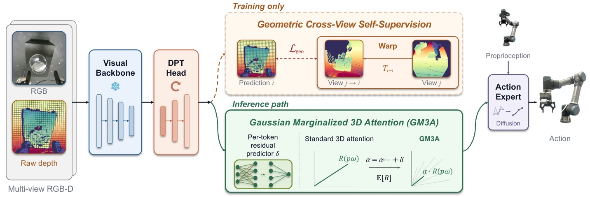

<!-- Generated by scripts/generate.py; edit data/works.json and data/media.json. -->

[← Back to the Awesome index](../../../README.md) · [Interactive website](https://chang-xinhai.github.io/Awesome-RGBDT-Manipulation/?collection=policy&item=nise#library)

# NISE

Noise-Invariant Spatial Encoding for 3D Manipulation Policies under Depth Corruption

**2026-10-17 · Preprint · Singapore Institute of Manufacturing Technology (SIMTech), A*STAR**

**[Paper](https://arxiv.org/abs/2610.24674)** · [Project](https://nise-robotics.github.io/)

Cross-view geometric supervision and uncertainty-aware 3D attention make spatial action features more robust to missing or misleading depth measurements.

*NISE authors; original rights retained · [Figure source](https://arxiv.org/abs/2610.24674) · Original rights retained.*

| Field | Reported value and source scope |
| :-- | :-- |
| Record type | policy |
| Policy family | Diffusion policy [1](https://arxiv.org/html/2610.24674)  |
| Base model and architecture | VGGT-Ω visual geometry backbone, DPT spatial head and DDPM action expert; native 3DDA/RVT-2 ablations retain their own decoders. [1](https://arxiv.org/html/2610.24674)  |
| Model size and component | Not reported [1](https://arxiv.org/html/2610.24674)  |
| Deployment inputs | Current RGB-D views, noisy lifted geometry/coordinate uncertainty and proprioception. [1](https://arxiv.org/html/2610.24674)  |
| Action outputs and horizon | Continuous action chunks through geometry-conditioned attention. [1](https://arxiv.org/html/2610.24674)  |
| Training method | Train Geometric Cross-View Self-Supervision and Gaussian Marginalized 3D Attention with policy objective; source-depth validity/visibility masks prevent oracle geometry. [1](https://arxiv.org/html/2610.24674)  |
| Training data | RLBench/MetaWorld demonstrations under clean or calibrated sensor-realistic corruption; physical transparent/reflective contact tasks. [1](https://arxiv.org/html/2610.24674)  |
| Training duration | Not reported [1](https://arxiv.org/html/2610.24674)  |
| Training hardware | Not reported [1](https://arxiv.org/html/2610.24674)  |
| Inference and control rates | Not reported [1](https://arxiv.org/html/2610.24674)  |
| Evaluation scope | 18-task RLBench clean/noisy protocols, MetaWorld and physical UR5e/dual UR3e; separate calibrated depth-repair comparisons. [1](https://arxiv.org/html/2610.24674)  |
| Observations / modalities | RGB · Depth · Proprioception |
| Evaluation domain | Simulation · Real world |
| Embodiment | Parallel-jaw gripper · Bimanual |
| Release: code | Not verified |
| Release: weights | Not verified |
| Release: data | Not verified |
| Release: license | Not verified |
| Release: notes | The inspected primary sources do not establish a public implementation, model checkpoint or dataset download. Paper figures retain their original rights. |

**Scope and qualifications**

- Calibrated multiview depth supervision is training-only; deployed attention retains uncertain measured geometry.
- Backbone-matched controls distinguish NISE mechanisms from gains due to VGGT-Ω pretraining.
- A depth-repair frontend is a separate component; model throughput is not low-level hardware control frequency.

**Primary evidence**

1. [Original full paper, methods and evaluation](https://arxiv.org/html/2610.24674) — Publication date is arXiv v1; implementation and deployment observations are distinguished from training supervision, generated geometry and base-model identity.
