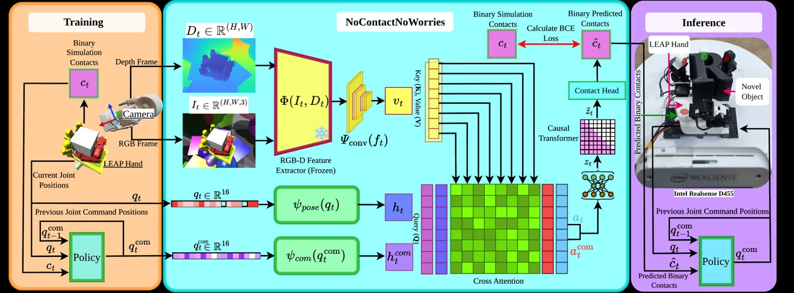

<!-- Generated by scripts/generate.py; edit data/works.json and data/media.json. -->

[← Back to the Awesome index](../../../README.md) · [Interactive website](https://chang-xinhai.github.io/Awesome-RGBDT-Manipulation/?collection=policy&item=nocontactnoworries#library)

# NoContactNoWorries

NoContactNoWorries: Estimating Contact through Vision and Proprioception for In-Hand Dexterous Manipulation

**2026-06-23 · Preprint · International Institute of Information Technology Hyderabad**

**[Paper](https://arxiv.org/abs/2606.24450)** · [Project](https://soham2560.github.io/no-contact-no-worries/)

Estimates fingertip binary contact from RGB-D and robot motion for downstream in-hand control without tactile sensing at deployment.

*NoContactNoWorries authors · [Figure source](https://arxiv.org/abs/2606.24450) · Original rights retained.*

| Field | Reported value and source scope |
| :-- | :-- |
| Record type | policy |
| Policy family | Estimated-contact in-hand policy [1](https://arxiv.org/abs/2606.24450)  |
| Base model and architecture | Transformer contact estimator and downstream RL control [1](https://arxiv.org/abs/2606.24450)  |
| Model size and component | Not reported [1](https://arxiv.org/abs/2606.24450)  |
| Deployment inputs | Synchronized RGB-D, measured and commanded finger joints. [1](https://arxiv.org/abs/2606.24450)  |
| Action outputs and horizon | Predicted binary fingertip contacts supplied to a separate manipulation policy. [1](https://arxiv.org/abs/2606.24450)  |
| Training method | Vision and pose cross-attention with causal temporal modeling, then downstream reinforcement-learning policy. [1](https://arxiv.org/abs/2606.24450)  |
| Training data | Simulation rollouts with physics-engine binary contact labels; real resistive sensors provide evaluation labels only. [1](https://arxiv.org/abs/2606.24450)  |
| Training duration | Not reported [1](https://arxiv.org/abs/2606.24450)  |
| Training hardware | Not reported [1](https://arxiv.org/abs/2606.24450)  |
| Inference and control rates | Not reported [1](https://arxiv.org/abs/2606.24450)  |
| Evaluation scope | Simulated and physical LEAP hand contact prediction and in-hand object rotation; ten physical trials reported per evaluation setting. [1](https://arxiv.org/abs/2606.24450)  |
| Observations / modalities | RGB · Depth · Proprioception |
| Evaluation domain | Simulation · Real world |
| Embodiment |  |
| Release: code | Not verified |
| Release: weights | Not verified |
| Release: data | Not verified |
| Release: license | Not verified |
| Release: notes | Project page does not by itself establish release of code, model weights or data. |

**Scope and qualifications**

- Predicted binary contact is pseudo-tactile, not an observed physical tactile stream. Real fingertip sensors provide evaluation ground truth and are removed for policy deployment.

**Primary evidence**

1. [Primary manuscript and first submission](https://arxiv.org/abs/2606.24450)
