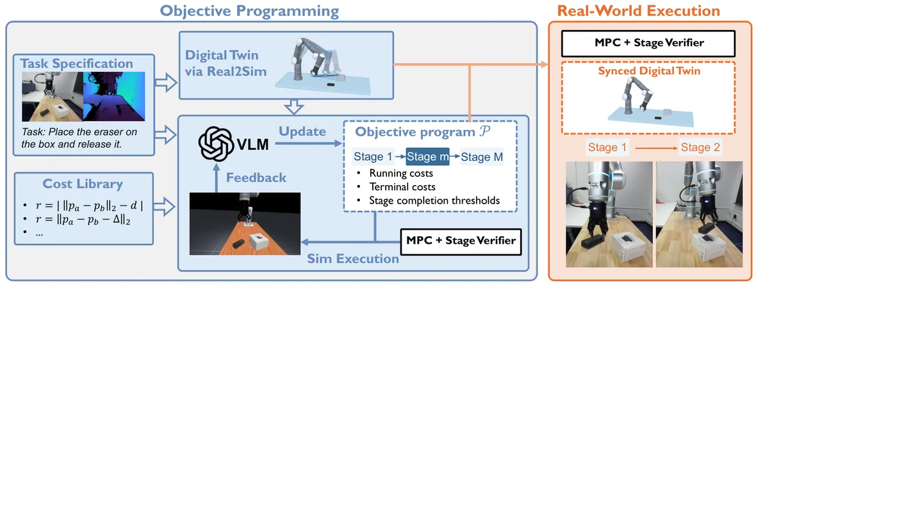

<!-- Generated by scripts/generate.py; edit data/works.json and data/media.json. -->

[← Back to the Awesome index](../../../README.md) · [Interactive website](https://chang-xinhai.github.io/Awesome-RGBDT-Manipulation/?collection=policy&item=oap#library)

# Objectives as Policies

Objectives as Policies: Vision-Language Model Cost Programs for Contact-Rich Manipulation

**2026-11-13 · Preprint · University of Illinois Chicago**

**[Paper](https://arxiv.org/abs/2611.18298)** · [Project](https://zihaolu001.github.io/oap-project/) · [Code](https://github.com/ZihaoLu001/OaP)

A VLM writes and revises staged cost programs for a shared sampling-based MPC in a reconstructed digital twin.

*Objectives as Policies authors · [Figure source](https://arxiv.org/html/2611.18298v1) · Original rights retained.*

| Field | Reported value and source scope |
| :-- | :-- |
| Record type | policy |
| Policy family | Agent-authored objective program with sampling MPC [1](https://arxiv.org/html/2611.18298)  |
| Base model and architecture | Pretrained vision-language model and sampling MPC [1](https://arxiv.org/html/2611.18298)  |
| Model size and component | Not reported [1](https://arxiv.org/html/2611.18298)  |
| Deployment inputs | Natural-language instruction and scene observations for real-to-sim; execution state for MPC. [1](https://arxiv.org/html/2611.18298)  |
| Action outputs and horizon | Multi-stage running/terminal costs, completion conditions and MPC control actions. [1](https://arxiv.org/html/2611.18298)  |
| Training method | VLM edits executable objectives after observing digital-twin rollouts; no foundation-model weight training described. [1](https://arxiv.org/html/2611.18298)  |
| Training data | Simulation rollouts for objective-program refinement. [1](https://arxiv.org/html/2611.18298)  |
| Training duration | Not reported [1](https://arxiv.org/html/2611.18298)  |
| Training hardware | Not reported [1](https://arxiv.org/html/2611.18298)  |
| Inference and control rates | Not reported [1](https://arxiv.org/html/2611.18298)  |
| Evaluation scope | Four physical contact-rich tasks alongside simulator results. [1](https://arxiv.org/html/2611.18298)  |
| Observations / modalities | RGB · Proprioception · Language |
| Evaluation domain | Simulation · Real world |
| Embodiment |  |
| Release: code | Available — objective programming and simulation integration source [2](https://zihaolu001.github.io/oap-project/) [3](https://github.com/ZihaoLu001/OaP)  |
| Release: weights | Not verified [2](https://zihaolu001.github.io/oap-project/) [3](https://github.com/ZihaoLu001/OaP)  |
| Release: data | Not verified [2](https://zihaolu001.github.io/oap-project/) [3](https://github.com/ZihaoLu001/OaP)  |
| Release: license | Apache-2.0 original source; external environments retain separate notices [2](https://zihaolu001.github.io/oap-project/) [3](https://github.com/ZihaoLu001/OaP)  |
| Release: notes | Actual source includes oap_pipeline/, src/ and example environment configuration. [2](https://zihaolu001.github.io/oap-project/) [3](https://github.com/ZihaoLu001/OaP)  |

**Scope and qualifications**

- The VLM uses rollouts for program refinement during development. The controller executes the retained objectives on the robot.
- The system separates visual scene reconstruction and the offline cost-programming agent from the runtime MPC action computation.

**Primary evidence**

1. [Primary paper and evaluated setting](https://arxiv.org/html/2611.18298)
2. [Author project and artifact status](https://zihaolu001.github.io/oap-project/)
3. [Official repository and public artifact inventory](https://github.com/ZihaoLu001/OaP) — Actual Apache-2.0 LICENSE, pipeline and controller source.
