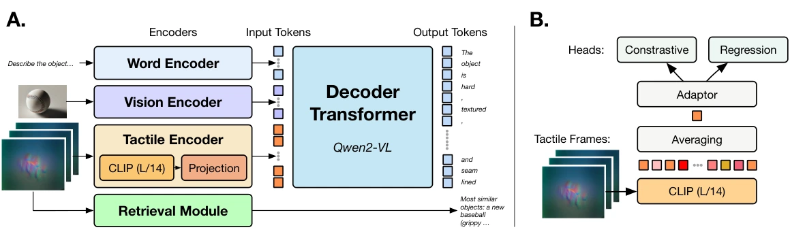

<!-- Generated by scripts/generate.py; edit data/works.json and data/media.json. -->

[← Back to the Awesome index](../../../README.md) · [Interactive website](https://chang-xinhai.github.io/Awesome-RGBDT-Manipulation/?collection=policy&item=octopi-15#library)

# Octopi-1.5

Demonstrating the Octopi-1.5 Visual-Tactile-Language Model

**2025-07-14 · RSS 2025 Demo Track · National University of Singapore**

**[Paper](https://arxiv.org/abs/2507.09985)** · [Code](https://github.com/clear-nus/octopi-1.5) · [Data](https://drive.google.com/file/d/1ckSzE4DxSiq4U34gWBIUGreImryLw94c/view?usp=drive_link) · [Weights](https://drive.google.com/file/d/1awBk019Ad3xdcQ0thsFCCdCnoEYREcf9/view?usp=sharing)

Adds multi-part tactile reasoning, scene vision and a retrieval module to a tactile-language interface demonstrated through a handheld sensor device.

*octopi-15 authors; original paper figure · [Figure source](https://arxiv.org/html/2507.09985#S1.F2) · Original rights retained.*

| Field | Reported value and source scope |
| :-- | :-- |
| Record type | model |
| Model role and downstream interface | Reusable representation or perception model; downstream controllers are separate systems [1](https://arxiv.org/abs/2507.09985)  |
| Model family | Tactile-language model [1](https://arxiv.org/abs/2507.09985)  |
| Model architecture | Qwen2-VL 7B plus a tactile CLIP module, projection layers and retrieval-augmented generation [1](https://arxiv.org/abs/2507.09985)  |
| Model size and component | Qwen2-VL 7B base; the paper comparison table labels the complete Octopi-1.5 variant “8B”, without a separate parameter audit [1](https://arxiv.org/abs/2507.09985)  |
| Model inputs | Tactile clips from multiple object parts, optional RGB observation, text prompt and retrieved tactile-object examples [1](https://arxiv.org/abs/2507.09985)  |
| Model outputs | Physical-property scores, comparative judgments, object guesses and language reasoning [1](https://arxiv.org/abs/2507.09985)  |
| Training method | Tactile CLIP pretraining with contrastive/regression objectives; frozen encoder with VPT/LoRA language adaptation; retrieval at inference [1](https://arxiv.org/abs/2507.09985)  |
| Training data and scale | Video counts: PhysiCLeAR Plain 2,689; PhysiCLeAR Dotted 1,939; Hardness 1,860; ObjectFolder Real 3,550. Object/sample counts differ across these sources. [1](https://arxiv.org/abs/2507.09985)  |
| Training duration | Tactile CLIP module: 30 epochs; other stages and wall-clock duration not reported [1](https://arxiv.org/abs/2507.09985)  |
| Training hardware | Not reported [1](https://arxiv.org/abs/2507.09985)  |
| Inference setting and runtime | Not reported [1](https://arxiv.org/abs/2507.09985)  |
| Downstream evaluation and scope | RSS demonstration: guessing game, tactile feature guessing and property comparison; held-out object tests with/without retrieval. [1](https://arxiv.org/abs/2507.09985)  |
| Observations / modalities | Tactile · RGB · Language |
| Evaluation domain | Real world |
| Embodiment |  |
| Release: code | Available [2](https://github.com/clear-nus/octopi-1.5)  |
| Release: weights | Available — official download link [2](https://github.com/clear-nus/octopi-1.5)  |
| Release: data | Available — official resource link [2](https://github.com/clear-nus/octopi-1.5)  |
| Release: license | No standalone top-level repository LICENSE identified; Qwen2-VL and component terms apply separately [2](https://github.com/clear-nus/octopi-1.5)  |
| Release: notes | Code, pretrained encoders and downstream task data are separate artifacts; no policy checkpoint is implied by an encoder release. [2](https://github.com/clear-nus/octopi-1.5)  |

**Scope and qualifications**

- The live interface is handheld and explicitly does not require a robot.
- Retrieval adds remembered tactile–object examples; it is not gradient-based robot policy adaptation.
- The prose calls the base Qwen2-VL 7B, while Table III labels Octopi-1.5 “8B”; these source descriptions have different scope.

**Primary evidence**

1. [Original model paper and first submission](https://arxiv.org/abs/2507.09985) — Method, experiments and implementation sections; specifications retain component and evaluation scope.
2. [Official implementation and current release instructions](https://github.com/clear-nus/octopi-1.5) — README and repository files inspected on 2026-10-17.
