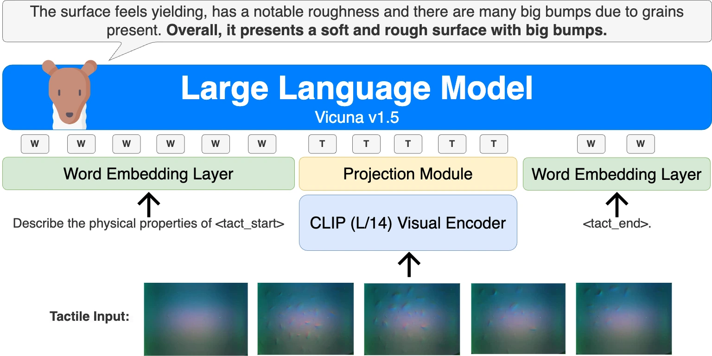

<!-- Generated by scripts/generate.py; edit data/works.json and data/media.json. -->

[← Back to the Awesome index](../../../README.md) · [Interactive website](https://chang-xinhai.github.io/Awesome-RGBDT-Manipulation/?collection=policy&item=octopi#library)

# Octopi / PhysiCLeAR

Octopi: Object Property Reasoning with Large Tactile-Language Models

**2024-05-05 · RSS 2024 · National University of Singapore; University of Washington**

**[Paper](https://arxiv.org/abs/2405.02794)** · [Project](https://github.com/clear-nus/octopi) · [Code](https://github.com/clear-nus/octopi) · [Weights](https://drive.google.com/drive/folders/1AdLCaD_5CiNvsm_cm6IT7KDeXgZVSQlY?usp=sharing)

Connects tactile video representations to a language model for physical-property description and scenario reasoning.

*octopi authors; original paper figure · [Figure source](https://arxiv.org/html/2405.02794#S4.F3) · Original rights retained.*

| Field | Reported value and source scope |
| :-- | :-- |
| Record type | model |
| Model role and downstream interface | Reusable representation or perception model; downstream controllers are separate systems [1](https://arxiv.org/abs/2405.02794)  |
| Model family | Tactile-language model [1](https://arxiv.org/abs/2405.02794)  |
| Model architecture | CLIP-based tactile video encoder + two-layer projection + Vicuna 7B/13B [1](https://arxiv.org/abs/2405.02794)  |
| Model size and component | Vicuna 7B and 13B language backbones; tactile/projection parameters additional [1](https://arxiv.org/abs/2405.02794)  |
| Model inputs | GelSight tactile videos and natural-language prompt [1](https://arxiv.org/abs/2405.02794)  |
| Model outputs | Physical-property labels/descriptions and scenario-reasoning text [1](https://arxiv.org/abs/2405.02794)  |
| Training method | Tactile encoder fine-tuning, tactile-feature alignment, and LoRA/end-to-end language adaptation [1](https://arxiv.org/abs/2405.02794)  |
| Training data and scale | PhysiCLeAR tactile videos and hardness/roughness/bumpiness labels; pressing/rotation exploratory procedures; 8K alignment samples reported [1](https://arxiv.org/abs/2405.02794)  |
| Training duration | Encoder fine-tuning 6h; alignment + end-to-end adaptation 5h (7B) /6.5h (13B) [1](https://arxiv.org/abs/2405.02794)  |
| Training hardware | 1 NVIDIA RTX A6000 (7B), 2 RTX A6000 (13B); encoder reported &lt;5GB VRAM [1](https://arxiv.org/abs/2405.02794)  |
| Inference setting and runtime | Not reported [1](https://arxiv.org/abs/2405.02794)  |
| Downstream evaluation and scope | Physical-property understanding, object description, comparison and scenario reasoning; no action-generating robot controller. [1](https://arxiv.org/abs/2405.02794)  |
| Observations / modalities | Tactile · Language |
| Evaluation domain | Real world |
| Embodiment |  |
| Release: code | Available [2](https://github.com/clear-nus/octopi) [3](https://github.com/clear-nus/octopi)  |
| Release: weights | Available — official download link [2](https://github.com/clear-nus/octopi) [3](https://github.com/clear-nus/octopi)  |
| Release: data | Not verified — dataset release not independently confirmed for the original paper snapshot [2](https://github.com/clear-nus/octopi) [3](https://github.com/clear-nus/octopi)  |
| Release: license | No standalone top-level repository LICENSE identified; component and Vicuna/LLaMA terms remain separate [2](https://github.com/clear-nus/octopi) [3](https://github.com/clear-nus/octopi)  |
| Release: notes | Code, pretrained encoders and downstream task data are separate artifacts; no policy checkpoint is implied by an encoder release. [2](https://github.com/clear-nus/octopi) [3](https://github.com/clear-nus/octopi)  |

**Scope and qualifications**

- The CLIP-like tactile encoder is fed tactile videos, rather than a measured scene-depth stream.
- Reasoning about how to manipulate an object does not itself provide an executable manipulation policy.

**Primary evidence**

1. [Original model paper and first submission](https://arxiv.org/abs/2405.02794) — Method, experiments and implementation sections; specifications retain component and evaluation scope.
2. [Official project](https://github.com/clear-nus/octopi) — Author project; author-reported release scope is distinguished from an executed reproduction.
3. [Official implementation and current release instructions](https://github.com/clear-nus/octopi) — README and repository files inspected on 2026-10-17.
