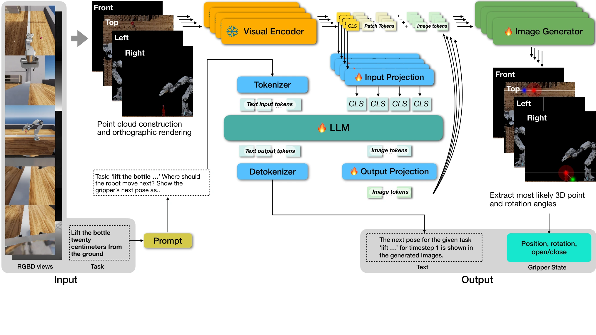

<!-- Generated by scripts/generate.py; edit data/works.json and data/media.json. -->

[← Back to the Awesome index](../../../README.md) · [Interactive website](https://chang-xinhai.github.io/Awesome-RGBDT-Manipulation/?collection=policy&item=og-vla#library)

# OG-VLA

OG-VLA: Orthographic Image Generation for 3D-Aware Vision-Language Action Model

**2025-06-01 · IROS 2026 · University of Southern California; NVIDIA**

**[Paper](https://arxiv.org/abs/2506.01196)** · [Project](https://og-vla.github.io/)

Canonical orthographic rendering aligns multi-view RGB-D inputs with image-generated keyframe actions.

*OG-VLA authors · [Figure source](https://arxiv.org/html/2506.01196) · Original rights retained.*

| Field | Reported value and source scope |
| :-- | :-- |
| Record type | policy |
| Policy family | VLA [1](https://arxiv.org/abs/2506.01196)  |
| Base model and architecture | X-VILA / Vicuna-7B v1.5, ImageBind and Stable Diffusion1.5 action-image generator. [1](https://arxiv.org/abs/2506.01196)  |
| Model size and component | Vicuna-7B language backbone; full multimodal total not reported [1](https://arxiv.org/abs/2506.01196)  |
| Deployment inputs | Calibrated multi-view RGB-D and natural language. [1](https://arxiv.org/abs/2506.01196)  |
| Action outputs and horizon | Images encoding next gripper position/orientation, decoded into quasi-static keyframe actions. [1](https://arxiv.org/abs/2506.01196)  |
| Training method | LoRA VLM tuning with action-image generation and SE(3) augmentation. [1](https://arxiv.org/abs/2506.01196)  |
| Training data | ARNOLD: about 500 demos/task for eight tasks; Colosseum: 100 demos/task; real adaptation uses 3–5 demos. [1](https://arxiv.org/abs/2506.01196)  |
| Training duration | ARNOLD 30K steps ~1.5 days; 100K ~5 days; distinct from 250K-step Colosseum run [1](https://arxiv.org/abs/2506.01196)  |
| Training hardware | 8 A100 GPUs for main training; inference on one A100 [1](https://arxiv.org/abs/2506.01196)  |
| Inference and control rates | Not reported in the inspected primary-source sections [1](https://arxiv.org/abs/2506.01196)  |
| Evaluation scope | ARNOLD, Colosseum and physical manipulation generalization. [1](https://arxiv.org/abs/2506.01196)  |
| Observations / modalities | RGB · Depth · Point cloud · Proprioception |
| Evaluation domain | Simulation · Real world |
| Embodiment | Parallel-jaw gripper |
| Release: code | Not verified [2](https://og-vla.github.io/)  |
| Release: weights | Not verified [2](https://og-vla.github.io/)  |
| Release: data | Not verified [2](https://og-vla.github.io/)  |
| Release: license | Not verified [2](https://og-vla.github.io/)  |
| Release: notes | Code, data and weights are checked independently; an upstream pretrained model is not a released task policy. [2](https://og-vla.github.io/)  |

**Scope and qualifications**

- Canonical views require calibrated 3D geometry; image diffusion produces keyframe actions rather than high-rate continuous control.

**Primary evidence**

1. [Original manuscript and first submission history](https://arxiv.org/abs/2506.01196) — Full author HTML method/evaluation/appendix inspected; depth observations, pseudo-labels and generated outputs retain distinct roles.
2. [Official author project](https://og-vla.github.io/) — Public author-linked project; figure and downstream scope verified separately.
