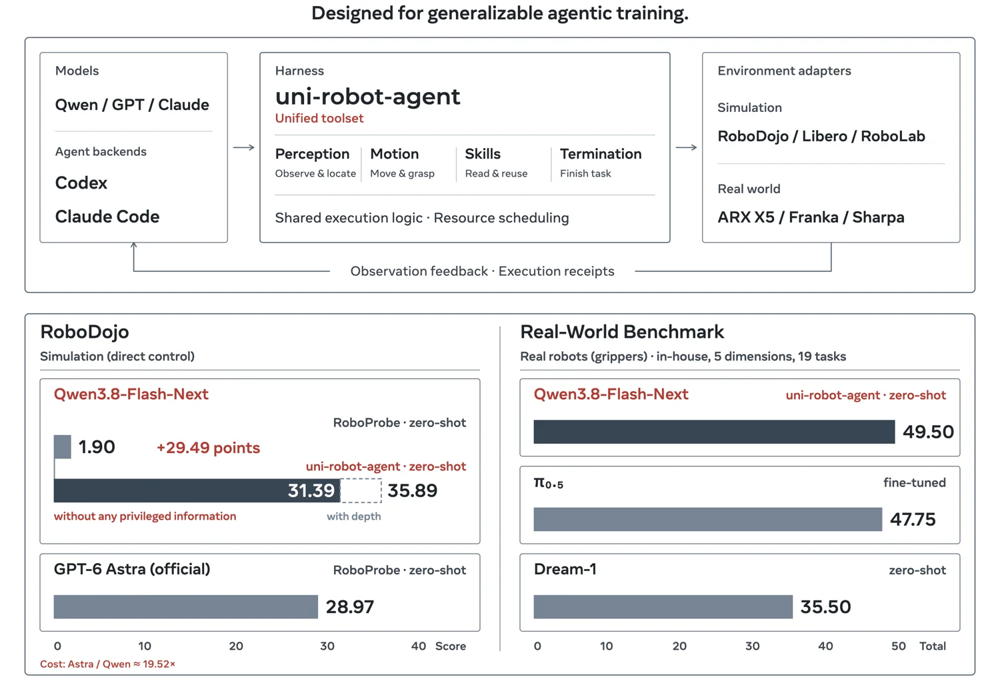

<!-- Generated by scripts/generate.py; edit data/works.json and data/media.json. -->

[← Back to the Awesome index](../../../README.md) · [Interactive website](https://chang-xinhai.github.io/Awesome-RGBDT-Manipulation/?collection=policy&item=openrua#library)

# OpenRUA

Democratizing Robot-Use Agents: A Unified Harness with Open Models

**2026-11-01 · Preprint · Tsinghua University; University of California, Berkeley**

**[Paper](https://arxiv.org/abs/2611.01560)**

An open-model robot-use agent uses a unified tool harness for simulated and real manipulation.

*OpenRUA authors · [Figure source](https://arxiv.org/abs/2611.01560) · Original rights retained.*

| Field | Reported value and source scope |
| :-- | :-- |
| Record type | policy |
| Policy family | Robot agent [1](https://arxiv.org/html/2611.01560v1)  |
| Base model and architecture | Qwen3.8-Flash-Next [1](https://arxiv.org/html/2611.01560v1)  |
| Model size and component | Not reported [1](https://arxiv.org/html/2611.01560v1)  |
| Deployment inputs | Visual observations and language task instructions [1](https://arxiv.org/html/2611.01560v1)  |
| Action outputs and horizon | Tool calls and robot manipulation commands [1](https://arxiv.org/html/2611.01560v1)  |
| Training method | Agent reasoning and a unified execution harness. [1](https://arxiv.org/html/2611.01560v1)  |
| Training data | See original paper for dataset and protocol. [1](https://arxiv.org/html/2611.01560v1)  |
| Training duration | Not reported [1](https://arxiv.org/html/2611.01560v1)  |
| Training hardware | Not reported [1](https://arxiv.org/html/2611.01560v1)  |
| Inference and control rates | Not reported [1](https://arxiv.org/html/2611.01560v1)  |
| Evaluation scope | Authors report 31.39 on RoboDojo and physical evaluation on 19 tasks. [1](https://arxiv.org/html/2611.01560v1)  |
| Observations / modalities | RGB · Language |
| Evaluation domain | Simulation · Real world |
| Embodiment | Not reported |
| Release: code | Not verified |
| Release: weights | Not verified |
| Release: data | Not verified |
| Release: license | Not verified |
| Release: notes | Release status checked against author artifacts on 2026-11-05. |

**Scope and qualifications**

- RoboDojo score and physical task results use different protocols; check the paper before comparing them.

**Primary evidence**

1. [Original paper: method, inputs and evaluation](https://arxiv.org/html/2611.01560v1) — Results and sensing claims are scoped to the authors’ evaluation and deployment setting.
