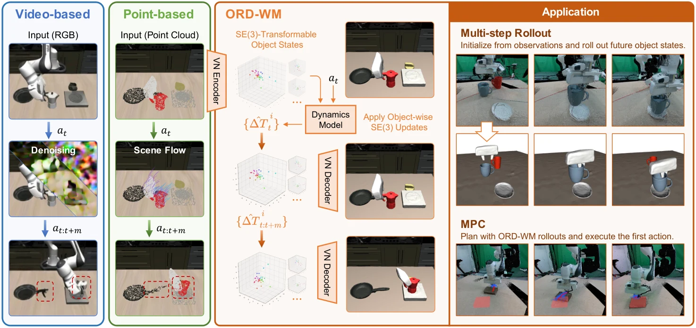

<!-- Generated by scripts/generate.py; edit data/works.json and data/media.json. -->

[← Back to the Awesome index](../../../README.md) · [Interactive website](https://chang-xinhai.github.io/Awesome-RGBDT-Manipulation/?collection=policy&item=ord-wm#library)

# ORD-WM

ORD-WM: Learning Object-Centric Rigid Dynamics for 3D World Modeling in Robotic Manipulation

**2026-10-16 · arXiv preprint · Harbin Institute of Technology, Shenzhen**

**[Paper](https://arxiv.org/abs/2610.23156)** · [Project](https://hitsz-wyy.github.io/ORD-WM/)

Predicts object-wise rigid motion in geometry-preserving vector latents for 3D rollouts and MPC.

*Ord Wm authors; original rights retained. · [Figure source](https://arxiv.org/html/2610.23156v1) · Original rights retained.*

| Field | Reported value and source scope |
| :-- | :-- |
| Record type | model |
| Model role and downstream interface | Object-centric 3D dynamics predictor; consumed by a downstream model-predictive controller. [2](https://arxiv.org/html/2610.23156v1)  |
| Model family | 3D world model [2](https://arxiv.org/html/2610.23156v1)  |
| Model architecture | SDF-supervised vector-neuron VAE and action-conditioned SE(3) motion predictor. [2](https://arxiv.org/html/2610.23156v1)  |
| Model size and component | Not reported [2](https://arxiv.org/html/2610.23156v1)  |
| Model inputs | Object point clouds, robot state and candidate actions. Real observations use three D435 camera views with FoundationStereo-estimated depth. [2](https://arxiv.org/html/2610.23156v1)  |
| Model outputs | Object-wise rigid-motion increments and geometry-preserving future latent/point-cloud states. [2](https://arxiv.org/html/2610.23156v1)  |
| Training method | Geometry reconstruction followed by action-conditioned rigid dynamics learning. [2](https://arxiv.org/html/2610.23156v1)  |
| Training data and scale | Manipulation trajectories with object-centric point clouds; paper retains train/evaluation trajectory splits. [2](https://arxiv.org/html/2610.23156v1)  |
| Training duration | Not reported [2](https://arxiv.org/html/2610.23156v1)  |
| Training hardware | Not reported [2](https://arxiv.org/html/2610.23156v1)  |
| Inference setting and runtime | MPC planning measured on one RTX 3090; budgets and candidate horizons vary. [2](https://arxiv.org/html/2610.23156v1)  |
| Downstream evaluation and scope | Multi-step geometry preservation and closed-loop MPC in simulation and with Franka Research 3. [2](https://arxiv.org/html/2610.23156v1)  |
| Observations / modalities | RGB · Point cloud · Proprioception |
| Evaluation domain | Simulation · Real world |
| Embodiment | Parallel-jaw gripper |
| Release: code | Not verified [3](https://hitsz-wyy.github.io/ORD-WM/)  |
| Release: weights | Not verified [3](https://hitsz-wyy.github.io/ORD-WM/)  |
| Release: data | Not verified [3](https://hitsz-wyy.github.io/ORD-WM/)  |
| Release: license | Not verified [3](https://hitsz-wyy.github.io/ORD-WM/)  |
| Release: notes | Paper and public presentation verified; no implementation, weight or data release is inferred from a publication or demonstration. [3](https://hitsz-wyy.github.io/ORD-WM/)  |

**Scope and qualifications**

- Real-world depth is estimated with FoundationStereo, not evidence that measured depth is the deployed input.
- MPC is a downstream controller; the predictive model is not counted as a learned action policy.

**Primary evidence**

1. [Canonical author manuscript and arXiv submission history](https://arxiv.org/abs/2610.23156) — Date retains the initial v1 submission, independently of revisions or current artifact releases.
2. [Full author paper: method, observations and evaluation scope](https://arxiv.org/html/2610.23156v1) — Physical sensors, predicted signals, training labels and policy inputs are recorded separately; undisclosed quantities remain unknown.
3. [Official paper-linked project page; release review on 19 October 2026](https://hitsz-wyy.github.io/ORD-WM/) — Current artifacts are checked separately from paper experiments. A project-only link is not proof of an implementation release.
