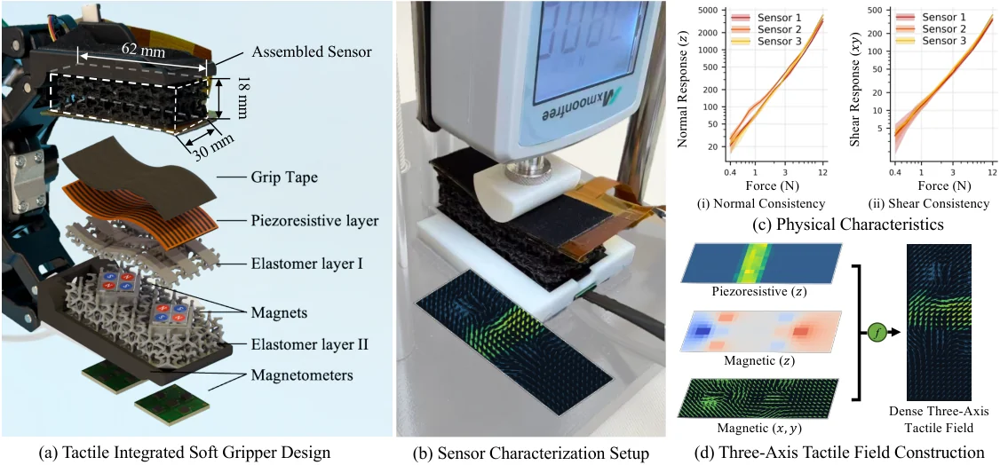

<!-- Generated by scripts/generate.py; edit data/works.json and data/media.json. -->

[← Back to the Awesome index](../../../README.md) · [Interactive website](https://chang-xinhai.github.io/Awesome-RGBDT-Manipulation/?collection=policy&item=panotac#library)

# PanoTac

PanoTac: A Dense Three-Axis Tactile Sensor for Robust Touch-Centric Manipulation

**2026-11-02 · Preprint · New York University; Columbia University**

**[Paper](https://arxiv.org/abs/2611.03520)** · [Project](https://panotac.github.io/)

A compliant dense three-axis tactile fingertip supports touch-centric visuomotor manipulation.

*PanoTac authors · [Figure source](https://arxiv.org/abs/2611.03520) · Original rights retained.*

| Field | Reported value and source scope |
| :-- | :-- |
| Record type | policy |
| Policy family | Visuotactile manipulation policy [1](https://arxiv.org/html/2611.03520v1)  |
| Base model and architecture | Not reported [1](https://arxiv.org/html/2611.03520v1)  |
| Model size and component | Not reported [1](https://arxiv.org/html/2611.03520v1)  |
| Deployment inputs | RGB, robot state and a 12 × 32 × 3 normal/shear tactile representation. [1](https://arxiv.org/html/2611.03520v1)  |
| Action outputs and horizon | Manipulation actions [1](https://arxiv.org/html/2611.03520v1)  |
| Training method | Touch-centric visuomotor learning evaluated with a dense fingertip sensor. [1](https://arxiv.org/html/2611.03520v1)  |
| Training data | See original paper for dataset and protocol. [1](https://arxiv.org/html/2611.03520v1)  |
| Training duration | Not reported [1](https://arxiv.org/html/2611.03520v1)  |
| Training hardware | Not reported [1](https://arxiv.org/html/2611.03520v1)  |
| Inference and control rates | Not reported [1](https://arxiv.org/html/2611.03520v1)  |
| Evaluation scope | Three real tasks include test-tube preparation, grain scooping and salt pouring. [1](https://arxiv.org/html/2611.03520v1)  |
| Observations / modalities | RGB · Tactile · Proprioception |
| Evaluation domain | Real world |
| Embodiment | Not reported |
| Release: code | Not verified |
| Release: weights | Not verified |
| Release: data | Not verified |
| Release: license | Not verified |
| Release: notes | Release status checked against author artifacts on 2026-11-05. |

**Scope and qualifications**

- The sensor supplies distributed contact measurements; it is distinct from a wrist force/torque sensor.

**Primary evidence**

1. [Original paper: method, inputs and evaluation](https://arxiv.org/html/2611.03520v1) — Results and sensing claims are scoped to the authors’ evaluation and deployment setting.
