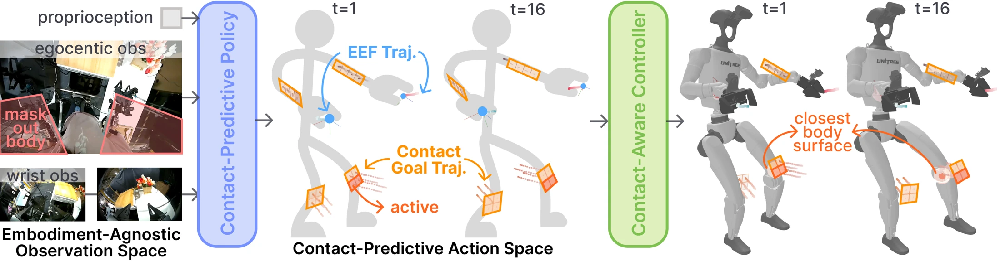

<!-- Generated by scripts/generate.py; edit data/works.json and data/media.json. -->

[← Back to the Awesome index](../../../README.md) · [Interactive website](https://chang-xinhai.github.io/Awesome-RGBDT-Manipulation/?collection=policy&item=pantact#library)

# PanTact

PanTact: Teaching Whole-Body Dexterity with a Wearable Contact Interface

**2026-10-08 · Preprint · Stanford University / Amazon Frontier AI & Robotics / Carnegie Mellon University**

**[Paper](https://arxiv.org/abs/2610.12558)** · [Project](https://pantact.github.io/)

Human body-contact supervision trains contact-predictive whole-body manipulation without additional robot body-touch sensors.

*PanTact: Teaching Whole-Body Dexterity with a Wearable Contact Interface authors · [Figure source](https://arxiv.org/abs/2610.12558) · Original rights retained.*

| Field | Reported value and source scope |
| :-- | :-- |
| Record type | policy |
| Policy family | Diffusion [1](https://arxiv.org/abs/2610.12558)  |
| Base model and architecture | DINOv3/DiT diffusion policy and contact-aware IK or RL sparse tracker. [1](https://arxiv.org/abs/2610.12558)  |
| Model size and component | Not reported [1](https://arxiv.org/abs/2610.12558)  |
| Deployment inputs | Masked egocentric 3D pointmap, wrist RGB and bimanual end-effector state history; human tactile patches supervise contact goals during training. [1](https://arxiv.org/abs/2610.12558)  |
| Action outputs and horizon | Head look-at point, bimanual EEF/gripper trajectories and world-frame body contact goals; tracker outputs 29 joint targets. [1](https://arxiv.org/abs/2610.12558)  |
| Training method | Diffusion imitation from robot-free wearable demos; contact-aware IK / sim-trained tracking controller executes goals. [1](https://arxiv.org/abs/2610.12558)  |
| Training data | 100 bulky object+small object demos,150 sweep/cabinet demos,110 carry/push demos in distinct real cohorts. [1](https://arxiv.org/abs/2610.12558)  |
| Training duration | 500 policy epochs; wall-clock time Not reported. [1](https://arxiv.org/abs/2610.12558)  |
| Training hardware | Not reported [1](https://arxiv.org/abs/2610.12558)  |
| Inference and control rates | Policy 10 Hz, tracker 50 Hz; recording 60 Hz, training subsampling 20 Hz. [1](https://arxiv.org/abs/2610.12558)  |
| Evaluation scope | Humanoid upper-body support, arm sweeping, knee/body pushing and carrying during locomotion. [1](https://arxiv.org/abs/2610.12558)  |
| Observations / modalities | RGB · Depth · Proprioception |
| Evaluation domain | Simulation · Real world |
| Embodiment | Humanoid · Bimanual |
| Release: code | Not verified [2](https://pantact.github.io/)  |
| Release: weights | Not verified [2](https://pantact.github.io/)  |
| Release: data | Not verified [2](https://pantact.github.io/)  |
| Release: license | Not verified [2](https://pantact.github.io/)  |
| Release: notes | Original paper reviewed; claimed future releases are not treated as currently available. [2](https://pantact.github.io/)  |

**Scope and qualifications**

- Body tactile patches record human training contact; deployed robot realizes predicted contact without additional body sensors.
- Egocentric pointmaps use ZED stereo reconstructed depth. Head LiDAR/IMU support SuperOdometry frame localization; this is separate from the policy depth observation.

**Primary evidence**

1. [Original paper and supplementary implementation details](https://arxiv.org/abs/2610.12558) — Primary full text reviewed; dataset, deployment modalities and training-only privileges are scoped separately.
2. [Official author project](https://pantact.github.io/) — Live artifact status reviewed separately from paper claims.
