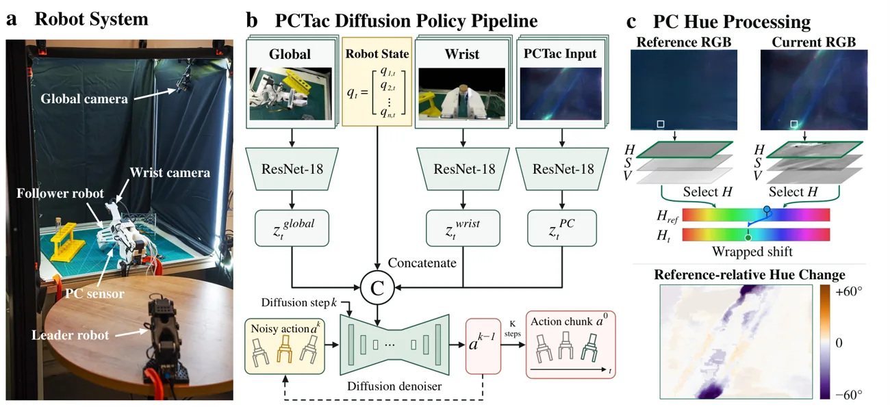

<!-- Generated by scripts/generate.py; edit data/works.json and data/media.json. -->

[← Back to the Awesome index](../../../README.md) · [Interactive website](https://chang-xinhai.github.io/Awesome-RGBDT-Manipulation/?collection=policy&item=pctac#library)

# PCTac

PCTac: Mechanochromic Photonic-Crystal Tactile Sensor for Dexterous Manipulation

**2026-11-09 · Preprint · ShanghaiTech University**

**[Paper](https://arxiv.org/abs/2611.12383)** · [Project](https://bey0ndt1me.github.io/PCTac-page/)

Integrates load-dependent photonic-crystal hue images into a visuotactile diffusion policy.

*PCTac authors · [Figure source](https://bey0ndt1me.github.io/PCTac-page/) · Original rights retained.*

| Field | Reported value and source scope |
| :-- | :-- |
| Record type | policy |
| Policy family | Visuotactile diffusion policy [1](https://arxiv.org/html/2611.12383v1)  |
| Base model and architecture | Not reported [1](https://arxiv.org/html/2611.12383v1)  |
| Model size and component | Not reported [1](https://arxiv.org/html/2611.12383v1)  |
| Deployment inputs | Wrist and global RGB, robot state and reference-relative tactile hue fields. [1](https://arxiv.org/html/2611.12383v1)  |
| Action outputs and horizon | Manipulation action sequences. [1](https://arxiv.org/html/2611.12383v1)  |
| Training method | Behavior cloning with Diffusion Policy on sensorized demonstrations; see paper for task-specific training. [1](https://arxiv.org/html/2611.12383v1)  |
| Training data | Behavior cloning with Diffusion Policy on sensorized demonstrations; see paper for task-specific training. [1](https://arxiv.org/html/2611.12383v1)  |
| Training duration | Not reported [1](https://arxiv.org/html/2611.12383v1)  |
| Training hardware | Not reported [1](https://arxiv.org/html/2611.12383v1)  |
| Inference and control rates | Not reported [1](https://arxiv.org/html/2611.12383v1)  |
| Evaluation scope | Three real tasks: wiping, test-tube insertion and perturbed insertion, with 90 physical rollouts. [1](https://arxiv.org/html/2611.12383v1)  |
| Observations / modalities | RGB · Tactile · Proprioception |
| Evaluation domain | Real world |
| Embodiment |  |
| Release: code | Not verified |
| Release: weights | Not verified |
| Release: data | Not verified |
| Release: license | Not verified |
| Release: notes | Paper and project links are not evidence of code or model availability. |

**Scope and qualifications**

- Hue is a load-sensitive optical tactile measurement, not a calibrated 3D force vector. Do not assume all author-described hardware or code is publicly downloadable.

**Primary evidence**

1. [Primary paper and first submission](https://arxiv.org/html/2611.12383v1)
