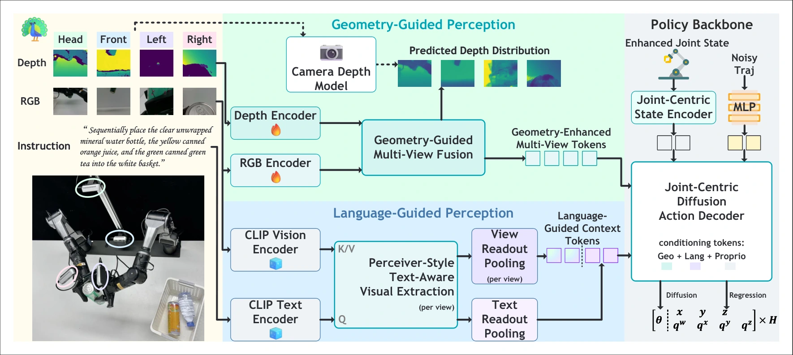

<!-- Generated by scripts/generate.py; edit data/works.json and data/media.json. -->

[← Back to the Awesome index](../../../README.md) · [Interactive website](https://chang-xinhai.github.io/Awesome-RGBDT-Manipulation/?collection=policy&item=peafowl#library)

# PEAfowl

PEAfowl: Perception-Enhanced Multi-View Vision-Language-Action for Bimanual Manipulation

**2026-01-25 · IEEE Robotics and Automation Letters 2026 · Institute of Automation, Chinese Academy of Sciences; Nanjing University**

**[Paper](https://arxiv.org/abs/2601.17885)** · [Project](https://peafowlvla.github.io/) · [Code](https://github.com/Qingyu-Fan/PEAfowl)

Multi-view RGB-D lifting and text-aware readout produce geometry-grounded bimanual action conditioning.

*PEAfowl authors · [Figure source](https://arxiv.org/html/2601.17885) · Original rights retained.*

| Field | Reported value and source scope |
| :-- | :-- |
| Record type | policy |
| Policy family | VLA [1](https://arxiv.org/abs/2601.17885)  |
| Base model and architecture | Grounding-DINO-initialized Swin-T RGB encoder, ResNet-34 depth branch, frozen CLIP ViT-L/14 language-aware readout, cross-view fusion and six-block diffusion decoder. [1](https://arxiv.org/abs/2601.17885)  |
| Model size and component | 312M trainable parameters; frozen components separate [1](https://arxiv.org/abs/2601.17885)  |
| Deployment inputs | Four calibrated RGB-D views, language and robot proprioception. [1](https://arxiv.org/abs/2601.17885)  |
| Action outputs and horizon | Bimanual action sequences. [1](https://arxiv.org/abs/2601.17885)  |
| Training method | Imitation with training-only teacher depth distillation and geometric multi-view fusion. [1](https://arxiv.org/abs/2601.17885)  |
| Training data | Nine RoboTwin2 tasks × 50 demonstrations; six physical tasks × 100 demonstrations. [1](https://arxiv.org/abs/2601.17885)  |
| Training duration | Main simulation: 400K updates; robustness checkpoints use separate 26/28-epoch schedules; wall-clock not reported [1](https://arxiv.org/abs/2601.17885)  |
| Training hardware | Not reported in the inspected primary-source sections [1](https://arxiv.org/abs/2601.17885)  |
| Inference and control rates | RTX 4090: 325.1 ms mean policy call; physical high-level query 1 Hz, low-level controller 25 Hz. [1](https://arxiv.org/abs/2601.17885)  |
| Evaluation scope | Clean/domain-randomized RoboTwin2 and AgileX Piper; 10 physical trials per task. [1](https://arxiv.org/abs/2601.17885)  |
| Observations / modalities | RGB · Depth · Point cloud · Proprioception |
| Evaluation domain | Simulation · Real world |
| Embodiment | Bimanual · Parallel-jaw gripper |
| Release: code | Available [2](https://peafowlvla.github.io/) [3](https://github.com/Qingyu-Fan/PEAfowl) [5](https://github.com/Qingyu-Fan/PEAfowl/tree/main)  |
| Release: weights | Not verified [2](https://peafowlvla.github.io/) [3](https://github.com/Qingyu-Fan/PEAfowl)  |
| Release: data | Not verified [2](https://peafowlvla.github.io/) [3](https://github.com/Qingyu-Fan/PEAfowl)  |
| Release: license | Apache-2.0 for repository code; pretrained models, data and figure rights remain separate [2](https://peafowlvla.github.io/) [3](https://github.com/Qingyu-Fan/PEAfowl) [4](https://github.com/Qingyu-Fan/PEAfowl/blob/main/LICENSE)  |
| Release: notes | Code, data and weights are checked independently; an upstream pretrained model is not a released task policy. [2](https://peafowlvla.github.io/) [3](https://github.com/Qingyu-Fan/PEAfowl)  |

**Scope and qualifications**

- Depth distillation is training-only; RGB-D observations/calibration remain part of the policy input.
- Robustness checkpoints have a separate training configuration from headline results.

**Primary evidence**

1. [Original manuscript and first submission history](https://arxiv.org/abs/2601.17885) — Full author HTML method/evaluation/appendix inspected; depth observations, pseudo-labels and generated outputs retain distinct roles.
2. [Official author project](https://peafowlvla.github.io/) — Public author-linked project; figure and downstream scope verified separately.
3. [Official implementation and release scope](https://github.com/Qingyu-Fan/PEAfowl) — Availability of research implementation does not establish public task-policy checkpoints.
4. [Actual license file in released source](https://github.com/Qingyu-Fan/PEAfowl/blob/main/LICENSE) — Only source code covered by this file; not a blanket license for paper figures or upstream weights.
5. [Actual repository content inventory](https://github.com/Qingyu-Fan/PEAfowl/tree/main) — 58 tracked paths inspected; code release is distinguished from a README/project/figure-only repository.
