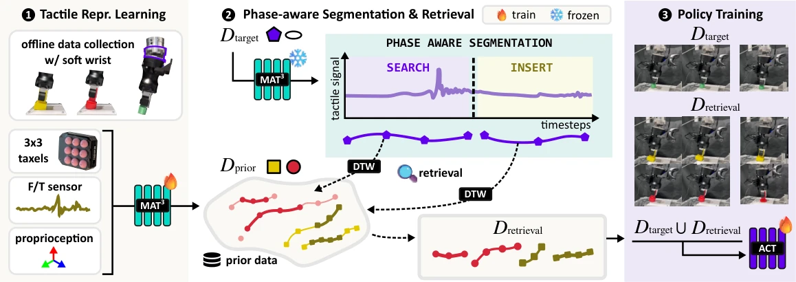

<!-- Generated by scripts/generate.py; edit data/works.json and data/media.json. -->

[← Back to the Awesome index](../../../README.md) · [Interactive website](https://chang-xinhai.github.io/Awesome-RGBDT-Manipulation/?collection=policy&item=phase-tactile#library)

# PHASE

PHASE: Compliance-Enabled Tactile Phase Retrieval for Few-Shot Insertion Learning

**2026-09-25 · Preprint · University of Tokyo / OMRON SINIC X**

**[Paper](https://arxiv.org/abs/2609.30889)**

Tactile phase segmentation retrieves relevant prior insertion segments for few-shot ACT learning with a compliant wrist.

*PHASE: Compliance-Enabled Tactile Phase Retrieval for Few-Shot Insertion Learning authors · [Figure source](https://arxiv.org/abs/2609.30889) · Original rights retained.*

| Field | Reported value and source scope |
| :-- | :-- |
| Record type | policy |
| Policy family | ACT [1](https://arxiv.org/abs/2609.30889)  |
| Base model and architecture | Masked Tactile Trajectory Transformer (MAT3) embeddings and ACT. [1](https://arxiv.org/abs/2609.30889)  |
| Model size and component | Not reported [1](https://arxiv.org/abs/2609.30889)  |
| Deployment inputs | Distributed 3×3 taxel 3 Dforce, wrist F/T and robot proprioception; no RGB required. [1](https://arxiv.org/abs/2609.30889)  |
| Action outputs and horizon | 50-step end-effector pose chunks. [1](https://arxiv.org/abs/2609.30889)  |
| Training method | Offline interaction-phase segmentation/retrieval, then ACT training on target+retrieved segments. [1](https://arxiv.org/abs/2609.30889)  |
| Training data | 122 prior demos:61 circle+61 square; four target demos pernew insertion geometry; retrieved segments are additional reused prior data. [1](https://arxiv.org/abs/2609.30889)  |
| Training duration | Not reported [1](https://arxiv.org/abs/2609.30889)  |
| Training hardware | Not reported [1](https://arxiv.org/abs/2609.30889)  |
| Inference and control rates | 50Hz sampling/control. [1](https://arxiv.org/abs/2609.30889)  |
| Evaluation scope | UR5e/Hand-E with soft wrist/Papill Array; five peg shapes:circle, square, rectangle, oval, hexagon. [1](https://arxiv.org/abs/2609.30889)  |
| Observations / modalities | Tactile · Force/Torque · Proprioception |
| Evaluation domain | Real world |
| Embodiment | Parallel-jaw gripper |
| Release: code | Not verified |
| Release: weights | Not verified |
| Release: data | Not verified |
| Release: license | Not verified |
| Release: notes | Original paper reviewed; claimed future releases are not treated as currently available. |

**Scope and qualifications**

- Few-shot retrieval trains a new policy; this is not frozen-weight in-context execution.
- Retrieval baselines instantiate core strategies under one shared ACT protocol rather than reproducing entire source systems.

**Primary evidence**

1. [Original paper and supplementary implementation details](https://arxiv.org/abs/2609.30889) — Primary full text reviewed; dataset, deployment modalities and training-only privileges are scoped separately.
