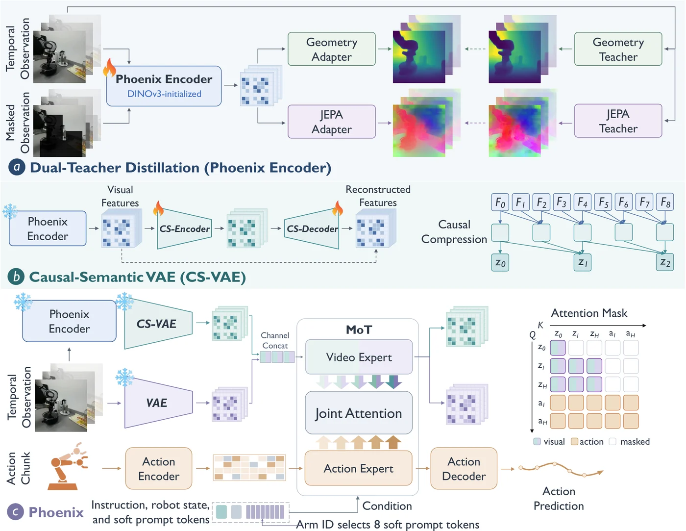

<!-- Generated by scripts/generate.py; edit data/works.json and data/media.json. -->

[← Back to the Awesome index](../../../README.md) · [Interactive website](https://chang-xinhai.github.io/Awesome-RGBDT-Manipulation/?collection=policy&item=phoenix-mwa#library)

# Phoenix

Phoenix: Learning Scene Structure Representations for Generalizable World-Action Models

**2026-11-18 · Preprint · Institute of Automation, Chinese Academy of Sciences and Anyverse Dynamics**

**[Paper](https://arxiv.org/abs/2611.24938)** · [Project](https://openphoenix-team.github.io/Phoenix-pages/) · [Code](https://github.com/Anyverse-Dynamics/Phoenix-MWA) · [Weights](https://huggingface.co/AnyverseDynamics/Phoenix-Pretrain) · [Encoders](https://huggingface.co/AnyverseDynamics/Phoenix-Encoders)

Distills geometric and spatiotemporal teachers into scene-structure latents and forecasts them jointly with appearance and robot actions.

*Phoenix authors · [Figure source](https://arxiv.org/html/2611.24938v1) · Original rights retained.*

| Field | Reported value and source scope |
| :-- | :-- |
| Record type | policy |
| Policy family | Geometry-distilled latent world-action model [1](https://arxiv.org/html/2611.24938)  |
| Base model and architecture | VGGT-Ω and V-JEPA 2.1 teachers, DINOv3 encoder foundation [1](https://arxiv.org/html/2611.24938)  |
| Model size and component | Not reported [1](https://arxiv.org/html/2611.24938)  |
| Deployment inputs | RGB observations, robot state and task conditioning. [1](https://arxiv.org/html/2611.24938)  |
| Action outputs and horizon | Predicted future structure and appearance latents and robot action chunks. [1](https://arxiv.org/html/2611.24938)  |
| Training method | Dual-teacher representation distillation, causal VAE training, world-action pretraining and benchmark-specific post-training. [1](https://arxiv.org/html/2611.24938)  |
| Training data | Approximately 39,000 hours reviewed for representation training; smaller robot-demonstration subset for action pretraining. [1](https://arxiv.org/html/2611.24938)  |
| Training duration | Not reported [1](https://arxiv.org/html/2611.24938)  |
| Training hardware | Not reported [1](https://arxiv.org/html/2611.24938)  |
| Inference and control rates | Not reported [1](https://arxiv.org/html/2611.24938)  |
| Evaluation scope | Author-reported simulation benchmarks and real-robot evaluations. [1](https://arxiv.org/html/2611.24938)  |
| Observations / modalities | RGB · Proprioception · Language |
| Evaluation domain | Simulation · Real world |
| Embodiment |  |
| Release: code | Available — encoder, world-action training and inference source [2](https://openphoenix-team.github.io/Phoenix-pages/) [3](https://github.com/Anyverse-Dynamics/Phoenix-MWA) [4](https://huggingface.co/AnyverseDynamics/Phoenix-Pretrain)  |
| Release: weights | Available — pretrained Phoenix-MWA, encoder and causal VAE [2](https://openphoenix-team.github.io/Phoenix-pages/) [3](https://github.com/Anyverse-Dynamics/Phoenix-MWA) [4](https://huggingface.co/AnyverseDynamics/Phoenix-Pretrain)  |
| Release: data | Public reconstruction manifests/tools; full curated raw archive not verified [2](https://openphoenix-team.github.io/Phoenix-pages/) [3](https://github.com/Anyverse-Dynamics/Phoenix-MWA) [4](https://huggingface.co/AnyverseDynamics/Phoenix-Pretrain)  |
| Release: license | MIT original repository; individual checkpoints, external data and dependencies retain their own terms [2](https://openphoenix-team.github.io/Phoenix-pages/) [3](https://github.com/Anyverse-Dynamics/Phoenix-MWA) [4](https://huggingface.co/AnyverseDynamics/Phoenix-Pretrain)  |
| Release: notes | Actual repository contains src, tools, configs and scripts. The model repository lists the Phoenix-MWA pretrain checkpoint and separate encoders. [2](https://openphoenix-team.github.io/Phoenix-pages/) [3](https://github.com/Anyverse-Dynamics/Phoenix-MWA) [4](https://huggingface.co/AnyverseDynamics/Phoenix-Pretrain)  |

**Scope and qualifications**

- Geometry and spatiotemporal features supervise the RGB-based encoder. They do not imply a measured depth stream at deployment.
- The reported roughly 39,000-hour curation is for representation pretraining. Only a robot-demonstration subset is used for WAM pretraining.

**Primary evidence**

1. [Primary paper and evaluated setting](https://arxiv.org/html/2611.24938)
2. [Author project and artifact status](https://openphoenix-team.github.io/Phoenix-pages/)
3. [Official repository and public artifact inventory](https://github.com/Anyverse-Dynamics/Phoenix-MWA) — Official source, LICENSE and public manifests.
4. [Official repository and public artifact inventory](https://huggingface.co/AnyverseDynamics/Phoenix-Pretrain) — Official pretrained checkpoint file inventory.
5. [Official repository and public artifact inventory](https://huggingface.co/AnyverseDynamics/Phoenix-Encoders) — Separate encoder and CS-VAE checkpoint files.
