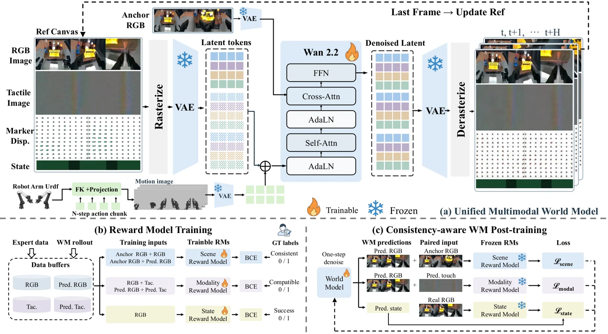

<!-- Generated by scripts/generate.py; edit data/works.json and data/media.json. -->

[← Back to the Awesome index](../../../README.md) · [Interactive website](https://chang-xinhai.github.io/Awesome-RGBDT-Manipulation/?collection=policy&item=physcanvas#library)

# PhysCanvas

Physical Canvas: A Vision Tactile World Model For Robot Policy Evaluation And Learning

**2026-10-20 · Preprint · Institute of Automation, Chinese Academy of Sciences**

**[Paper](https://arxiv.org/abs/2610.28613)** · [Project](https://zebinx.github.io/PhysCanvas_HomePage/)

A unified visual–tactile predictive canvas supports robot-policy evaluation and imagined-rollout reinforcement before physical fine-tuning.

*PhysCanvas authors · [Figure source](https://arxiv.org/abs/2610.28613) · Original rights retained.*

| Field | Reported value and source scope |
| :-- | :-- |
| Record type | model |
| Model role and downstream interface | A unified visual–tactile predictive canvas supports robot-policy evaluation and imagined-rollout reinforcement before physical fine-tuning. [1](https://arxiv.org/abs/2610.28613)  |
| Model family | Predictive representation [1](https://arxiv.org/abs/2610.28613)  |
| Model architecture | Wan2.2 video world model; separate ResNet18 consistency/reward models and policy interfaces. [1](https://arxiv.org/abs/2610.28613)  |
| Model size and component | Not reported [1](https://arxiv.org/abs/2610.28613)  |
| Model inputs | Multiview RGB, four Xense fingertip tactile images/marker displacement, robot state and supplied actions. [1](https://arxiv.org/abs/2610.28613)  |
| Model outputs | Action-conditioned future multimodal observations and consistency scores; separate policies provide actions. [1](https://arxiv.org/abs/2610.28613)  |
| Training method | Train visual/tactile/state canvas dynamics and rewards; imagined GRPO refines a tactile-augmented policy before real SFT. [1](https://arxiv.org/abs/2610.28613)  |
| Training data and scale | Not reported [1](https://arxiv.org/abs/2610.28613)  |
| Training duration | Not reported [1](https://arxiv.org/abs/2610.28613)  |
| Training hardware | Not reported [1](https://arxiv.org/abs/2610.28613)  |
| Inference setting and runtime | Not reported [1](https://arxiv.org/abs/2610.28613)  |
| Downstream evaluation and scope | Four ARX AC One bimanual real tasks; task-mean policy-evaluation correlation 0.602 to 0.885; π0.5 real performance 59.1% to 70.8% with the stated reinforcement/SFT recipe. [1](https://arxiv.org/abs/2610.28613)  |
| Observations / modalities | RGB · Tactile · Proprioception |
| Evaluation domain | Simulation · Real world |
| Embodiment | Bimanual · Parallel-jaw gripper |
| Release: code | Not released [2](https://zebinx.github.io/PhysCanvas_HomePage/)  |
| Release: weights | Not verified [2](https://zebinx.github.io/PhysCanvas_HomePage/)  |
| Release: data | Not verified [2](https://zebinx.github.io/PhysCanvas_HomePage/)  |
| Release: license | Not verified [2](https://zebinx.github.io/PhysCanvas_HomePage/)  |
| Release: notes | Official project marks Code and Model coming soon; website videos/materials are not a full executable simulator or training-data release. [2](https://zebinx.github.io/PhysCanvas_HomePage/)  |

**Scope and qualifications**

- World-model predictions and downstream policy-action generation are separate interfaces.
- Tactile contact displacement is not external scene depth.
- Website-template CC BY-SA does not license the unreleased research code/model.

**Primary evidence**

1. [Primary manuscript and first-submission history](https://arxiv.org/abs/2610.28613) — Current primary manuscript reviewed; first-public date uses arXiv v1. Observations, training privileges and deployed interfaces retain their separate scopes.
2. [Official project source and actual artifact inventory](https://zebinx.github.io/PhysCanvas_HomePage/) — Reviewed 26 October 2026. Availability and licensing apply only to the described released component, independently of paper results.
