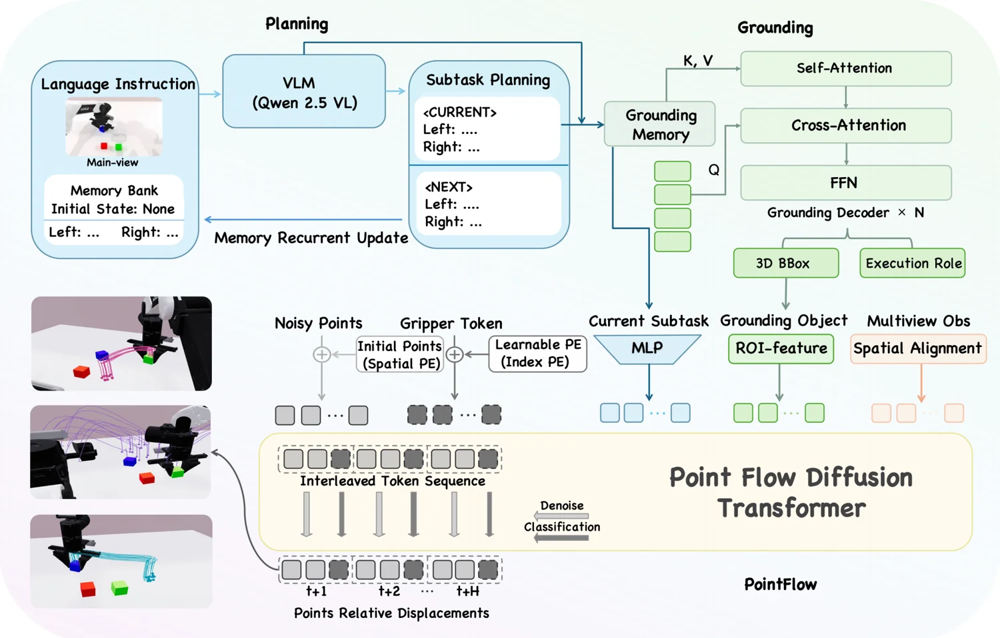

<!-- Generated by scripts/generate.py; edit data/works.json and data/media.json. -->

[← Back to the Awesome index](../../../README.md) · [Interactive website](https://chang-xinhai.github.io/Awesome-RGBDT-Manipulation/?collection=policy&item=pointpilot#library)

# PointPilot

PointPilot: Unified Robotic Manipulation via Object-Centric 3D Point Flow Prediction

**2026-11-02 · Preprint · The Chinese University of Hong Kong, Shenzhen; DexForce Technology**

**[Paper](https://arxiv.org/abs/2611.02930)**

Object-centric 3D point-flow prediction guides manipulation across simulation and physical robots.

*PointPilot authors · [Figure source](https://arxiv.org/abs/2611.02930) · Original rights retained.*

| Field | Reported value and source scope |
| :-- | :-- |
| Record type | policy |
| Policy family | 3D flow manipulation policy [1](https://arxiv.org/html/2611.02930v1)  |
| Base model and architecture | Not reported [1](https://arxiv.org/html/2611.02930v1)  |
| Model size and component | Not reported [1](https://arxiv.org/html/2611.02930v1)  |
| Deployment inputs | Multi-view RGB images and language; point geometry is inferred. Depth estimates are used for offline reconstruction only. [1](https://arxiv.org/html/2611.02930v1)  |
| Action outputs and horizon | Object-centric 3D point flows and robot actions [1](https://arxiv.org/html/2611.02930v1)  |
| Training method | Learns to predict point flows for unified manipulation. [1](https://arxiv.org/html/2611.02930v1)  |
| Training data | See original paper for dataset and protocol. [1](https://arxiv.org/html/2611.02930v1)  |
| Training duration | Not reported [1](https://arxiv.org/html/2611.02930v1)  |
| Training hardware | Not reported [1](https://arxiv.org/html/2611.02930v1)  |
| Inference and control rates | Not reported [1](https://arxiv.org/html/2611.02930v1)  |
| Evaluation scope | Manipulation experiments in simulation and on physical robots. [1](https://arxiv.org/html/2611.02930v1)  |
| Observations / modalities | RGB · Proprioception · Language |
| Evaluation domain | Simulation · Real world |
| Embodiment | Not reported |
| Release: code | Not verified |
| Release: weights | Not verified |
| Release: data | Not verified |
| Release: license | Not verified |
| Release: notes | Release status checked against author artifacts on 2026-11-05. |

**Scope and qualifications**

- The inferred 3D geometry should not be interpreted as a verified physical depth sensor input.

**Primary evidence**

1. [Original paper: method, inputs and evaluation](https://arxiv.org/html/2611.02930v1) — Results and sensing claims are scoped to the authors’ evaluation and deployment setting.
