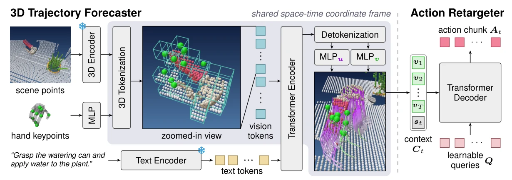

<!-- Generated by scripts/generate.py; edit data/works.json and data/media.json. -->

[← Back to the Awesome index](../../../README.md) · [Interactive website](https://chang-xinhai.github.io/Awesome-RGBDT-Manipulation/?collection=policy&item=pointwam#library)

# PointWAM

PointWAM: 3D World Action Modeling for Dexterous Robotic Manipulation

**2026-10-02 · Preprint · POSTECH**

**[Paper](https://arxiv.org/abs/2610.02840)** · [Project](https://chrockey.github.io/PointWAM/)

A 3D world-action model forecasts hand and scene point trajectories and retargets them into dexterous actions.

*PointWAM authors · [Figure source](https://arxiv.org/abs/2610.02840) · Original rights retained.*

| Field | Reported value and source scope |
| :-- | :-- |
| Record type | policy |
| Policy family | 3D world-action model [1](https://arxiv.org/abs/2610.02840)  |
| Base model and architecture | 3D scene encoder, trajectory forecaster and action-retargeting transformer [1](https://arxiv.org/abs/2610.02840)  |
| Model size and component | Not reported [1](https://arxiv.org/abs/2610.02840)  |
| Deployment inputs | Language, colored RGB-D point cloud, hand keypoints and robot state. [1](https://arxiv.org/abs/2610.02840)  |
| Action outputs and horizon | Scene and hand trajectories in a shared 3D frame and retargeted action chunks. [1](https://arxiv.org/abs/2610.02840)  |
| Training method | Forecast point trajectories as world representation and retarget predicted hand motion to executable robot actions. [1](https://arxiv.org/abs/2610.02840)  |
| Training data | Human-video pretraining on 1.15M EgoDex and VITRA episodes, followed by robot demonstration fine-tuning. [1](https://arxiv.org/abs/2610.02840)  |
| Training duration | Not reported [1](https://arxiv.org/abs/2610.02840)  |
| Training hardware | Not reported [1](https://arxiv.org/abs/2610.02840)  |
| Inference and control rates | Not reported [1](https://arxiv.org/abs/2610.02840)  |
| Evaluation scope | DexJoCo, RoboDojo-Precision, and real bimanual OpenArm setup. [1](https://arxiv.org/abs/2610.02840)  |
| Observations / modalities | RGB · Depth · Point cloud · Proprioception · Language |
| Evaluation domain | Simulation · Real world |
| Embodiment |  |
| Release: code | Not verified [2](https://chrockey.github.io/PointWAM/)  |
| Release: weights | Not verified [2](https://chrockey.github.io/PointWAM/)  |
| Release: data | Not verified [2](https://chrockey.github.io/PointWAM/)  |
| Release: license | Not verified [2](https://chrockey.github.io/PointWAM/)  |
| Release: notes | Official project labels code coming soon; no implementation or checkpoint release independently established. [2](https://chrockey.github.io/PointWAM/)  |

**Scope and qualifications**

- Human-video episodes are training sources, not a claim that the paper releases all 1.15M episodes.
- Project marks code as coming soon.

**Primary evidence**

1. [Author paper and first submission](https://arxiv.org/abs/2610.02840)
2. [Official project and artifact scope](https://chrockey.github.io/PointWAM/)
