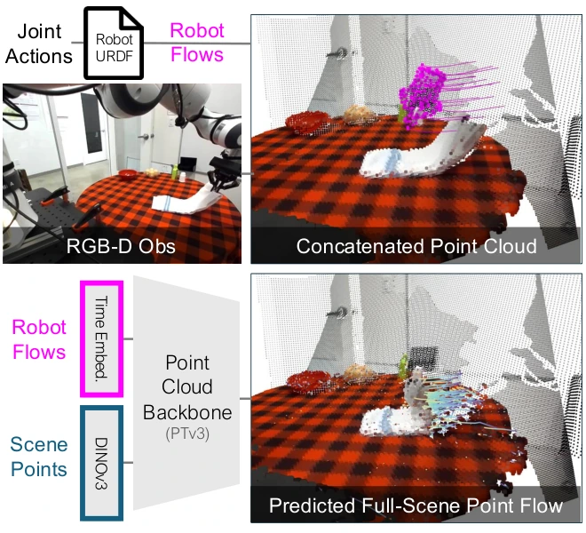

<!-- Generated by scripts/generate.py; edit data/works.json and data/media.json. -->

[← Back to the Awesome index](../../../README.md) · [Interactive website](https://chang-xinhai.github.io/Awesome-RGBDT-Manipulation/?collection=policy&item=pointworld#library)

# PointWorld + MPC

PointWorld: Scaling 3D World Models for In-The-Wild Robotic Manipulation

**2026-01-07 · CVPR 2026 · Stanford University; NVIDIA**

**[Paper](https://arxiv.org/abs/2601.03782)** · [Project](https://point-world.github.io/) · [Code](https://github.com/NVlabs/PointWorld) · [Data](https://huggingface.co/datasets/nvidia/PointWorld-DROID) · [Weights](https://huggingface.co/nvidia/PointWorld_models)

An action-conditioned 3D scene-flow model supports model-predictive manipulation from one or few RGB-D captures.

*PointWorld + MPC authors · [Figure source](https://arxiv.org/html/2601.03782) · Original rights retained.*

| Field | Reported value and source scope |
| :-- | :-- |
| Record type | policy |
| Policy family | Planning / hybrid [1](https://arxiv.org/abs/2601.03782)  |
| Base model and architecture | Point Transformer v3 scene/robot point-flow representation with frozen DINOv3 scene features; MPPI planning. [1](https://arxiv.org/abs/2601.03782)  |
| Model size and component | Not reported in the inspected primary-source sections [1](https://arxiv.org/abs/2601.03782)  |
| Deployment inputs | Calibrated RGB-D scene, robot URDF and candidate robot action sequences. [1](https://arxiv.org/abs/2601.03782)  |
| Action outputs and horizon | Predicted scene 3D point flows; MPC selects executable actions using task-specific costs. [1](https://arxiv.org/abs/2601.03782)  |
| Training method | Large-scale supervised 3D dynamics learning and sampling-based model-predictive control. [1](https://arxiv.org/abs/2601.03782)  |
| Training data | About 2M trajectories / 500 hours mixing DROID and BEHAVIOR; overlapping annotation counts not additive. [1](https://arxiv.org/abs/2601.03782)  |
| Training duration | Not reported in the inspected primary-source sections [1](https://arxiv.org/abs/2601.03782)  |
| Training hardware | Not reported in the inspected primary-source sections [1](https://arxiv.org/abs/2601.03782)  |
| Inference and control rates | Approximately 0.1 s per dynamics forward pass; complete MPC loop depends on candidate planning. [1](https://arxiv.org/abs/2601.03782)  |
| Evaluation scope | Physical Franka pushing, deformable/articulated manipulation and tool use without task-specific training. [1](https://arxiv.org/abs/2601.03782)  |
| Observations / modalities | RGB · Depth · Point cloud · Proprioception |
| Evaluation domain | Simulation · Real world |
| Embodiment | Parallel-jaw gripper |
| Release: code | Available [2](https://point-world.github.io/) [3](https://github.com/NVlabs/PointWorld) [5](https://github.com/NVlabs/PointWorld/tree/main)  |
| Release: weights | Available [2](https://point-world.github.io/) [3](https://github.com/NVlabs/PointWorld) [6](https://huggingface.co/nvidia/PointWorld_models)  |
| Release: data | Available [2](https://point-world.github.io/) [3](https://github.com/NVlabs/PointWorld) [7](https://huggingface.co/datasets/nvidia/PointWorld-DROID)  |
| Release: license | Apache-2.0 code; released model checkpoints use NVIDIA Open Model License (see checkpoint package); dataset terms separate [2](https://point-world.github.io/) [3](https://github.com/NVlabs/PointWorld) [4](https://github.com/NVlabs/PointWorld/blob/main/LICENSE)  |
| Release: notes | HF file inventory contains small/large DROID and DROID+BEHAVIOR checkpoints; dataset/model licenses are independent. [2](https://point-world.github.io/) [3](https://github.com/NVlabs/PointWorld)  |

**Scope and qualifications**

- Provided action sequences and hand-designed MPC cost functions are required; dynamics latency is not total control latency.

**Primary evidence**

1. [Original manuscript and first submission history](https://arxiv.org/abs/2601.03782) — Full author HTML method/evaluation/appendix inspected; depth observations, pseudo-labels and generated outputs retain distinct roles.
2. [Official author project](https://point-world.github.io/) — Public author-linked project; figure and downstream scope verified separately.
3. [Official implementation and release scope](https://github.com/NVlabs/PointWorld) — Availability of research implementation does not establish public task-policy checkpoints.
4. [Actual license file in released source](https://github.com/NVlabs/PointWorld/blob/main/LICENSE) — Only source code covered by this file; not a blanket license for paper figures or upstream weights.
5. [Actual repository content inventory](https://github.com/NVlabs/PointWorld/tree/main) — 462 tracked paths inspected; code release is distinguished from a README/project/figure-only repository.
6. [Released checkpoint terms and file inventory](https://huggingface.co/nvidia/PointWorld_models) — Three small/large variants plus filtered-split checkpoint files exist; model terms differ from code license.
7. [Official data release destination](https://huggingface.co/datasets/nvidia/PointWorld-DROID) — Destination linked by the official project/repository; component release scope is retained in release notes.
