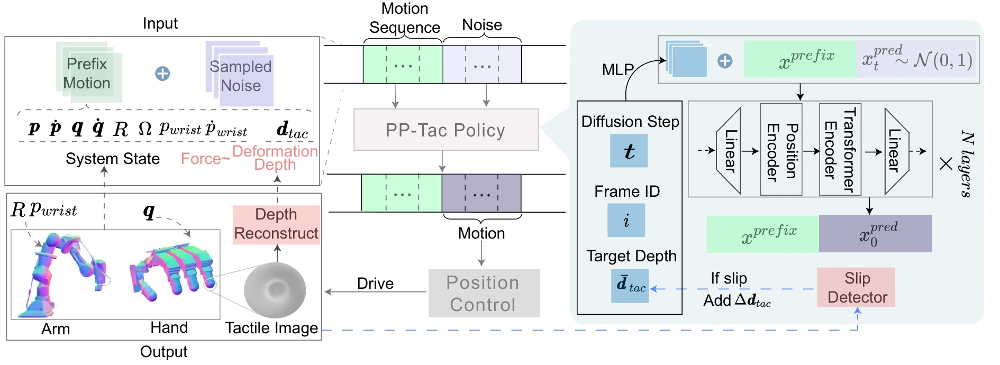

<!-- Generated by scripts/generate.py; edit data/works.json and data/media.json. -->

[← Back to the Awesome index](../../../README.md) · [Interactive website](https://chang-xinhai.github.io/Awesome-RGBDT-Manipulation/?collection=policy&item=pp-tac#library)

# PP-Tac

PP-Tac: Paper Picking Using Tactile Feedback in Dexterous Robotic Hands

**2025-04-23 · RSS 2025 · BIGAI / ShanghaiTech University / Bei hang University**

**[Paper](https://arxiv.org/abs/2504.16649)** · [Project](https://peilin-666.github.io/projects/PP-Tac) · [Code](https://github.com/bigai-ai/PP-Tac)

Tactile surface/slip feedback and learned finger–wrist coordination pick thin paper-like objects from varied terrain.

*PP-Tac: Paper Picking Using Tactile Feedback in Dexterous Robotic Hands authors · [Figure source](https://arxiv.org/abs/2504.16649) · Original rights retained.*

| Field | Reported value and source scope |
| :-- | :-- |
| Record type | policy |
| Policy family | Diffusion [1](https://arxiv.org/abs/2504.16649)  |
| Base model and architecture | Omni directional tactile fingertips, slip CNN/MLP and transformer diffusion motion generator. [1](https://arxiv.org/abs/2504.16649)  |
| Model size and component | Not reported [1](https://arxiv.org/abs/2504.16649)  |
| Deployment inputs | Tactile contact deformation/slip and hand/arm state. [1](https://arxiv.org/abs/2504.16649)  |
| Action outputs and horizon | Coordinated finger joints, wrist pose and contact-adjusted sliding motions. [1](https://arxiv.org/abs/2504.16649)  |
| Training method | Slip class i fier learning and~600 k iteration diffusion motion training. [1](https://arxiv.org/abs/2504.16649)  |
| Training data | ~20 min tactile slip data with manual labels; synthetic trajectory sequences for motion training. [1](https://arxiv.org/abs/2504.16649)  |
| Training duration | ~600,000 motion model iterations; wall-clock Not reported. [1](https://arxiv.org/abs/2504.16649)  |
| Training hardware | Single NVIDIA RTX4090. [1](https://arxiv.org/abs/2504.16649)  |
| Inference and control rates | Motion generation 11 mson RTX4090; not a reported overall control frequency. [1](https://arxiv.org/abs/2504.16649)  |
| Evaluation scope | Real paper/fabric picking across flat/complex supporting terrains. [1](https://arxiv.org/abs/2504.16649)  |
| Observations / modalities | Tactile · Proprioception |
| Evaluation domain | Real world |
| Embodiment | Dexterous hand |
| Release: code | Available [2](https://peilin-666.github.io/projects/PP-Tac) [3](https://github.com/bigai-ai/PP-Tac)  |
| Release: weights | Not verified [2](https://peilin-666.github.io/projects/PP-Tac) [3](https://github.com/bigai-ai/PP-Tac)  |
| Release: data | Not verified [2](https://peilin-666.github.io/projects/PP-Tac) [3](https://github.com/bigai-ai/PP-Tac)  |
| Release: license | Not verified; no unambiguous repository license identified. [2](https://peilin-666.github.io/projects/PP-Tac) [3](https://github.com/bigai-ai/PP-Tac)  |
| Release: notes | Author-linked repository and actual LICENSE inspected; code, checkpoints anddatasets have independent availability. [2](https://peilin-666.github.io/projects/PP-Tac) [3](https://github.com/bigai-ai/PP-Tac)  |

**Scope and qualifications**

- Tactile-depth reconstruction is local sensor surface deformation, not external scene depth.

**Primary evidence**

1. [Original paper and supplementary implementation details](https://arxiv.org/abs/2504.16649) — Primary full text reviewed; dataset, deployment modalities and training-only privileges are scoped separately.
2. [Official author project](https://peilin-666.github.io/projects/PP-Tac) — Live artifact status reviewed separately from paper claims.
3. [Official released implementation and LICENSE](https://github.com/bigai-ai/PP-Tac) — Repository metadata,README and actualNone inspected; availability scoped to the listed component.
