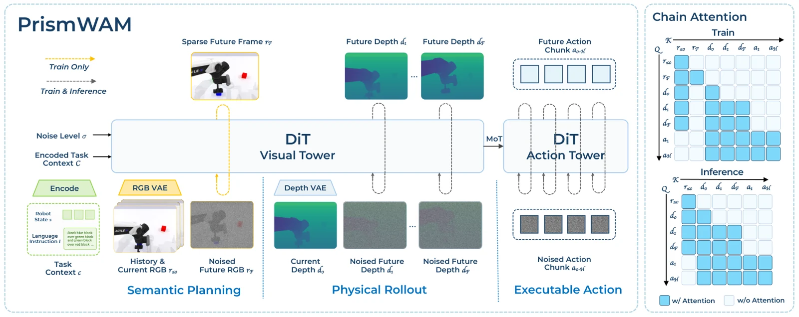

<!-- Generated by scripts/generate.py; edit data/works.json and data/media.json. -->

[← Back to the Awesome index](../../../README.md) · [Interactive website](https://chang-xinhai.github.io/Awesome-RGBDT-Manipulation/?collection=policy&item=prismwam#library)

# PrismWAM

PrismWAM: Decoupling State Representations in World Action Models

**2026-10-19 · Preprint · Tsinghua University**

**[Paper](https://arxiv.org/abs/2610.26564)** · [Project](https://prism-wam.github.io/) · [Code](https://github.com/THUSI-Lab/PrismWAM) · [Weights](https://huggingface.co/THUSI-Lab/PrismWAM)

RGB semantic context conditions a measured-depth rollout, from which a joint diffusion action expert reads motor commands.

*PrismWAM authors · [Figure source](https://arxiv.org/abs/2610.26564) · Original rights retained.*

| Field | Reported value and source scope |
| :-- | :-- |
| Record type | policy |
| Policy family | World-action model [1](https://arxiv.org/abs/2610.26564)  |
| Base model and architecture | Wan2.2-5B for 6B PrismWAM; exploratory 15B PrismWAM* uses Wan2.1-14B and additional video-only pretraining. [1](https://arxiv.org/abs/2610.26564)  |
| Model size and component | 6B main model; 15B starred variant is separate. [1](https://arxiv.org/abs/2610.26564)  |
| Deployment inputs | Observed RGB history/current image, current aligned metric depth, robot state and language. Current depth is required at test time; future RGB is training-only. [1](https://arxiv.org/abs/2610.26564)  |
| Action outputs and horizon | Jointly denoised future depth and action chunks; 14D absolute joints on bimanual suites, 7D delta end-effector/gripper on LIBERO. [1](https://arxiv.org/abs/2610.26564)  |
| Training method | Depth-VAE pretraining, depth-only adaptation and joint RGB/depth/action flow matching under one-way chain attention. No embodied action pretraining in the stated setting. [1](https://arxiv.org/abs/2610.26564)  |
| Training data | Approximately 2,300 hours of depth for VAE training, then benchmark-specific demonstrations; this is not no-pretraining. [1](https://arxiv.org/abs/2610.26564)  |
| Training duration | Not reported [1](https://arxiv.org/abs/2610.26564)  |
| Training hardware | Not reported [1](https://arxiv.org/abs/2610.26564)  |
| Inference and control rates | 32-step predicted joint-action horizon; execution/query timing is recipe-dependent. [1](https://arxiv.org/abs/2610.26564)  |
| Evaluation scope | Main6B RoboDojo:25.10/18.55% Score/SR and RoboTwin clean/random mean 70.57%; starred15B:36.23/29.30% and 83.67% use a separate variant/protocol. LIBERO:99.35%, Plus 79.44%, Pro:54.48%; scoped real-robot trials. [1](https://arxiv.org/abs/2610.26564)  |
| Observations / modalities | RGB · Depth · Proprioception · Language |
| Evaluation domain | Simulation · Real world |
| Embodiment | Bimanual · Parallel-jaw gripper |
| Release: code | Available [3](https://github.com/THUSI-Lab/PrismWAM) [4](https://huggingface.co/THUSI-Lab/PrismWAM)  |
| Release: weights | Available [3](https://github.com/THUSI-Lab/PrismWAM) [4](https://huggingface.co/THUSI-Lab/PrismWAM)  |
| Release: data | Not verified [3](https://github.com/THUSI-Lab/PrismWAM) [4](https://huggingface.co/THUSI-Lab/PrismWAM)  |
| Release: license | MIT original code with separate Apache components; own model-weight license is not verified in the HF card/inventory. Upstream Wan/T5 and datasets retain their own terms. [3](https://github.com/THUSI-Lab/PrismWAM) [4](https://huggingface.co/THUSI-Lab/PrismWAM)  |
| Release: notes | Substantive training/evaluation/HTTP-serving source plus actual RoboTwin, RoboDojo and LIBERO policy.pt files, depth/RGB VAEs and initializer weights are released. Separately linked PrismWAM-Star is not evidence that every15B benchmark checkpoint is released. [3](https://github.com/THUSI-Lab/PrismWAM) [4](https://huggingface.co/THUSI-Lab/PrismWAM)  |

**Scope and qualifications**

- Depth-camera observations are genuinely required; unlike RGB-derived geometry, the policy starts from current metric depth.
- Noise studies train and test a separate model per corruption level, not one fixed model tested at all levels.
- Main6B and starred15B results, official-board rows and paper three-seed summaries must remain separate.
- Depth-only adaptation and action training affect performance; cross-paper margins do not isolate a causal benefit of semantic/physics decoupling.

**Primary evidence**

1. [Primary paper, full text and arXiv v1 history](https://arxiv.org/abs/2610.26564) — Current primary manuscript verified independently of discovery collections and leaderboard labels.
2. [Official author project](https://prism-wam.github.io/) — Author/institution and actual figure provenance.
3. [Actual source tree and LICENSE](https://github.com/THUSI-Lab/PrismWAM) — Substantive implementation verified; code license is not automatically a model-weight license.
4. [Actual checkpoint inventory, card and binary sample](https://huggingface.co/THUSI-Lab/PrismWAM) — Method checkpoint files verified through inventory and HTTP206 binary sample; upstream components and own license scopes stay separate.
