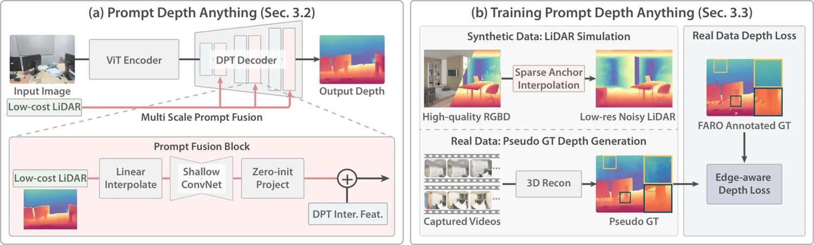

<!-- Generated by scripts/generate.py; edit data/works.json and data/media.json. -->

[← Back to the Awesome index](../../../README.md) · [Interactive website](https://chang-xinhai.github.io/Awesome-RGBDT-Manipulation/?collection=policy&item=prompt-depth-anything#library)

# Prompt Depth Anything

Prompting Depth Anything for 4K Resolution Accurate Metric Depth Estimation

**2024-12-18 · CVPR 2025 · Zhejiang University**

**[Paper](https://arxiv.org/abs/2412.14015)** · [Project](https://promptda.github.io/) · [Code](https://github.com/DepthAnything/PromptDA) · [Weights](https://huggingface.co/depth-anything/prompt-depth-anything-vits)

A depth foundation model uses a low-resolution depth prompt to recover high-resolution metric geometry.

*Prompt Depth Anything authors · [Figure source](https://promptda.github.io/) · Original rights retained.*

| Field | Reported value and source scope |
| :-- | :-- |
| Record type | model |
| Model role and downstream interface | Depth and geometry perception reference [1](https://arxiv.org/html/2412.14015v1)  |
| Model family | Depth estimation [1](https://arxiv.org/html/2412.14015v1)  |
| Model architecture | See original paper [1](https://arxiv.org/html/2412.14015v1)  |
| Model size and component | Not reported [1](https://arxiv.org/html/2412.14015v1)  |
| Model inputs | RGB image and sparse or low-resolution depth prompt. [1](https://arxiv.org/html/2412.14015v1)  |
| Model outputs | Dense predicted metric depth. [1](https://arxiv.org/html/2412.14015v1)  |
| Training method | Fine-tuned depth foundation model with multiscale prompt fusion. [1](https://arxiv.org/html/2412.14015v1)  |
| Training data and scale | See original paper for dataset scope [1](https://arxiv.org/html/2412.14015v1)  |
| Training duration | Not reported [1](https://arxiv.org/html/2412.14015v1)  |
| Training hardware | Not reported [1](https://arxiv.org/html/2412.14015v1)  |
| Inference setting and runtime | See original paper and official implementation [1](https://arxiv.org/html/2412.14015v1)  |
| Downstream evaluation and scope | Metric depth reconstruction and downstream robot grasping evaluation. [1](https://arxiv.org/html/2412.14015v1)  |
| Observations / modalities | RGB · Depth |
| Evaluation domain |  |
| Embodiment |  |
| Release: code | Available — source linked [2](https://github.com/DepthAnything/PromptDA)  |
| Release: weights | Available — see official model page; terms vary by checkpoint [2](https://github.com/DepthAnything/PromptDA)  |
| Release: data | Not verified [2](https://github.com/DepthAnything/PromptDA)  |
| Release: license | Apache-2.0 code and official Small, Large, and Small-Transparent model cards; input data retain their own terms. [2](https://github.com/DepthAnything/PromptDA)  |
| Release: notes | Uses measured or otherwise supplied depth as a prompt; predicted output is not a direct sensor reading. [2](https://github.com/DepthAnything/PromptDA)  |

**Scope and qualifications**

- Uses measured or otherwise supplied depth as a prompt; predicted output is not a direct sensor reading.

**Primary evidence**

1. [Author paper and first submission](https://arxiv.org/html/2412.14015v1)
2. [Official code and license](https://github.com/DepthAnything/PromptDA)
