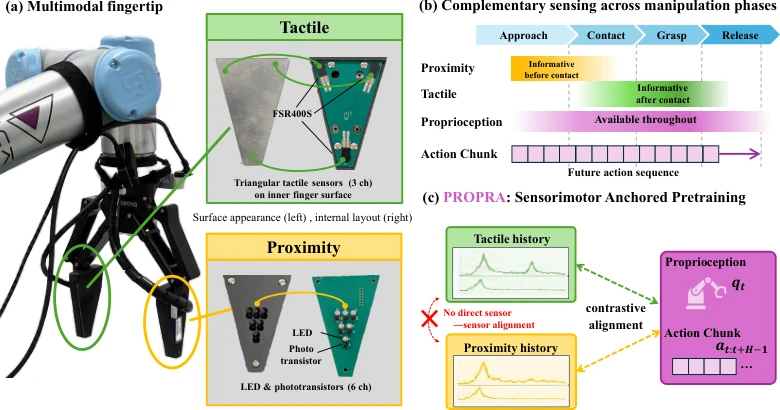

<!-- Generated by scripts/generate.py; edit data/works.json and data/media.json. -->

[← Back to the Awesome index](../../../README.md) · [Interactive website](https://chang-xinhai.github.io/Awesome-RGBDT-Manipulation/?collection=policy&item=propra#library)

# PROPRA

Self-Supervised Anchoring of Fingertip Sensing to Proprioception and Proactive Actions for Robot Imitation Learning

**2026-09-24 · Preprint · AIST / CNRS-AIST JRL**

**[Paper](https://arxiv.org/abs/2609.29822)** · [Project](https://tomohiromotoda.github.io/nia.propra/)

Proprioceptive/action anchoring learns pressure and proximity representations for pre-contact and post-contact imitation.

*Self-Supervised Anchoring of Fingertip Sensing to Proprioception and Proactive Actions for Robot Imitation Learning authors · [Figure source](https://arxiv.org/abs/2609.29822) · Original rights retained.*

| Field | Reported value and source scope |
| :-- | :-- |
| Record type | policy |
| Policy family | Diffusion [1](https://arxiv.org/abs/2609.29822)  |
| Base model and architecture | Contrastive sensor encoders anchored to proprioception plus proactive action chunks; diffusion manipulation policy. [1](https://arxiv.org/abs/2609.29822)  |
| Model size and component | Not reported [1](https://arxiv.org/abs/2609.29822)  |
| Deployment inputs | Two RGB views, robot state and 50-sample histories of three force andsix reflective-proximity channels. [1](https://arxiv.org/abs/2609.29822)  |
| Action outputs and horizon | Robot joint and gripper commands, 16-step action horizon. [1](https://arxiv.org/abs/2609.29822)  |
| Training method | Info NCE sensor pretraining 1000 epochs, then diffusion policy 1000 epochs. [1](https://arxiv.org/abs/2609.29822)  |
| Training data | Four tasks×50 demonstrations:Pick Cup, Pick Sponge, Move Pen, Open Lid;96/4%episode train/validation split. [1](https://arxiv.org/abs/2609.29822)  |
| Training duration | Pretraining~3–4 h; policy training~8 h. [1](https://arxiv.org/abs/2609.29822)  |
| Training hardware | One NVIDIA H200141GB GPU and Intel Xeon Platinum 8558 CPU. [1](https://arxiv.org/abs/2609.29822)  |
| Inference and control rates | Sensors 100 Hz; policy 30 Hz. [1](https://arxiv.org/abs/2609.29822)  |
| Evaluation scope | UR5e/Robotiq 2 F-140 real manipulation; three seeds, 20 trials/seed. [1](https://arxiv.org/abs/2609.29822)  |
| Observations / modalities | RGB · Tactile · Proximity · Proprioception |
| Evaluation domain | Real world |
| Embodiment | Parallel-jaw gripper |
| Release: code | Not verified [2](https://tomohiromotoda.github.io/nia.propra/)  |
| Release: weights | Not verified [2](https://tomohiromotoda.github.io/nia.propra/)  |
| Release: data | Not verified [2](https://tomohiromotoda.github.io/nia.propra/)  |
| Release: license | Not verified [2](https://tomohiromotoda.github.io/nia.propra/)  |
| Release: notes | Original paper reviewed; claimed future releases are not treated as currently available. [2](https://tomohiromotoda.github.io/nia.propra/)  |

**Scope and qualifications**

- Reflective proximity sensors provide pre-contact signal; they are not depth cameras.
- RealSense camera model alone does not establish RGB-D runtime input.

**Primary evidence**

1. [Original paper and supplementary implementation details](https://arxiv.org/abs/2609.29822) — Primary full text reviewed; dataset, deployment modalities and training-only privileges are scoped separately.
2. [Official author project](https://tomohiromotoda.github.io/nia.propra/) — Live project artifact links inspected on2026-10-17.
