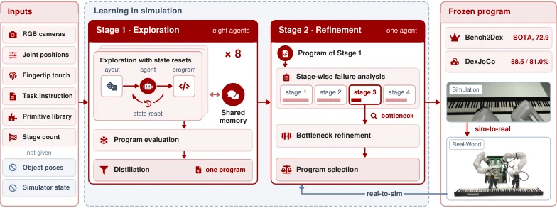

<!-- Generated by scripts/generate.py; edit data/works.json and data/media.json. -->

[← Back to the Awesome index](../../../README.md) · [Interactive website](https://chang-xinhai.github.io/Awesome-RGBDT-Manipulation/?collection=policy&item=pyrua-dex#library)

# PyRUA-Dex

PyRUA-Dex: Learning Programmatic Policies for Dexterous Bimanual Manipulation with Coding Agents

**2026-11-24 · Preprint · Peking University; National University of Singapore; NVIDIA; Tongji University; University of Chicago**

**[Paper](https://arxiv.org/abs/2611.33144)** · [Project](https://vme0522.github.io/PyRUA-Dex/) · [Source Release Notice](https://github.com/DAGroup-PKU/PyRUA-Lean/tree/dex)

Coding agents independently explore, distill and refine reusable dexterous programs in simulation, then run frozen programs on a tactile bimanual robot.

*Feixiang Ruan and coauthors · [Figure source](https://arxiv.org/html/2611.33144v1) · Original rights retained.*

| Field | Reported value and source scope |
| :-- | :-- |
| Record type | policy |
| Policy family | Programmatic policy learning with coding agents [1](https://arxiv.org/html/2611.33144v1)  |
| Base model and architecture | Not reported [1](https://arxiv.org/html/2611.33144v1)  |
| Model size and component | Not reported [1](https://arxiv.org/html/2611.33144v1)  |
| Deployment inputs | Calibrated robot scene observations and callable control primitives. The physical setup exposes cameras, joint state and fingertip force-pad signals; tactile availability differs by platform. [1](https://arxiv.org/html/2611.33144v1)  |
| Action outputs and horizon | Reusable Python control policies composed of arm and hand primitives through robot-specific interfaces. [1](https://arxiv.org/html/2611.33144v1)  |
| Training method | Independent simulation exploration and synthesis phase, then stage-wise program refinement. Hardware interaction can inform simulator calibration; the program executes without an online language model. [1](https://arxiv.org/html/2611.33144v1)  |
| Training data | No fixed demonstration corpus. Reported learning uses agent-generated rollouts, resets and validation layouts. [1](https://arxiv.org/html/2611.33144v1)  |
| Training duration | Not reported [1](https://arxiv.org/html/2611.33144v1)  |
| Training hardware | Not reported [1](https://arxiv.org/html/2611.33144v1)  |
| Inference and control rates | Not reported [1](https://arxiv.org/html/2611.33144v1)  |
| Evaluation scope | Bench2Dex score 72.9 and DexJoCo randomized score 81.0% in paper. Physical dual 22-DoF hands show piano, stacking, cube placement and calligraphy; repeated success is measured in calibrated simulation. [1](https://arxiv.org/html/2611.33144v1)  |
| Observations / modalities | RGB · Tactile · Proprioception · Language |
| Evaluation domain | Simulation · Real world |
| Embodiment | Dexterous hand · Bimanual |
| Release: code | Announced — dedicated dex branch describes forthcoming harness [3](https://github.com/DAGroup-PKU/PyRUA-Lean/tree/dex)  |
| Release: weights | Not applicable |
| Release: data | Not verified |
| Release: license | Not verified |
| Release: notes | The base PyRUA repository and the dedicated dex branch have different availability. The dex branch currently provides a project README and figures. |

**Scope and qualifications**

- Tactile observations differ across Bench2Dex, DexJoCo and the physical robot. Real-world videos are feasibility demonstrations, not a repeated physical success table.

**Primary evidence**

1. [Original paper and evaluation settings](https://arxiv.org/html/2611.33144v1)
2. [Official project with task and method examples](https://vme0522.github.io/PyRUA-Dex/)
3. [Dedicated dex branch says code is not yet released](https://github.com/DAGroup-PKU/PyRUA-Lean/tree/dex)
