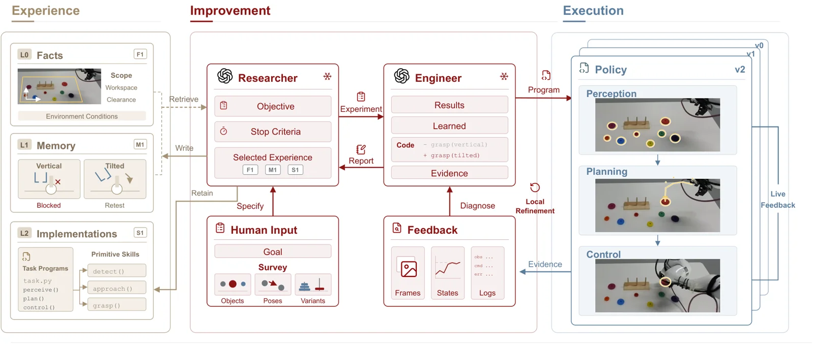

<!-- Generated by scripts/generate.py; edit data/works.json and data/media.json. -->

[← Back to the Awesome index](../../../README.md) · [Interactive website](https://chang-xinhai.github.io/Awesome-RGBDT-Manipulation/?collection=policy&item=pyrua-real#library)

# PyRUA-REAL

PyRUA-REAL: Robot Exploration and Adaptive Learning through RSI in the Real World

**2026-11-04 · Preprint · Peking University**

**[Paper](https://arxiv.org/abs/2611.06768)** · [Project](https://dagroup-pku.github.io/PyRUA-Lean/real/) · [Code](https://github.com/DAGroup-PKU/PyRUA-Lean)

Coding agents iteratively refine robot programs using interaction feedback and preserve reusable experience and skills.

*PyRUA-REAL authors · [Figure source](https://arxiv.org/abs/2611.06768) · Original rights retained.*

| Field | Reported value and source scope |
| :-- | :-- |
| Record type | policy |
| Policy family | Robot agent [1](https://arxiv.org/abs/2611.06768)  |
| Base model and architecture | Coding-agent models including GPT-6 Astra [1](https://arxiv.org/abs/2611.06768)  |
| Model size and component | Not reported [1](https://arxiv.org/abs/2611.06768)  |
| Deployment inputs | RGB and depth observations, task descriptions, robot state and execution feedback. [1](https://arxiv.org/abs/2611.06768)  |
| Action outputs and horizon | Executable robot programs and reusable skills. [1](https://arxiv.org/abs/2611.06768)  |
| Training method | Iterative program revision and persistent code/experience memory; not a claim of policy-weight updating. [1](https://arxiv.org/abs/2611.06768)  |
| Training data | Physical interaction feedback and reusable prior task skills. [1](https://arxiv.org/abs/2611.06768)  |
| Training duration | Not reported [1](https://arxiv.org/abs/2611.06768)  |
| Training hardware | Not reported [1](https://arxiv.org/abs/2611.06768)  |
| Inference and control rates | Not reported [1](https://arxiv.org/abs/2611.06768)  |
| Evaluation scope | Eight real tasks and 42 separate RoboDojo simulated tasks; authors report 91.1% and 84.4% average success respectively. [1](https://arxiv.org/abs/2611.06768)  |
| Observations / modalities | RGB · Depth · Proprioception · Language |
| Evaluation domain | Simulation · Real world |
| Embodiment | Not reported |
| Release: code | Partial — shared PyRUA framework and integrations [2](https://github.com/DAGroup-PKU/PyRUA-Lean)  |
| Release: weights | External model; not separately verified [2](https://github.com/DAGroup-PKU/PyRUA-Lean)  |
| Release: data | Not verified [2](https://github.com/DAGroup-PKU/PyRUA-Lean)  |
| Release: license | Apache-2.0 for repository; external dependencies separate [2](https://github.com/DAGroup-PKU/PyRUA-Lean)  |
| Release: notes | Public main-branch code covers the shared framework; paper-specific physical hardware reproducibility is not established. [2](https://github.com/DAGroup-PKU/PyRUA-Lean)  |

**Scope and qualifications**

- Agent-based refinement occurs during exploration; final fixed programs can execute without an online agent, with online assistance retained for certain contact-rich cases.
- Real-world and RoboDojo results use separate tasks and evaluation protocols.

**Primary evidence**

1. [Author paper or official project: methods and evaluation scope](https://arxiv.org/abs/2611.06768)
2. [Official repository: release inventory and scope](https://github.com/DAGroup-PKU/PyRUA-Lean) — Release availability, assets and third-party licenses are independently scoped; no end-to-end reproduction is implied.
