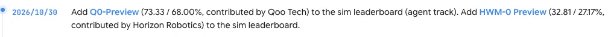

<!-- Generated by scripts/generate.py; edit data/works.json and data/media.json. -->

[← Back to the Awesome index](../../../README.md) · [Interactive website](https://chang-xinhai.github.io/Awesome-RGBDT-Manipulation/?collection=policy&item=q0-preview#library)

# Q0-Preview

Q0-Preview

**2026-10-30 · Leaderboard / preview · Qoo Tech**

**[Project](https://robodojo-benchmark.com/leaderboard?bench=sim)**

Robot agent submitted to the official RoboDojo simulation leaderboard. Architecture and release details have not been independently disclosed.

*RoboDojo benchmark team · [Figure source](https://robodojo-benchmark.com/) · Original rights retained.*

**Preview scope:** Directly captured or reproduced from the cited primary source; original rights retained. Source previews are not asserted to be architecture diagrams.

| Field | Reported value and source scope |
| :-- | :-- |
| Record type | policy |
| Policy family | Robot agent |
| Base model and architecture | Not reported |
| Model size and component | Not reported |
| Deployment inputs | Not verified |
| Action outputs and horizon | Not verified |
| Training method | Not verified |
| Training data | Not reported |
| Training duration | Not reported |
| Training hardware | Not reported |
| Inference and control rates | Not reported |
| Evaluation scope | Official RoboDojo simulation snapshot 30 October 2026: score 73.33; success 68.00%. [1](https://robodojo-benchmark.com/data/leaderboard.generated.json)  |
| Observations / modalities |  |
| Evaluation domain | Simulation |
| Embodiment |  |
| Release: code | Not verified |
| Release: weights | Not verified |
| Release: data | Not verified |
| Release: license | Not verified |
| Release: notes | A scored leaderboard row does not establish a public implementation or checkpoint. |

**Scope and qualifications**

- No author method report or deployment inputs verified; leaderboard type does not establish measured depth, weight updates or a public release.
- The date records the official leaderboard announcement, not a paper submission.

**Primary evidence**

1. [Official RoboDojo simulation results](https://robodojo-benchmark.com/data/leaderboard.generated.json) — Snapshot updated 2026-10-30; system type Agent is specified by the leaderboard app.
2. [Official leaderboard announcement](https://robodojo-benchmark.com/) — October 30 dates its leaderboard announcement, not a technical paper.
