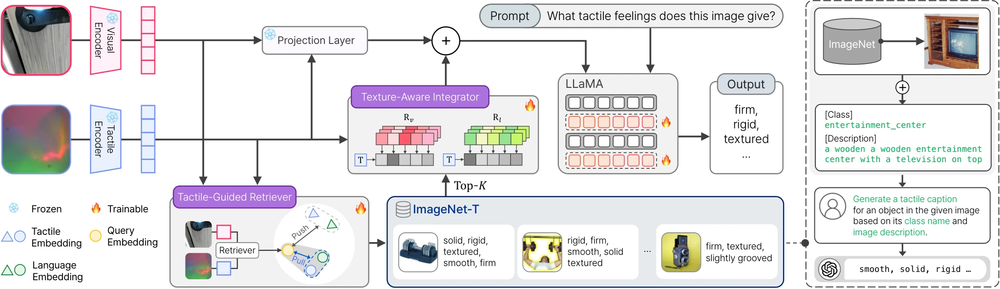

<!-- Generated by scripts/generate.py; edit data/works.json and data/media.json. -->

[← Back to the Awesome index](../../../README.md) · [Interactive website](https://chang-xinhai.github.io/Awesome-RGBDT-Manipulation/?collection=policy&item=ra-touch#library)

# RA-Touch

RA-Touch: Retrieval-Augmented Touch Understanding with Enriched Visual Data

**2025-05-20 · ACM Multimedia 2025 · Sungkyunkwan University**

**[Paper](https://arxiv.org/abs/2505.14270)** · [Project](https://aim-skku.github.io/RA-Touch/) · [Code](https://github.com/AIM-SKKU/RA-Touch) · [Data](https://huggingface.co/datasets/yoorhim/ImageNet-T)

A tactile-guided retriever and texture-aware integrator enrich tactile descriptions using an external visual corpus with synthetic tactile captions.

*RA-Touch authors · [Figure source](https://arxiv.org/abs/2505.14270) · Original rights retained.*

| Field | Reported value and source scope |
| :-- | :-- |
| Record type | model |
| Model role and downstream interface | Retrieval-augmented tactile-language understanding [1](https://arxiv.org/abs/2505.14270)  |
| Model family | Tactile-language model [1](https://arxiv.org/abs/2505.14270)  |
| Model architecture | TVL/OpenCLIP vision/tactile encoders and LLaMA-2-7B; learned tactile-guided retrieval and texture-aware cross-attention integration. [1](https://arxiv.org/abs/2505.14270)  |
| Model size and component | 7B language-model backbone with ViT-Tiny/Small/Base tactile variants; complete-system parameter count not reported. [1](https://arxiv.org/abs/2505.14270)  |
| Model inputs | RGB/tactile image pairs and a language prompt; ImageNet-T visual/text embeddings supply external retrieval context. [1](https://arxiv.org/abs/2505.14270)  |
| Model outputs | Open-vocabulary tactile-property descriptions, rather than robot actions. [1](https://arxiv.org/abs/2505.14270)  |
| Training method | Train retriever first, then freeze it while training the integrator and LoRA-adapted LLaMA layers. [1](https://arxiv.org/abs/2505.14270)  |
| Training data and scale | TVL: 43,548 aligned visuo-tactile pairs; external ImageNet-T has up to 150K recaptioned images. ImageNet-T adds visual-language context, not new measured tactile samples. [1](https://arxiv.org/abs/2505.14270) [4](https://huggingface.co/datasets/yoorhim/ImageNet-T/tree/main)  |
| Training duration | Retriever: 60 epochs; integrator/LLM adaptation: one epoch. Elapsed time not reported. [1](https://arxiv.org/abs/2505.14270)  |
| Training hardware | Four NVIDIA RTX A6000 GPUs. [1](https://arxiv.org/abs/2505.14270)  |
| Inference setting and runtime | Not reported in the inspected primary manuscript [1](https://arxiv.org/abs/2505.14270)  |
| Downstream evaluation and scope | TVL tactile-description benchmark: 402 test pairs across SSVTP/HCT; description similarity rated with the stated language-model evaluation protocol. [1](https://arxiv.org/abs/2505.14270)  |
| Observations / modalities | RGB · Tactile · Language |
| Evaluation domain | Real robot |
| Embodiment |  |
| Release: code | Available [2](https://aim-skku.github.io/RA-Touch/) [3](https://github.com/AIM-SKKU/RA-Touch/tree/main)  |
| Release: weights | Not released [2](https://aim-skku.github.io/RA-Touch/) [3](https://github.com/AIM-SKKU/RA-Touch/tree/main)  |
| Release: data | Available [2](https://aim-skku.github.io/RA-Touch/) [4](https://huggingface.co/datasets/yoorhim/ImageNet-T/tree/main)  |
| Release: license | Not verified [2](https://aim-skku.github.io/RA-Touch/) [3](https://github.com/AIM-SKKU/RA-Touch/tree/main)  |
| Release: notes | Actual repository has retriever/integrator training and evaluation modules; actual ImageNet-T inventory contains annotations and embedding files. Models section remains TBU; upstream TVL weights are not RA-Touch checkpoints. No repository-wide license verified. [2](https://aim-skku.github.io/RA-Touch/)  |

**Scope and qualifications**

- Retrieval augmentation supports tactile perception; no robot-control policy is introduced or evaluated.
- Some external tactile descriptions are inferred from visual/context cues and can be inaccurate; they are not sensor measurements.

**Primary evidence**

1. [Original manuscript and first public submission history](https://arxiv.org/abs/2505.14270) — Full author method, evaluation and appendix reviewed; downstream controller probes are distinguished from the reusable model.
2. [Official author project and current artifact destinations](https://aim-skku.github.io/RA-Touch/) — A project button or advertised artifact does not establish a downloadable release; paper-version differences are retained.
3. [Actual public repository content inventory](https://github.com/AIM-SKKU/RA-Touch/tree/main) — 57 tracked paths reviewed; representation code, action-policy code and README placeholders are distinguished.
4. [Actual ImageNet-T file inventory](https://huggingface.co/datasets/yoorhim/ImageNet-T/tree/main) — Public 10K/50K/100K/150K annotation and embedding files exist; these are visual/tactile-caption retrieval resources, not tactile sensor episodes.
