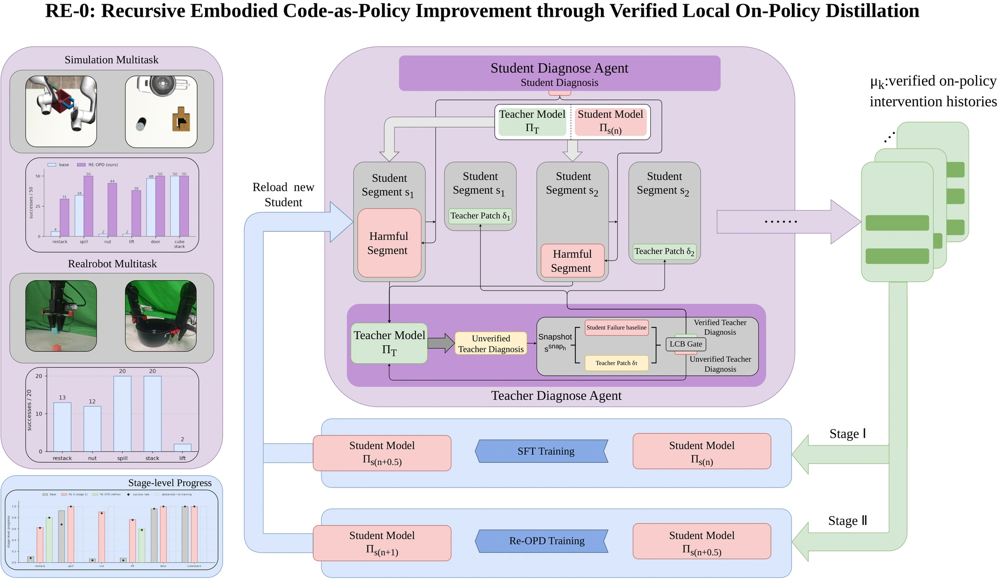

<!-- Generated by scripts/generate.py; edit data/works.json and data/media.json. -->

[← Back to the Awesome index](../../../README.md) · [Interactive website](https://chang-xinhai.github.io/Awesome-RGBDT-Manipulation/?collection=policy&item=re-0#library)

# RE-0

RE-0: Verified Recursive Improvement of Embodied Code-as-Policy Agents through Local On-Policy Distillation

**2026-09-26 · Preprint · Not reported**

**[Paper](https://arxiv.org/abs/2609.32416)**

Verifies bounded repairs to failing code-policy segments through paired counterfactual rollouts, then distills accepted interventions into a standalone student.

*RE-0 authors · [Figure source](https://arxiv.org/abs/2609.32416) · Original rights retained.*

| Field | Reported value and source scope |
| :-- | :-- |
| Record type | policy |
| Policy family | Robot agent [1](https://arxiv.org/abs/2609.32416)  |
| Base model and architecture | Qwen3.8-27B student; qwen3.8-max teacher / diagnostic API. [1](https://arxiv.org/abs/2609.32416)  |
| Model size and component | 27B student backbone; teacher parameter count is not disclosed. [1](https://arxiv.org/abs/2609.32416)  |
| Deployment inputs | Task and code-policy trajectory context; simulator snapshots and paired rollouts are used to verify proposed local repairs during learning. [1](https://arxiv.org/abs/2609.32416)  |
| Action outputs and horizon | Standalone student-generated code-as-policy programs; the teacher supplies bounded replacement segments during training. [1](https://arxiv.org/abs/2609.32416)  |
| Training method | Student weights are updated with LoRA. Repair candidates preserve the execution prefix and pass a lower-confidence-bound paired-rollout gate before distillation. [1](https://arxiv.org/abs/2609.32416)  |
| Training data | Only verified local intervention rows enter cold-start SFT and recursive on-policy distillation, with retention data; admission varies by task. [1](https://arxiv.org/abs/2609.32416)  |
| Training duration | Reported student setup includes 120 optimization steps, batch size 2 and LoRA rank 16 / alpha 32; absolute duration is not reported here. [1](https://arxiv.org/abs/2609.32416)  |
| Training hardware | Not reported [1](https://arxiv.org/abs/2609.32416)  |
| Inference and control rates | Not reported [1](https://arxiv.org/abs/2609.32416)  |
| Evaluation scope | Five simulated manipulation tasks with held-out seeds; AgileX PiPER zero-shot sim-to-real trials on selected tasks. [1](https://arxiv.org/abs/2609.32416)  |
| Observations / modalities | RGB · Proprioception · Language |
| Evaluation domain | Simulation · Real world |
| Embodiment | Bimanual · Parallel-jaw gripper |
| Release: code | Not verified |
| Release: weights | Not verified |
| Release: data | Not verified |
| Release: license | Not verified |
| Release: notes | The paper is public; implementation and artifact availability require separate verification. |

**Scope and qualifications**

- This is parameter adaptation rather than only editing a prompt or persistent skill file.
- Counterfactual snapshot access is a training verification privilege.

**Primary evidence**

1. [Primary paper, full text](https://arxiv.org/abs/2609.32416) — Publication date is the first arXiv submission. Policy fields distinguish model calls, controller execution and learning.
